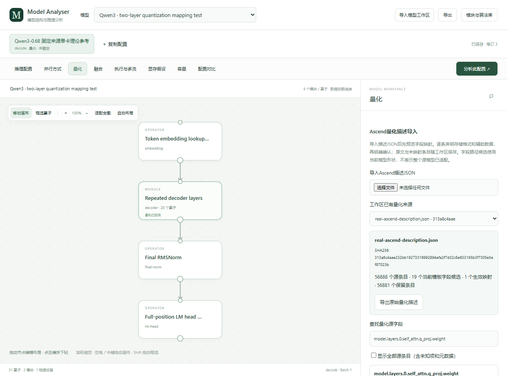

# Ascend量化描述导入与精确存储映射

检查点44：在模型画布的“量化”侧栏导入 `quant_model_description.json`，先预览和保存，再逐条确认映射。当前具名候选适配当前Qwen3模板中的标准HF权重路径；其他字段保留原文，可明确选择规范存储并声明规格，不把名称相似当作完整模型兼容。

## 操作

1. 打开目标模型画布，切换需要修改的配置，进入“量化”。选择Ascend描述JSON；来源显示文件名、完整SHA256、总条目数、候选、生效映射和保留项。
2. 先看当前模板候选，或勾选“显示全部源条目”查找未知标签、专家和元数据。列表每页25项。候选显示所属模块／调用及实际规范存储，不只显示公式或字母。
3. 选择源字段。候选只带入目标和已知标签的payload位宽；辅助数组默认为空，须逐项明确填写dtype、count、分组／轴、packing与alignment，并说明依据或假设。描述标签无法提供的布局不会自动猜测。
4. “加入待确认映射”只保存预览。可继续编辑，包括未完成的JSON；保存重开会恢复，计算输入hash和数学结果保持原值。填写“量化导入确认说明”，再点“确认映射并应用量化”。所有映射一起校验，失败保留原有效配置。
5. 在画布标记和结果量化表核对精确存储、分配前后值、源字段／标签／SHA及布局说明。复制配置后可独立修改或撤销；来源在工作区只存一份。移除量化覆盖同时更新其生效导入记录，保留原文和待确认编辑。

“导出原始量化描述”保留原UTF-8文本、空白和BOM；工作区导出包含完整来源及固定资产，离线可复算。未知对象、null、0和未映射字段不丢弃。非法JSON、重复键、超限和损坏SHA不能成为有效来源，扫描诊断保留损坏文件供恢复。

## 计算口径

映射作用于一个明确的canonical存储，不因Q/K/V同属一个算子而一起修改。精确存储规则优先于普通节点／子树量化；同级不兼容规格拒绝。alias不能另作物理分配；共享embedding／LM head指向同一规范存储，冲突必须明确解决。

`WmAn[_DYNAMIC]`只提供对应weight／activation的payload位宽约束。源中出现的weight_scale、weight_offset、input_scale、input_offset、quant_bias、deq_scale等辅助字段须全部提供明确规格；辅助dtype、数量和内部计算精度并不能由标签推出。`FLOAT`只保留目标模型原始浮点格式，不猜FP16／BF16／FP32。非FLOAT缺少辅助布局时不能用空数组直接确认。

当前内部ComputeClass、显式流量、通信和转换方程保留作者声明；物理分配及依赖分配的流量按原引擎规则重新计算。若要改变计算／反量化／转换成本，应在对应模块或算子声明方程。未知格式须人工明确规格和依据；保留待确认本身不会影响计算。

## 真实文件与独立证据

固定[发布者产物](../references/ascend-quantization/README.md)的描述文件为4,218,198字节、56,888项，SHA256为`313a8c4aae232bb19273316992894efa2f7d32c8e633195b3f7305e5ef87023b`。公开产物为48层、128专家的Qwen3 MoE，本检查点**不宣称完整30B MoE适配，也未取得真实权重头**。

[独立账本](../examples/ascend-quantization/reference.json)将其中一个Q字段映射到作者声明的小Qwen目标（H=4、2层）；使用显式假设的六项辅助布局，验证原BF16权重32B → 8bit payload16B + 辅助88B = 104B。辅助分项16+16+4+4+16+32B；这不是发布者权重dtype／shape证明，也不是量化必然节省空间的承诺。其余56,881个源条目完整保留，内部BF16工作不变；移除映射恢复原计算输入hash。

四份可移植文件位于[examples/ascend-quantization](../examples/ascend-quantization/reference.json)：pending-project、confirmed-project、confirmed-result及reference。运行 `npm run reference:ascend` 重新生成、用Node SHA核对原文并执行独立标量断言；`npm run acceptance:ascend` 包含全部既有组合门禁。

## 限额与验证范围

单个描述8MiB、100,000顶层项、嵌套48层／250,000节点；一个工作区来源合计16MiB。正式项目写入／读取上限32MiB，项目草稿文件64MiB，项目HTTP正文64MiB，资产文件／资产解码仍为4MiB。项目扫描和直接重开均重新核对来源完整性。当前来源与完整项目快照一同保存、扫描；不提供大权重张量下载或无限文件流式处理。

12项领域测试覆盖独立SHA、真实混合文件、重复／非法输入、原文及未完成草稿往返、明确确认、精确单存储32→104B、FLOAT、共享冲突、来源篡改、复制／撤销与原hash恢复。HTTP验证完整4.2MB文件解码、提交、扫描、重开及损坏文件隔离；3个新Chrome场景通过画布完成真实文件和未知项预览、六项辅助确认、离线结果复算、复制配置及撤销。完整组合结果以[验收状态](ACCEPTANCE_STATUS.md)为准。

