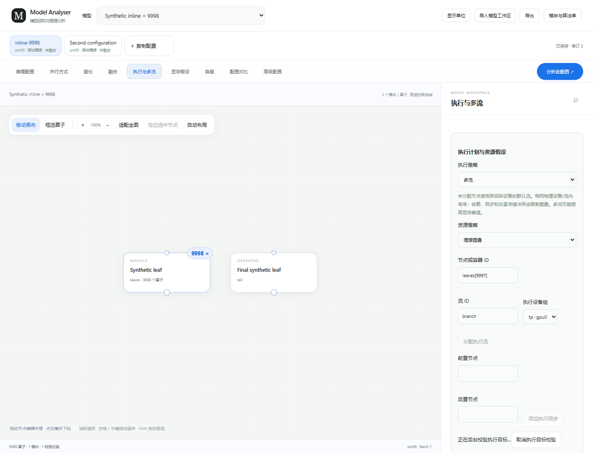

# 辅助模型校验的后台任务

检查点65继续落实原PRD9“大运算不阻塞编辑”，把已定位的五类辅助入口迁移到可终止Worker：

| 入口 | 后台处理及提交条件 |
| --- | --- |
| 执行计划 | 一次实例化核对全部请求的节点／容器／融合／放置通信ID；成功后才添加执行流或同步。修改表单或配置会使旧请求失效 |
| config导入 | 确认映射后完整验证默认Prefill与Decode两个阶段；两者都通过才返回待发布模型，不用单阶段成功替代双阶段校验 |
| 依赖升级预览 | 固定升级计划返回后，在后台实例化目标配置；成功后才显示可应用计划。取消不发布父级定义或项目 |
| Ascend量化确认 | 来源校验、目标验证、应用前／后的两次实例化及完整项目校验都在后台。返回值绑定整个项目与当前导入记录，画布布局等新编辑也会使旧回复失效 |
| 兼容编辑器 | 模块峰值范围及Ascend存储目标缺少外部结构时后台展开，可分别取消／重试；保留未完成表单。主画布仍优先使用已有解析结果 |

任务按请求ID、回复类型、输入及当前运行身份核对。取消终止计算；异常、错误阶段、无效或迟到回复不进入应用回调。异步返回后仍沿原有草稿／正式提交、固定快照和幂等发布路径保存，不改变计算算法。取消计算不会撤销用户已明确开始的正式保存。配置导入与升级的只读HTTP准备仍沿原有等待及输入守卫处理，后台取消按钮对应已启动的计算阶段。

新增反例证明：一个默认Prefill可以展开、Decode激活后出现除零的模型仍不得发布。独立小Qwen配置保持624个矩阵operations；单Q权重的显式8bit payload及FP32输出通道scale仍为32B，来源和原项目均保留。真实9,999叶图执行目标校验期间可操作显示单位，取消不添加分配，重试只采用当前目标。

浏览器还核对config取消／改名后的迟到回复、升级预览取消无发布，以及Ascend回复暂缓期间拖动画布：旧量化结果不得覆盖新布局，随后重新确认会保留新布局。暂缓的是实际计算后的回复，用于确定性复核交互和身份守卫；观察不是延迟或帧率SLA。

当前全量733单元／契约（81文件，44.53s）、新增相关29单元、构建／架构／严格类型检查通过。七项新Chrome和十四项原config／升级／多流／Ascend闭环共21项通过（2.0m）；另五项原模块／设备峰值Chrome通过（25.3s），本轮共26项专项Chrome。完整58步组合会话5352仍在运行，终端签收后才更新完整结果。首次旧闭环运行13项通过、1项失败：恢复测试仍假设项目candidate为对象；现按明确格式解析字符串candidate后保留原空名称、恢复文件和重开断言，最终21项成功。数学核心、公共契约和引擎.20保持。

本轮只签收列明的后台校验入口。一般精确来源变换、恢复包尺寸边界、输入序列化／解析、投影布局和实际DOM成本仍需处理或核验，原980段及935项最终证据复核继续保留。完整58步组合若尚在运行，不以专项通过代替终端签收。

执行证据：[增量状态](../_local/history/checkpoint65-result.json)、[主闭环浏览器日志](../_local/history/checkpoint65-chrome2.log)、[峰值浏览器日志](../_local/history/checkpoint65-peaks-chrome.log)、[最大图观察](../_local/history/checkpoint65-artifacts/execution-observation.json)、[原工作区只读核验](../_local/history/checkpoint65-production.json)。

检查点65最终完整签收：会话5352已观察真实终端退出0，完整58步命令与逐步展开计划全部一致；733单元／契约（81文件，41.30s）、7HTTP（6文件，2.81s）、228Chrome（31.8m）及45运行组、全部组合参考通过。784份冻结来源无漂移，核心／公共契约相对64未改，引擎.20；原980段保持原位置。门禁后只读原工作区仍修订1、1配置、0测量、589资产、0问题、0草稿。仅签收列明后台校验范围；恢复包尺寸反例、一般精确来源、数据处理／DOM成本及原935最终证据队列继续保留，整个目标active。早期“运行中”段落为历史观察，当前以本段及checkpoint65-result.json为准。
