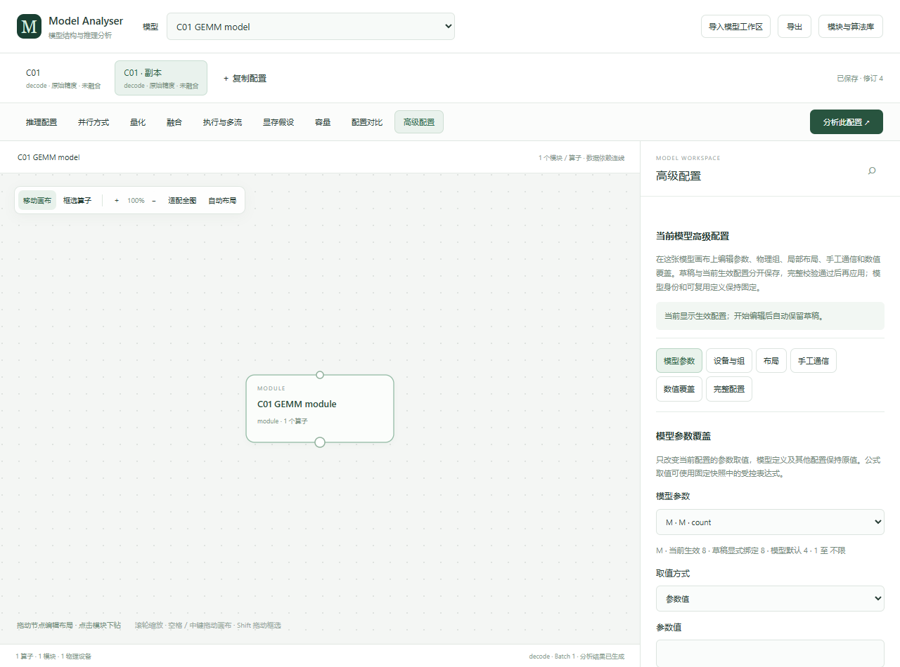
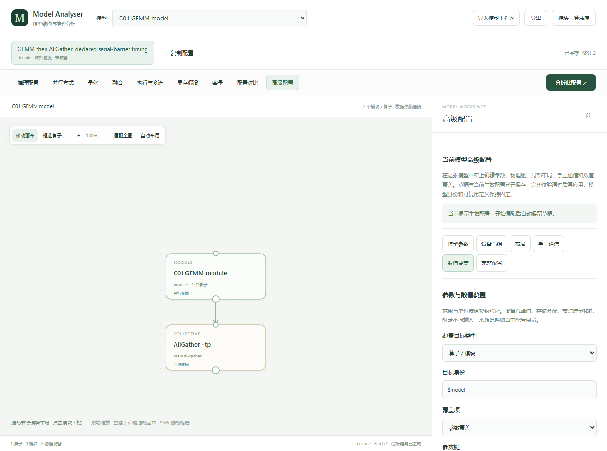

# 画布高级配置与可恢复草稿

检查点45将模型参数、任意物理组、张量／存储布局、手工通信和数值覆盖迁移到模型画布的“高级配置”侧栏。当前模型身份与固定定义保持不变，配置标签负责复制、切换与比较；无需转到旧项目维护页。

## 编辑与应用

高级配置分别保存当前生效值和待应用草稿。表单中的未完成数字（例如`-`）、组成员、JSON及其他输入随工作区保存，关闭／重开后恢复。表单输入须先“加入…草稿”；加入后仍不改变生效图、计算输入hash、测量绑定或结果。

点击“验证并应用配置草稿”后，在独立Worker中检查严格字段、引用、公式、图、布局、共享、通信、执行与完整工作负载，再整体替换当前配置。逐步decode也按原引擎完整验证，仍遵守256步限制。缺少硬件能力可以保留为相关指标未知，不用虚构能力才能应用；结构或公式错误则保留原有效配置及编辑内容。

未加入表单输入会阻止应用；可以继续加入，或明确清空这些表单输入。尚未完成的完整配置JSON同样保留，应用前定位字段错误。使用“导出配置编辑草稿”单独保留编辑记录，或正常导出整个工作区，后者同时包含固定资产和所有配置草稿，支持完整迁移。

## 侧栏内容

| 分类 | 可编辑内容 | 范围与约束 |
| --- | --- | --- |
| 模型参数 | 当前模型声明参数、值／公式／符号、覆盖移除 | 显示名称、键、单位、默认值与范围；只修改当前配置的bindings，不改可复用定义 |
| 设备与组 | 增加／更新设备的固定硬件引用；任意成员组；无mesh、一维生成或完整mesh JSON | 设备是实际身份，多个组可复用；移除／重命名后布局、流和通信引用须一并修复 |
| 布局 | 模块子树／节点列表、prefill／decode、张量／存储、复制／分片／partial | 默认带入当前画布范围；支持even／padded／明确切片及完整多轴／manual分布JSON；分片与边界完整校验 |
| 手工通信 | AllReduce、AllGather、ReduceScatter、AllToAll、SendRecv，源／目标分布、独立发送／接收byte、传输dtype、系数／启动轮数、带宽／延迟、实际端点、前后置依赖及临时存储 | 要求范围和算法假设；不按组别名增卡，不把收发相加当同一payload，不推断未声明的本地HBM／归约算术 |
| 数值覆盖 | 当前配置／工作区默认参数、节点／模块参数、节点固定时间／效率／流量、通信带宽／延迟、存储分配及设备峰值 | 明确目标、单位、参数键和来源；和显存侧栏的模块／设备预算共用原有计算语义 |
| 完整配置 | 上述字段及工作负载、动态payload、逐rank通信、自定义耗时、native角色、执行、量化、融合、显存覆盖等完整契约 | 身份与模型引用固定，不接收额外字段；复杂内容仍可从同一画布编辑，保留JSON草稿 |

布局对象名称来自当前生效图；修改草稿参数后，实际shape与所有相关约束在应用时重新绑定。选择多个节点时可明确使用节点列表；子树要求一个根。用户负责为自定义分布声明局部算术、数据边界和通信，通用编辑不意味着自动适配未知并行方案。

通信表单中显示的默认传输格式、流量系数和启动轮数也是显式可编辑假设。完整配置支持所有已有字段，不把表单中的单轴／字面量入口扩大为自动多轴或动态消息推断。

## 草稿隔离、复制与过期保护

工作区的可选`configurationDrafts`按`scenarioId`保存模型引用、基线字段、固定资产指纹、候选JSON和未加入表单输入。它位于项目外层，不进入Scenario计算输入，也不收集其未确认公式引用。正式生效引用仍按原规则校验。

复制配置同时独立复制其草稿；合法候选中的当前配置数值目标会改为新身份，未完成JSON逐字保留。未完成文本若包含旧配置身份，应修复后再应用。一个配置应用后只清除自己的草稿，其他配置和固定定义保持原值。

若当前生效配置、模型引用或固定资产已变化，草稿标为过期，不能覆盖新内容。面板提供基线／当前差异和草稿导出；“丢弃编辑并从生效配置重新开始”是明确的重新开始操作，不会自动合并未知冲突。验证中编辑、移动布局、切换或复制配置也会取消旧Worker；迟到结果不能覆盖新的工作区。

Ascend来源与确认记录继续由量化侧栏维护。高级编辑保留完整原文和已确认来源；直接删除或篡改导入的生效规则而不更新确认记录会被拒绝，避免脱离真实来源。正常移除请使用量化侧栏。

## 独立参考与验证

运行`npm run reference:configuration`生成[八份可移植证据](../examples/configuration-editing/reference.json)，其数值均为人工小模型和声明的合成硬件：

| 修改 | 独立算术 | 结果 |
| --- | --- | --- |
| 单卡M=8、N=8、K=16、BF16 | work=2×8×8×16；X/W/Y=256/256/128B；100 B/s | 2048 operations，640B，6.4s |
| 两卡列分片N=16 | 每卡X/W/Y=128/256/64B；两卡合计896B | 448B／卡，2048 operations，4.48s |
| 两卡GEMM＋明确Gather，节点覆盖1.25s | 通信32/1000＋0.001=0.033s；权重128＋输出64＋scratch200B | 1.283s，392B／卡；完整collective HBM仍未知 |

未完成草稿的活动输入hash保持不变，已应用案例的hash改变，资产快照逐字不变。生成器使用独立标量断言，不读取引擎公式来生成期望值；这些结果不是实卡测量或自动并行加速承诺。

10项领域测试覆盖完整工作负载、未知硬件、模型／资产变更、未完成输入、单／多卡算术、通信临时存储、身份固定、来源一致、复制及失败原值保持。5个新Chrome场景在画布完成表单、JSON错误恢复、过期保护、配置复制、取消迟到、任意组复用、通信和数值覆盖；与原8画布场景共同13项通过。完整组合状态见[验收记录](ACCEPTANCE_STATUS.md)。

契约新增4根后为205根／87联合／223分支，外壳schemaVersion仍为1且新项目字段可选；数学引擎保持`0.1.0-execution.17`。`npm run acceptance:configuration`包含本参考及全部既有Ascend、模块预算、画布、型号、研究和文件组合门禁。

