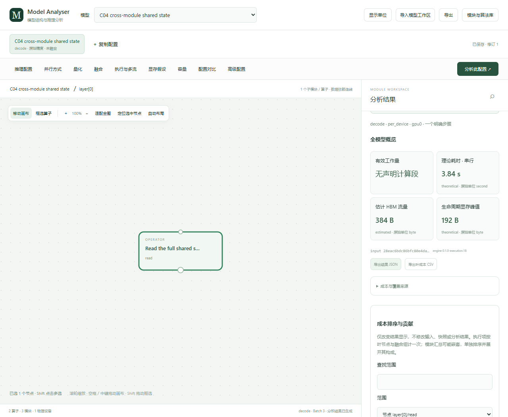
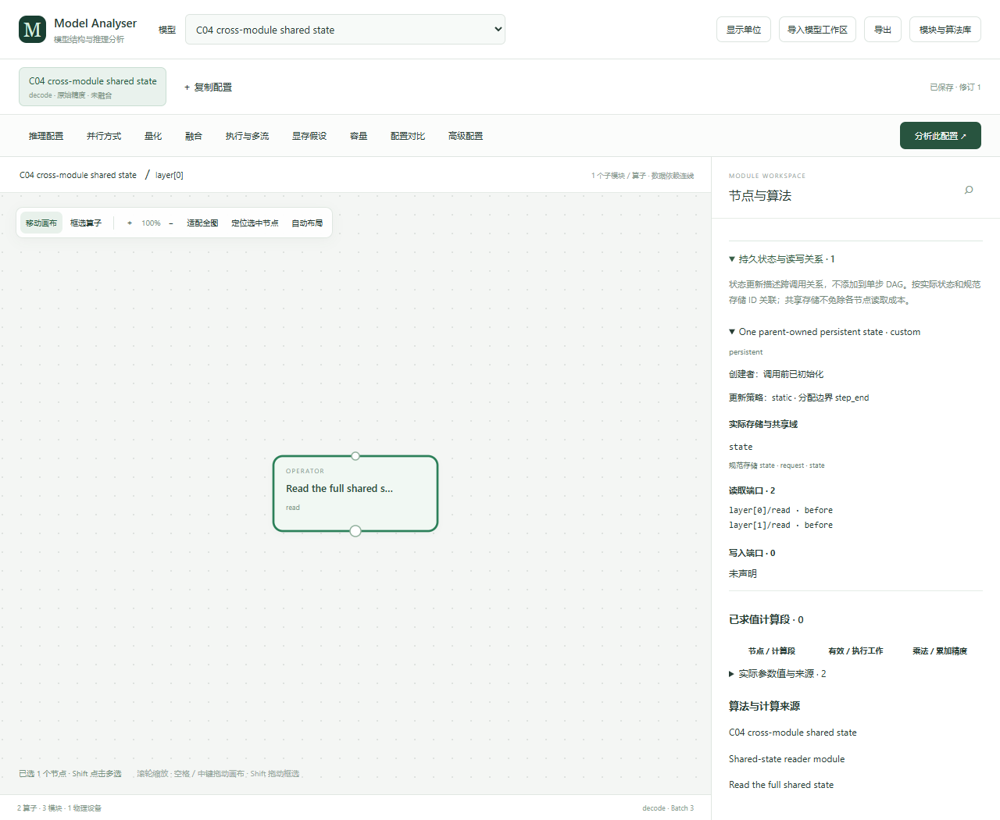

# 画布选择、状态关系与手工测量

检查点52（2026-11-16）继续按用户确认的模型画布组织交互。点击／键盘选择改变当前显示范围；完整模型仍沿同一份固定输入计算，选择操作不写配置，不改变数学 hash。

## 选择即带入上下文

- 选中模块、重复实例或算子后，分析侧栏显示其稳定路径及已有范围成本。成本表、Roofline、手工测量分别带入对应目标。
- 控件可以手动改选；普通重渲染不会覆盖手动选择。再次明确选择画布目标时，各控件接收新的上下文。不同工作区／配置通过独立组件身份隔离。
- 全模型概览有明确标题，与选中目标的范围成本分开；不会把总模型成本伪装成单个算子的结果。
- 成本表新增精确叶节点范围，不靠文本包含筛选模拟单节点结果。模块／节点在当前步骤缺失时保持不可用，不自动切回模型总计或补零。Decode步骤切换保留明确目标。
- 完整框选集合恰好匹配当前生效融合组时，使用该实际融合组目标；部分融合成员保留数学明细，测量与独立耗时 Roofline 明确提示缺少独立区间。用户仍可在目标列表明确选择完整组。
- 范围选择长列表按匹配显示最多100项，并保留当前目标；可以输入稳定路径查找其余范围。成本CSV记录实际所选模块／节点与步骤，原结果不变。

## 主画布状态关系

节点详情的“持久状态与读写关系”读取当前 `ResolvedGraph`，按实际状态ID、对象绑定、访问端口及规范存储关联。模块包含其实际调用的状态；共享状态从任一个读取模块都能看到同一份状态及全部真实访问端口。

每项显示创建者或调用前初始化、状态类别、更新策略、分配边界、存储与共享域，以及有界的读取／写入端口列表。不同状态不会因为显示名称相同而合并，别名解析到规范存储。状态更新仍是跨调用关系，不添加单步循环边，也不把共享存储解释为读取免费。

侧栏表格适配窄宽度，逻辑与规范存储精度可同时阅读；切换目标或面板回到详情顶部。真实每卡分布和不同Decode步骤的容量仍沿对应分析证据查看，不从逻辑规格推断。

## 手工测量表单

支持 `single`、`mean`、`sum`、`span`，调用次数、秒／毫秒／微秒、区间／调用集合说明、精确参与设备和可选实际读写bytes（每调用／整个区间）。表单和导入共用既有 `MeasurementRecord` 及语义校验，结果不增加另一套利用率公式。

- `single` 要求count=1；`mean`是每调用平均，`sum`是全部调用累计，`span`明确开始／结束。非单次统计须声明覆盖区间或调用集合，跨度必须为正。
- 秒是持久化单位；原始单位和原输入值保留在手工来源的绑定说明。平均／单次乘次数只得到累计工作时间；跨度除次数是区间归一化等效时间，不冒充单次延迟。
- 设备显示所选结果的实际参与成员。设备子集或重复设备拒绝绑定到完整目标，需要具有同一范围的独立理论结果，不按卡数猜测工作量。
- 实际bytes用于已有实测HBM MBU口径；启用后读写两项都须明确给出，零可显式填入。没有实际bytes时保留估算MBU，不从逻辑流量伪造测量。
- Decode可选整个序列作为一次调用，或选择实际步骤。第三步记录绑定第三步输入hash、阶段和设备；重开并重新计算完整序列后，比较仍选用该实际步骤结果和方案。旧输入未匹配时仍不可用。
- 分析取消／重试保留未提交表单值。只有显式记录才加入项目，最终持久化以工作区保存状态为准；每条比较可展开原始范围与统计证据。

## 独立复算

`npm run reference:canvas-context` 重建[可移植项目与独立账本](../examples/canvas-context/hand-ledger.json)：

| 案例 | 独立预期 |
| --- | --- |
| C01两次调用 | mean=5000ms、sum=10000ms、span=[100000,110000]ms，均为每调用等效5s |
| C01实际bytes | 区间读取768B／写入128B，除次数2后每调用448B；100B/s硬件下MBU=0.896 |
| C01有效工作 | 1024 operations，1000 operation/s硬件、5s时MFU=0.2048 |
| C04共享状态 | Batch3，每请求64B，驻留192B；两个读取模块各读192B，合计384B |
| Decode第三步 | C=4，100000µs换算为约0.1s，记录hash是该步而非序列顶层 |

浮点比例采用明确误差容限；初次参考脚本的严格浮点等值断言失败记录保留为 `checkpoint52-reference-initial.log`，没有为通过参考修改计算算法。引擎仍为 `0.1.0-execution.18`，契约结构及既有文件格式不变。

新增11项领域／SSR检查与6项Chrome覆盖以上范围；既有画布来源／分析／状态／Roofline共同18项专项通过，最终修订另有6项新闭环与4项成本排序共同10项通过。完整 `npm run acceptance:canvas-context` 包含全部先前组合门禁；第一轮完整150／152 Chrome通过，两处来源key／融合选项回归修正后8专项通过，第二轮完整命令退出0：591单元／契约、7HTTP、152Chrome（25.8分钟）、45运行组及全部原有参考通过，另五基础参考通过。最终时点见[验收记录](ACCEPTANCE_STATUS.md)。

检查点53已补[时间线选择和后台比较](CANVAS_DERIVED_VIEWS.md)，检查点54增加[所选范围的规范存储参与关系](SELECTED_MEMORY.md)；比较等其他指标来源、同步编辑长路径、错误项目修复，以及原文逐条最终审计继续按[剩余项](REMAINING_PRD.md)推进。以上具体交付不代表全目标签收。
