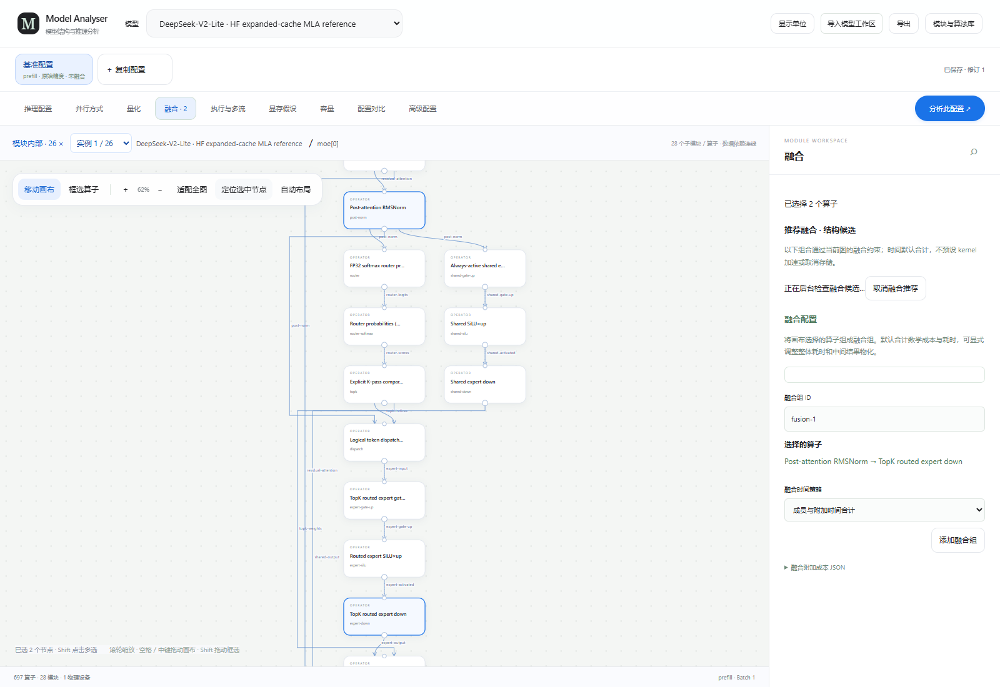
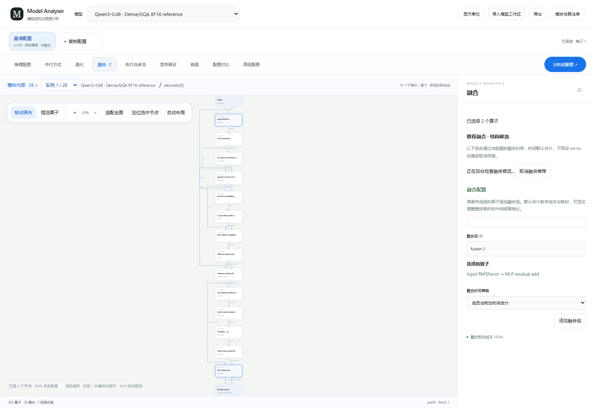

# 模型数据流画布

2026-11-16 用户补充：连线表达真实数据流；相同重复模块用“n ×”展示，点击进入内部；整体界面与画布采用简洁的现代风格。

2026-11-17补充验证：新增Qwen浏览器断言，核对同一输入同时流向input norm和attention residual，以及attention residual到MLP residual的跳连；28 ×直接进入第一个调用并切换到第28个。10项画布Chrome通过，另在最新构建中重跑两项数据流和五项来源面板Chrome通过。此次未重跑完整组合门禁。

画布读取当前实例化图的真实张量边与显式控制依赖。输入／输出边界按张量身份显示，同一个residual输入可以分流到主计算路径和残差加法；跨层边绕开中间节点，箭头与张量标注表达流向。MoE的router／TopK／dispatch／专家计算与shared expert分支保持独立，在原图声明的加法节点汇合。布局不添加执行依赖，不按节点排列顺序猜测数据流。

重复模块外部保留一个模块及“28 ×／26 ×”计数，点击直接进入实际第一个调用内部。实例切换器可以查看其他层的真实参数、张量与状态；计算核心仍保留全部实例，界面折叠不合并成本，也不宣称不同层的配置相同。

样式采用白色面板、浅灰画布、蓝色数据流、浮动工具栏及清晰的选中状态。拖拽节点、滚轮缩放、移动画布、框选融合和结构连线继续可用；输入／输出边界不提供结构编辑端口。

验证：702项单元／契约、构建及架构／类型检查通过；8项现有画布Chrome回归与1项新增MoE分支／实例切换用例通过。新增领域测试核对Qwen残差分流、DeepSeek双分支与重复调用身份。旧节点总数断言已按真实输入／输出节点更新，模型导航等待准确模型身份。本次画布已完成完整58步门禁：703单元／7HTTP／203Chrome与45运行组通过，767份冻结来源无漂移。前一轮60的201项Chrome仍单独保留为变更前历史。

下图是隔离浏览器的DeepSeek固定资产图，未修改原用户项目。

检查点62补充：单个重复算子不再错误退回总图，详情读取实际算子；重复算子可显式开启跨调用选择，普通重复模块仍保持单实例内部视图。超过128项调用以编号跳转。完整58步命令npm run acceptance:quantization-scope已观察会话79629退出0：703单元／契约（77文件，41.08s）、7HTTP（6文件，2.62s）、203Chrome（28.3m）及全部组合参考通过，45运行组完成。767份冻结来源无漂移，核心与公共契约源码相对60没有改变，引擎保持.20。

历史重跑：首次运行基线计数失败、第二次旧网格导航失败后中止，均保留原日志；最终79629完整通过。
