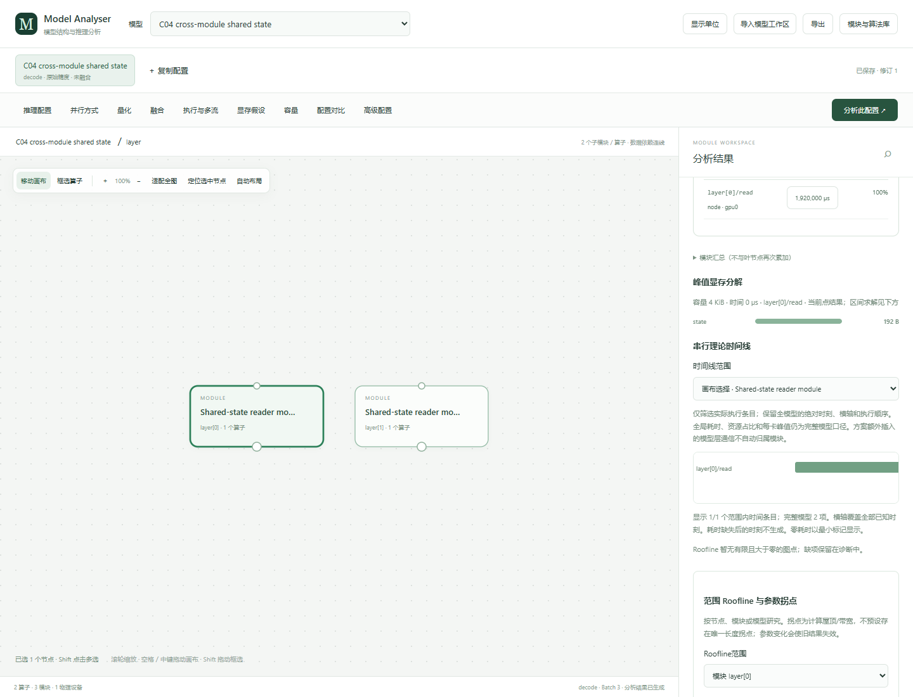

# 时间线上下文与后台测量比较

检查点53延续模型画布：分析仍读取同一份固定输入，画布选择改变派生视图的显示范围。引擎 `0.1.0-execution.18`、原数学结果、输入hash和持久化格式保持。

## 时间线跟随画布

普通串行、多设备和多流时间线支持“画布选择”与“全部执行条目”。选中模块、重复实例、算子或完整融合组时，按当前结果中的稳定ID筛选实际执行条目。手动选择全部后，普通重渲染及显示单位切换保留选择；新画布目标接收新的默认范围。

- 横轴、节点的绝对开始／结束时刻与原执行顺序保持，不将所选范围重新调度到零点。多流跨度、资源占比和每设备生命周期峰值仍标明全模型口径。
- 部分融合成员涉及一个不可拆分的执行单元时，展示整个融合组并说明原因，不虚构成员独立耗时。
- 整个Decode序列按每个实际步骤分别查找节点／模块／融合成员。单步展开读取该步的结果；缺失目标或步骤保持缺失，不拿另一调用的结构补填。
- 模型层额外插入的通信不自动划给模块；图内通信按实际执行ID关联。列表先按范围筛选，再分批显示；显示数量同时列出范围内和全模型条目数。
- 这次没有把全模型显存峰值分摊成模块峰值。检查点54继续补充[所选范围存储](SELECTED_MEMORY.md)：读取真实规范分配、共享／常驻／私有／接口关系、量化分解与实际调用来源；全模型峰值仍单独保留。原PRD第56行最终签收继续按剩余审计核对。

## 测量比较后台任务

当前页最多20条记录的比较改在独立Worker执行，继续调用原 `compareMeasurement`。逐步Decode记录按其精确hash找到实际步骤方案和结果，再执行原校验／计算；不能匹配的旧输入继续拒绝。

界面逐条显示已完成项，并区分后台进行、完整完成、取消和失败。支持取消和重试；每次任务绑定当前计算输入、结果对象、配置、记录页和运行次数。更换输入、配置、翻页或离开组件会终止旧任务，旧回复不能替换新页。客户端核对回复的顺序、记录ID、载荷及完成数量，部分页不能被标成完整结果。

取消保留已经完成的条目和未提交的手工表单；重试使用新任务。切换配置后，分析组件先清理旧输入任务，再处理自动计算，避免新建任务被初始化清理立即终止。后台化不改变记录、项目修订或理论公式。

本次完整门禁的真实Chrome场景中，9,999节点／20记录比较期间可填写单次时间并切换显示单位；输入操作约66ms，操作后任务仍处于进行中。这是带自动化及页面渲染开销的一次观察，不是延迟保证，也不能与检查点52的Node同步探针直接比较。该次观察保存在 `checkpoint53-comparison-responsiveness.json`；不作跨环境速度对比。

## 严格来源选择

成本来源请求使用明确步骤、目标和指标。任一项不存在时显示缺失原因，保留请求的ID，不改成序列汇总、搜索结果第一项或其他指标。搜索只筛选候选列表，当前目标即使不匹配搜索或位于前100项之外，也保留在控件中。用户明确改选另一目标时，才选择该目标中可用的指标。

步骤来源使用该实际调用的方案查看覆盖及硬件声明。既有的实际参数记录继续沿对应结果读取；不从当前默认值补填历史来源。比较表等其余F10直接指标入口仍待逐项完成。

## 独立证据

`npm run reference:canvas-derived` 生成[四份可移植项目与独立账本](../examples/canvas-derived/hand-ledger.json)：

| 场景 | 独立预期 |
| --- | --- |
| C01二十条比较 | 每条1024/(1000×5)=0.2048 MFU；448/(100×5)=0.896估算MBU |
| C05选中B | 保留原第3个执行项，绝对时刻1–6ms，全模型跨度6.5ms |
| 融合内部A | 对应完整融合执行单元，独立成员耗时不拆分 |
| 第三步Decode | 按C=4的实际调用hash比较，序列时间条保留步骤0／1／2 |

新增8项领域／SSR与7项Chrome覆盖计算一致性、严格回复、取消／重试／切页／配置隔离、时间条、来源缺失和大图操作；完整 `npm run acceptance:canvas-derived` 继承全部原组合门禁。最终执行结果以[验收状态](ACCEPTANCE_STATUS.md)及 `checkpoint53-result.json` 为准。检查点54的存储增量另记[所选范围存储](SELECTED_MEMORY.md)。错误项目修复、其余F10入口、同步编辑长路径与原文最终审计继续见[剩余项](REMAINING_PRD.md)。
