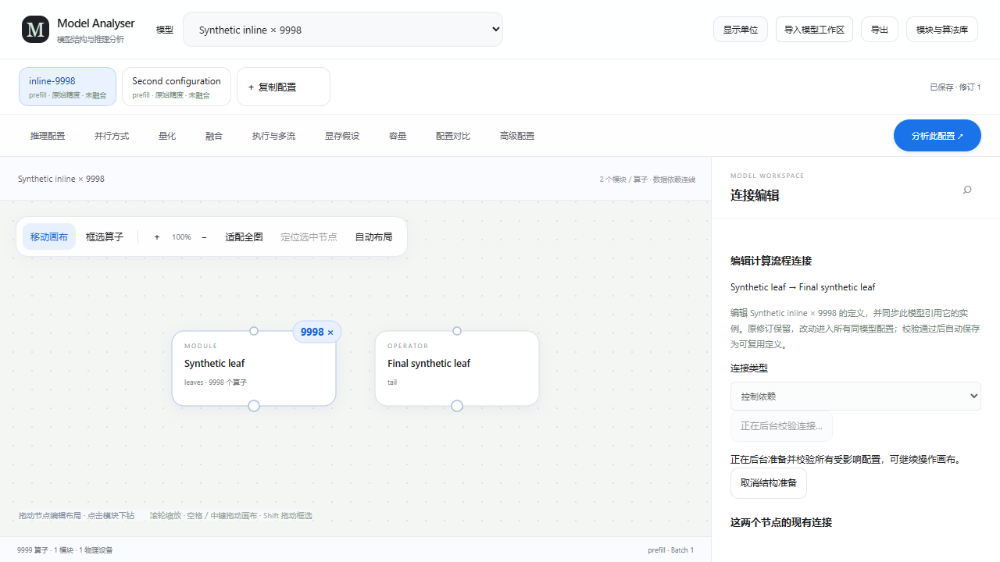

# 画布结构编辑的后台准备

检查点64将主画布连接编辑的计算准备放入独立Worker：固定闭包发现、连接／端口与访问方程改写、受影响定义及祖先复制、完整项目校验，以及每个同模型配置的实际实例化。主线程只在准备成功且工作区身份仍匹配后开始正式发布。

准备阶段提供“取消结构准备”，终止Worker并中止尚未完成的只读快照请求；此时没有创建资产草稿、资产head或项目新修订。修改配置、导入其他工作区、离开连接侧栏或卸载组件也会使旧准备失效。任务ID、回复阶段和结果Schema不匹配时显示错误，不返回可发布计划。工作区会话、导航、正文和当前配置在异步边界再次核对。

进入正式保存后，界面明确显示保存阶段，沿用原发布顺序：先保存全部准备好的定义草稿，再按依赖顺序提交资产，最后切换项目模型引用。网络失败保留原计划与请求ID，重试不重新生成身份；移除连接的重试保留原移除指令，不会误变成添加连接。已有固定修订与完整可移植闭包保留，同模型的全部配置在成功后引用同一新定义。

兼容维护页的“展开模型结构”也改用可终止的模型实例化Worker；只有显式点击才启动，取消／输入变化后旧回复不能显示旧结构。兼容依赖图用一次邻接索引计算真实数据／控制依赖的层级，并按固定图复用；分页或检查节点不再对每个节点重扫全部边。图形仍按60个节点逐页显示，源节点选择及DOM渲染仍有成本，不给固定帧率承诺。

实际浏览器验证使用两个配置、每个9,999叶节点、两个直接模板端点的合成模型。完整后台计算后的回复被测试探针暂缓，用于确定性验证单位设置仍可操作、取消无发布和迟到回复隔离；重试后每个配置仍有9,999个算子，理论时间均为0.009999s，原资产快照保留。此合成时间是作者固定的一微秒叶成本，不能当作设备测量或软件操作耗时。观察文件明确包含自动化、取消和重试，不作延迟／帧率SLA。

验证结果：11项新增领域／任务／布局测试与原相关用例共同34项通过；当前全量724单元／契约（80文件，42.47s）和构建／架构／严格类型检查通过。6项新Chrome与8项既有画布Chrome通过（14项，52.6s），另外3项原压缩／Qwen导入／表格重复模块兼容入口通过（27.1s）。另13项原文修复／MoE数据流回归通过（35.4s），本轮共30项相关Chrome。本轮不声称已重跑完整58步组合门禁，62完整结果只对应其旧源码。

核心计算、公共契约和数学引擎.20保持；只改变准备发生的位置和界面任务生命周期。原工作区仍通过只读API核对，不用于制造最大图测试数据。

下一步仍有明确的同步路径，不能把本轮视为原PRD9全部完成：

- `execution-view.tsx`新增流分配／同步边时仍同步实例化校验目标。
- `config-import-view.tsx`发布前仍同步验证prefill和decode两个阶段。
- `dependency-upgrade-view.tsx`升级预览后仍同步实例化目标配置。
- `module-peak-editor.tsx`及`ascend-quantization-view.tsx`的兼容调用仍有显式同步回退；主画布已禁止该回退。
- 主线程的输入序列化、结果解码、画布投影／布局与实际DOM任务需按可达路径继续测量和优化。

一般精确来源、恢复包尺寸边界及原文逐项最终证据复核继续保留。

执行证据：[增量结果](../_local/history/checkpoint64-result.json)、[实际浏览器观察](../_local/history/checkpoint64-artifacts/browser-edit-observation.json)、[主画布浏览器日志](../_local/history/checkpoint64-chrome3.log)、[兼容入口日志](../_local/history/checkpoint64-compat-chrome.log)、[修复与数据流回归](../_local/history/checkpoint64-recovery-chrome.log)。
