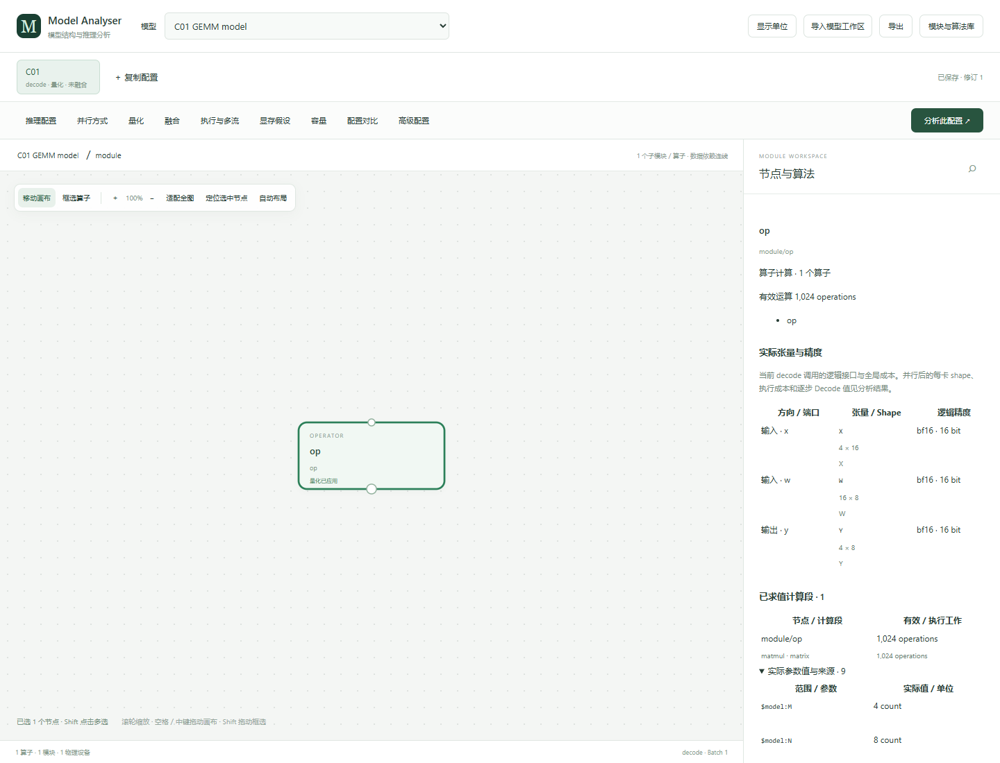

# 画布实际规格与指标来源

检查点51沿用用户确认的模型画布：详情和分析都读取当前固定输入的展开结果，不维护第二套 shape 或成本公式。

## 查看节点与模块

选中算子后，侧栏显示输入输出端口、实际张量 ID、已求值 shape、逻辑 dtype、规范存储格式和计算段的有效／执行工作、乘法／累加精度。存储别名沿实际目标解析；量化 payload 位宽、packing、alignment 和辅助项独立显示，避免把 BF16 逻辑张量误写成底层 W4 存储。

模块使用自身 `objectBindings` 对应的输入输出；重复容器外壳使用调用方明确绑定的完整边界。独立重复的整体输出可为 `3 × 4`，单个实例仍为 `4`；不以第一个叶算子的接口冒充模块接口。模块计算列表只读取其数学叶节点，长列表分批显示。模块的公式来源遍历固定模块／算子引用闭包，不把某一个内部算子当成整个模块。

此处是当前调用的逻辑／全局规格。每卡物理分片、实际参与设备与局部工作沿分析结果查看；多步 Decode 的变化沿各步骤结果查看。

## 从指标查看来源

- 分析顶部的工作量、耗时、HBM 和峰值卡支持键盘及点击，打开对应范围、指标的“成本与覆盖来源”。模块耗时也有直接入口。
- 成本排序表的数值可直接展开该行构成和公式、参数、假设。每步参数读取该步的分析结果，设备分项沿已有成本来源保留。
- Decode 表的本步耗时直接打开该步来源；例如三个增长步骤的 `C=2,3,4`，第三步显示 `4 count`，不会用画布的起始 `C=2` 补填。

`SingleStepAnalysisResult.parameterTrace?: ResolvedParameter[]` 在每次实际调用保留一次完整的参数值、单位及判别来源。各指标继续沿 `Provenance.parameterSources` 选择其相关记录，不在每个指标重复保存全表。单卡和显式多卡均记录；序列顶层不伪造一个通用参数表，各实际步骤分别保留。

旧结果没有这项可选证据时明确提示重新计算。当前资产默认值、画布基础结构和其他步骤都不用于补填。数值覆盖声明与实际生效记录仍分开显示，范围共用公式引用不等于每个公式都独立贡献当前指标。

该字段只补充求值证据，不改变数值算法或 `inputHash`，数学引擎保持 `0.1.0-execution.18`。Schema 由 Zod 重生成；根／联合／分支仍为206／87／223。

## 后台融合检查

融合推荐、预设求值、添加前完整校验使用独立 Worker。候选仍通过原融合约束，不预设加速；完整框选成员必须全部存在，不能过滤失效 ID 后偷偷推荐较小的组合。

推荐与应用前验证可取消。配置、固定资产、层级、选择或表单改变会终止旧任务；只有对应当前完整输入及活动线程的结果可应用。预设载入只填候选，添加成功才改变配置。中间物化候选通过一次依赖扫描收集，不在主线程反复遍历整个边集合。

真实 Chrome 专项在9,999个算子、9,998条内部依赖上确认六个候选；计算期间可操作显示单位设置。一次观测用时约5.98秒，期间记录298个动画帧，包含线程传输、界面和共享主机影响，不是帧率承诺，也不能和检查点50的 Node 同步探针直接作速度比。观测见[浏览器记录](../examples/canvas-evidence/fusion-background-observation.json)。

## 复算与验证

`npm run reference:canvas-evidence` 生成[可移植项目、结果和独立整数账本](../examples/canvas-evidence/hand-ledger.json)：C01的 `M=5,N=8,K=16` 给出1,280 operations、输入 `5 × 16`、W4 payload 64 byte；Decode各步工作为3／4／5 operations，参数上下文为2／3／4。

`npm run acceptance:canvas-evidence` 先执行上述参考，再执行包含运行基线的全部既有组合门禁。新增七项领域／SSR检查与五项Chrome检查覆盖实际接口、重复／嵌套调用、逻辑／存储精度、覆盖、分布式证据、逐步参数、取消／迟到及最大图后台计算。最终完整命令退出0：580单元／契约、7HTTP、146Chrome（25.6分钟）及全部既有参考通过，另五基础参考通过。具体时点见[验收状态](ACCEPTANCE_STATUS.md)，不把专项或完整测试数量当作全部需求完成。

原文逐项最终审计、其他长计算入口，以及比较／测量／Roofline等所有指标入口是否均符合主画布要求，继续见[剩余项](REMAINING_PRD.md)。
