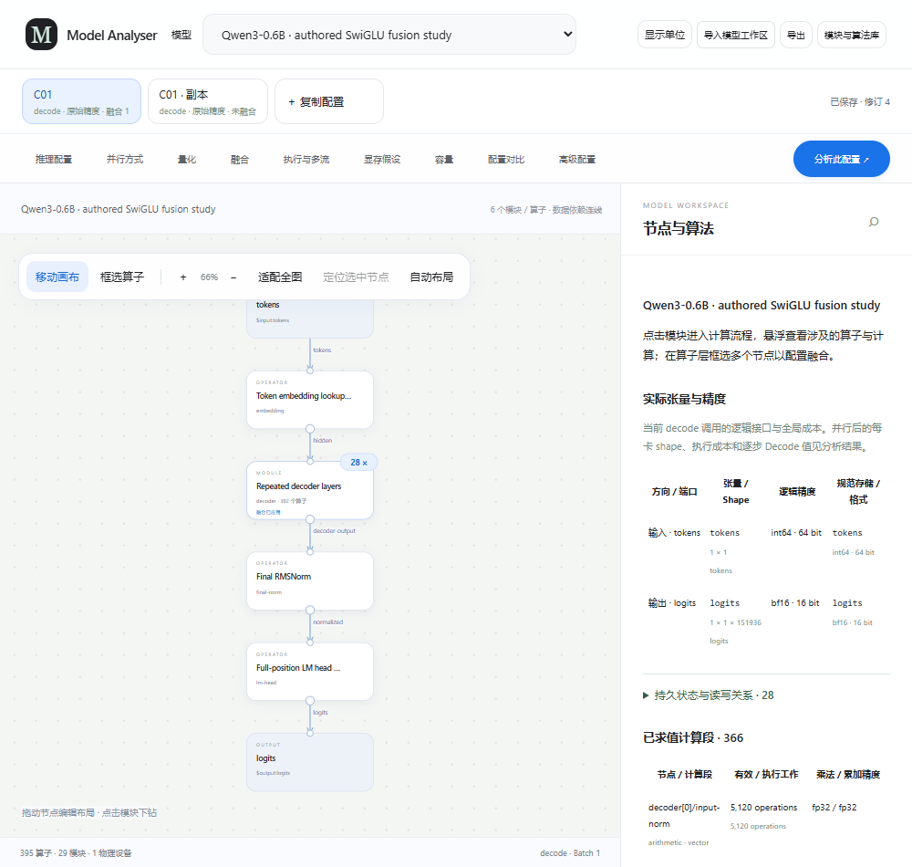
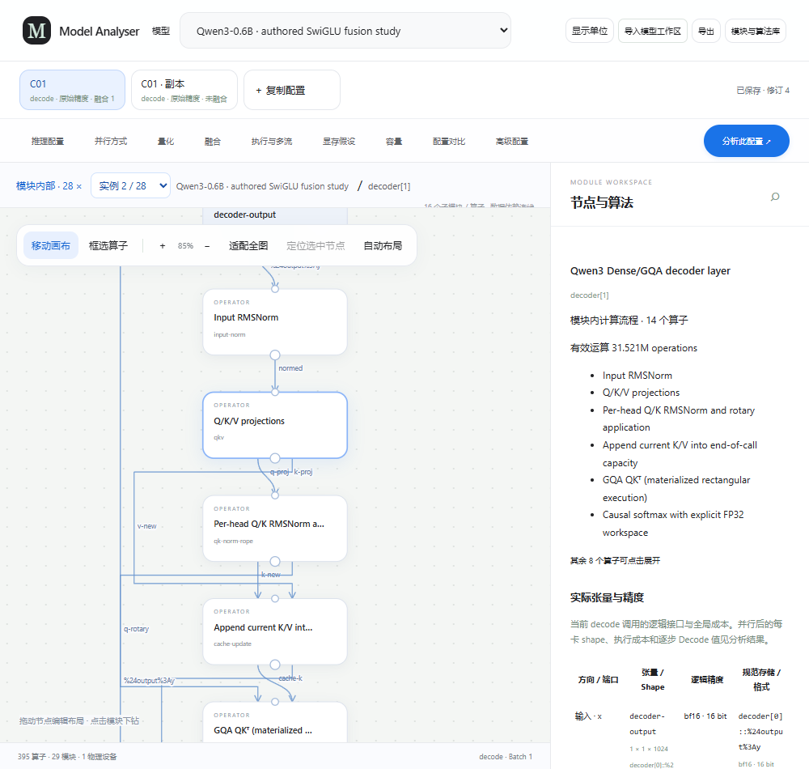
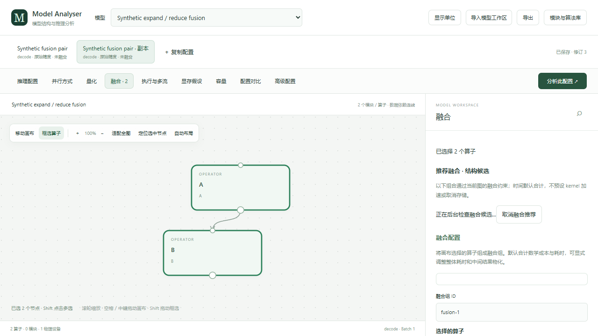
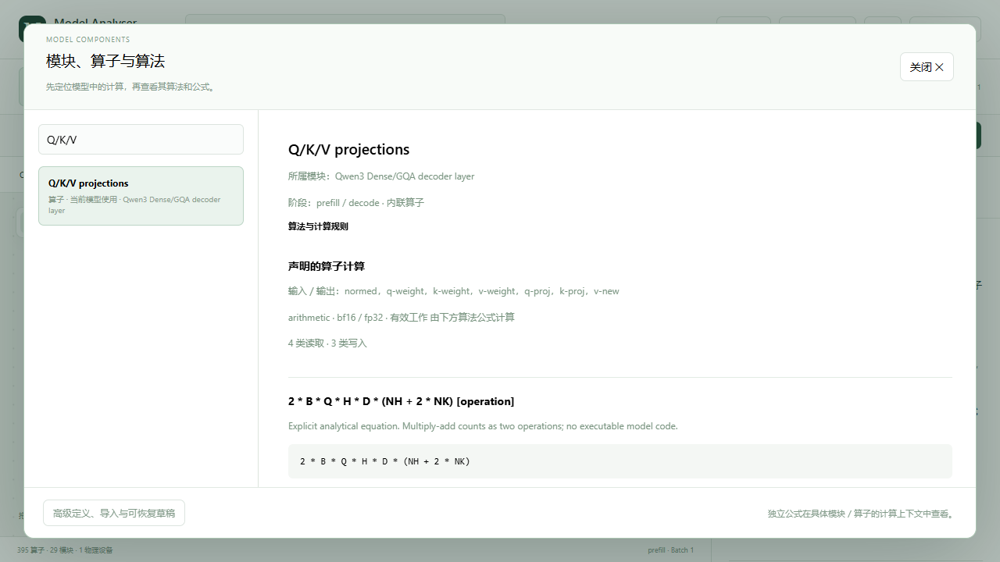

# 模型画布工作台

2026-11-15 用户确认的交互基线：模型结构图是主界面，采用可拖拽、缩放和平移的画布；点击模块下钻算子连接，悬浮查看涉及的算子与计算；框选算子后查看融合建议并指定融合。并行、量化、执行与分析围绕同一模型的不同配置展示。资产定义进入辅助入口，公式随模块／算子及对应算法展示。

这项确认替代原 PRD 中“先创建项目”和“第一版无需完整拖拽编辑器”的交互安排，保留原计算、校验和可恢复文件要求。底层项目／方案文件继续兼容，用户主流程围绕模型与配置组织。

## 当前实现

- 默认地址直接进入模型画布，首次打开选择 Qwen3-0.6B；以后恢复最近模型工作区。选择另一个模型直接打开其结构与已保存配置，无需先创建空项目。
- 模块包含关系用于折叠／下钻，数据与控制／同步依赖分别投影为实线和虚线；重复层先展示容器，再进入实际实例。不会把包含关系画成执行依赖，也不重复统计容器成本。
- 节点可拖动，布局通过已有独立 `viewState.nodes` 自动保存并随工作区导出；布局变化不改计算 hash。滚轮缩放、按钮缩放、适配全图、中键／空格拖动、框选与 Shift 多选已接入。视口位置缓存于本机浏览器，和可移植节点布局分开。
- [大图近景与总览](CANVAS_RENDERING.md)按视窗绘制实际数据流。“查找节点”可按名称或 ID 跳到当前范围的算子或模块。
- 模块与算子悬浮展示涉及的数学叶节点和已绑定有效运算；选中算子展示算法说明、原公式、单位和固定来源。当前模块下的量化默认作用于该模块，选择算子时自动带入相应范围。
- [高级配置](CANVAS_CONFIGURATION_EDITING.md)在当前画布编辑参数、任意设备组／mesh、布局范围、手工通信和数值覆盖；未完成输入与JSON作为独立配置草稿自动保留，校验完整工作负载后应用。有效配置／资产变更会提示过期，复制和取消均保留隔离。
- 同一模型的配置以标签切换和复制。工作负载、量化、融合、并行与多流配置分别保存；结构定义修改同步到同一模型的配置，原模型修订保持。
- 量化侧栏提供[Ascend描述导入](ASCEND_QUANTIZATION_IMPORT.md)：预览当前模板字段与实际规范存储，明确声明辅助布局后确认；未知项和未完成编辑随工作区保留，配置复制／撤销独立，原文SHA可核对。
- 模块详情可直接进入[模块私有峰值预算](MODULE_PEAK_OVERRIDES.md)，自动带入实际调用路径；画布标记“显存预算”。权重、KV、接口与共享对象保留，预算按真实调用跨度叠加，规则随当前配置保存，可与串行基线、decode和整数容量结果对照。
- 框选算子后自动进入融合面板，候选组合先通过现有图约束检查。默认保留数学成本和成员耗时，不承诺 kernel 加速；可选择内部结果取消物化，仍由规范存储／图边界／状态／组外消费者校验。算子名称从画布带入，不要求抄写节点 ID。
- 从节点端口拖到另一节点进入连接编辑，明确选择数据、控制或同步依赖。数据连接同步修改目标端口和输入张量绑定；内联算子在相同声明 shape／精度下同步修改读取存储与局部成本绑定。无法从共享访问方程唯一归属输入、shape／精度发生变化、通信 payload／分布需要重定义时，明确要求编辑相应定义和方程，不仅移动一条显示线。
- 连接修改先验证整个受影响模型及配置，再复制修改的定义和受影响父定义，按依赖顺序发布可复用用户资产并切换当前模型工作区。内嵌的外来依赖按新身份发布；原固定修订和其他模型不漂移。同一模块定义被多层引用时，编辑范围在面板中明确说明。循环依赖在发布前拒绝。库中可复用依赖先读取固定内容核验；同ID/同修订但内容不同的外来快照以新身份保存，工作区和重新载入的库模型复算hash一致。
- “模块与算法库”为辅助窗口，先展示模块／算子，再展示算法说明、公式、输入输出和修订。已导入工作区使用其固定快照，支持尚未发布到全局库的可移植定义；库中其他组件按固定依赖载入。高级定义／导入／草稿恢复继续保留。

## 验证与边界

画布验证覆盖包含投影、实际 repeat 实例边、合法融合候选、实际数据端口与访问方程改写、同模型配置一致、原定义不变及循环拒绝；浏览器验证主入口／模块下钻／悬浮／缩放平移、布局保存重开、框选融合与配置隔离、结构发布与离线复算、上下文算法库。完整组合门禁通过481单元/契约、3HTTP和106Chrome（13.9分钟）；最后的私有固定快照辅助编辑/关闭保存及内容冲突修复另经11领域、严格编译/构建和8Chrome通过，1000×950主画布响应布局也已核对。具体日志与范围见[实施记录](PROGRESS.md)。

旧定义／项目管理入口保留为显式 `?legacy=1` 的兼容与维护路径，旧浏览器用例明确使用该路径；这些旧用例不代替新画布交互验收。常规 `/` 以及旧 `?workspace=projects` 地址均进入新的模型画布。

工作区文件可保留不同模型的历史记录；主配置标签只显示当前模型的配置。现有数学资产的模型范围、人工硬件、通信缺项和近似假设保持有效，画布形式不扩大理论能力。布局自动保存与连接改写分别测试；不能用视觉连接替代成本与数据依赖。原 PRD 的其他未完成条目继续见[剩余项](REMAINING_PRD.md)。

画布右上角可设置[显示单位](DISPLAY_UNITS.md)，在同一配置下切换容量／流量与时间口径；只改变浏览器视图，不触发模型保存或改变原始导出。

检查点47补充[可编辑预设](PRESET_EXPANSION.md)：模型按家族组织；模块候选载入后高亮实际算子，可用“定位选中节点”缩放移动到所选范围。原始模型／配置与未应用候选分开，候选来源和实际调用固定修订可追溯。

检查点50补充[实际规模与运行记录](RUNTIME_BASELINE.md)：模型结构后台展开，可取消／重试并拒绝迟到旧结果；大图依据真实范围适配，低于1%时仍显示有效缩放值。9,999算子连线案例验证实际下钻／适配／拖动保存和完整复算；DOM绘制／共享主机造成的长任务另记，不承诺任意图规模的帧率。

检查点51补充[实际规格与直接指标来源](CANVAS_EVIDENCE.md)：主画布显示真实模块／重复边界、张量shape、逻辑／存储量化精度与计算段；指标直接查看实际求值参数和逐步Decode证据。融合候选／预设／应用校验改为可取消后台任务。其余选择上下文、手工测量输入、状态详情与指标入口继续逐项迁移。

检查点52补充[选择上下文、状态与手工测量](CANVAS_CONTEXT.md)：成本／Roofline／测量控件跟随实际目标，完整融合组和不可用范围明确区分；状态读写关系进入主画布，统计方式／次数／单位／区间／设备／实际bytes及Decode步骤均可手工声明。检查点53继续补充[实际时间线上下文、后台测量比较和严格来源选择](CANVAS_DERIVED_VIEWS.md)。检查点54的[所选范围存储](SELECTED_MEMORY.md)按实际调用／物理设备展示规范分配、共享／常驻／私有／接口、量化分解与来源，可从分析结果快捷定位；全模型峰值不分摊。其余指标入口和完整派生功能继续按原PRD审计。

检查点55的[指标与差值来源](METRIC_SOURCES.md)仍在同一画布侧栏：配置对比的数值／Δ可直接查看当前配置及基准的依据；固定硬件修订和通信逐事件合计单独解释。模型概览的计算分类逐类选择，不将类别数绑定第一类指标；改单位／展开来源不修改配置或数学hash。

检查点57的[执行工作量利用率与比较导出](EXECUTED_UTILIZATION.md)将模型有效MFU与实际执行工作量分别列在画布分析及导入预览中，点击查看真实分子、统计时间和逐卡固定峰值。当前页比较JSON／CSV保留固定快照、原记录和未完成／不可用项；导出时翻页或重新分析会阻止旧文件下载。完整回归状态见[验收记录](ACCEPTANCE_STATUS.md)。

检查点58的[预算实参与成本构成](DECLARATION_COST_SOURCES.md)提供后台固定输入复核、嵌套公式实参、成本占比／合计／逐步构成的直接数值入口。真实Decode步骤单独解释，单卡设备预算也在该步详情查看；不存在的步骤不借用序列参数。短模块路径的作用域优先级已修复，实际数学引擎升至.19，历史输入hash及原固定修订保留。

## 检查点59追加说明：具体叶表达式

[精确叶表达式来源](LEAF_COST_SOURCES.md)按实际字段选择器在后台复核，实例化观察器于literal折叠前捕获指定调用及规范存储的实际符号。原引擎版本、固定hash、完整MetricValue及真实stepContext全部核对后才呈现所选表达式和实际运算。支持范围与未采集变换明确区分，部分页／预算截断不称完整链，原公共AnalysisResult契约和.19数值算法保持。本追加说明不改写或签收原文未复核要求。

## 检查点60追加说明：量化数字作用域

[量化作用域修复](QUANTIZATION_SCOPE.md)让辅助公式与预算／融合共用根在前的数字作用域顺序，使用已绑定的真实调用参数。短节点P3不再被根P2覆盖，单份14B反例、共享冲突、真实Decode与容量候选有独立证明；数学引擎升.20，输入hash和公共结果契约保持。旧19数据独立保留，来源报告跨算法须重新计算。本追加说明不改变原要求或关闭原文最终审计。

2026-11-16 用户画布修订已加入[真实数据流与重复模块导航](CANVAS_DATAFLOW.md)：实际residual与MoE双分支、n ×模块入口、直接进入单实例内部及现代浅色画布。702单元与9项相关Chrome通过，完整组合门禁尚待本次变更后重跑。
