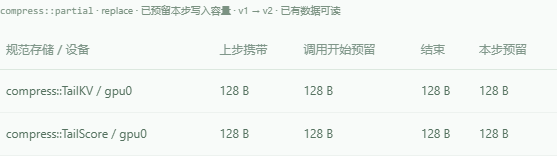
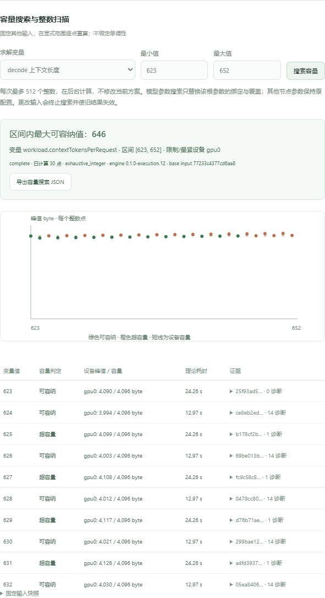
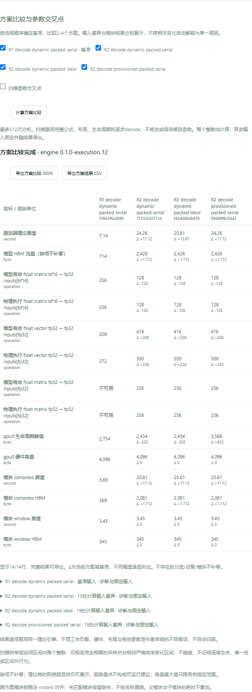

# 完整压缩组、部分组状态与缓存预留

检查点31补齐P5的ratio>1压缩/部分组预设。项目只覆盖压缩器和独立window/cache准备两个模块；不含attention、indexer、完整encoder或整个模型。三研究案例的范围继续见[P5清单](P5_RESEARCH_CASES.md)。P5的DSA、KDA/递归混合及P6仍待完成。

## 固定来源与作者假设

现场读取[DeepSeek V4.1 Flash官方推理代码](https://huggingface.co/deepseek-ai/DeepSeek-V4.1-Flash/blob/314113f8a7dadb388215396ba5fbee2c610a04d6/inference/model.py)，固定提交`314113f8a7dadb388215396ba5fbee2c610a04d6`。代码SHA256为`e5decd76fe70fd56ef2f10124d245c6f64fb6a0003cc9068a1d3182a168b8d2d`，config为`2e84f45cf1dac8c7fcbb200e96667d4b913275690668ed496f24c7747207a809`。事实与人工假设分别写在[来源锁](../references/parallel/compression-source-lock.json)。

源码Compressor与Attention._compress_kv的相关语义：

- ratio=1使用单个BF16投影；ratio>1使用FP32 value/gate权重与投影、FP32 softmax pooling，池化结果转回输入精度再RMSNorm。
- 仅完整组产生新latent。prefill保留余数；单query decode写入当前槽，仅在组完成时pool。两个独立FP32状态`kv_state`、`score_state`各为B×R×D，余数为零时仍保留完整缓冲。
- 压缩器返回pre-RoPE latent；有新latent才执行主cache的rotary/quantization和append。原始window ring独立存在。
- 固定config的encoder来源层使用ratio2、decoder使用ratio1；ratio4项目是作者对通用压缩器的研究变体，不声称它是该config的设置。源码demo使用浮点cache并按最大batch/sequence预分配。

人工参数B=1、H=4、D=16、W=2，decode C=255/Q=1、prefill C=0/Q=5。硬件容量4096 B，BF16 matrix、FP32 matrix、FP32 vector各1000 operations/s，HBM 100 B/s。三类算力分别计算，不能合并精度分母。这些人工秒数不是实卡预测。

ratio2压缩器显式包含输入cast、两个FP32投影、尾部保存、物化softmax/product/reduction、latent cast、norm、rotary、quant/store；window显式包含BF16投影、norm/rotary和fake-quant/store。内部norm/rotary/quant workspace声明在片上，pooling的FP32中间量则正式分配HBM。存活期使用图中生产/最后读取和导出边界，不复刻Python局部变量或allocator保留行为。cast与量化转换仅增加执行工作，不增加模型有效算术。

## 完整组、有效条目与分配容量

令R为压缩率，C为调用前上下文，Q为本次输入长度。prefill固定C=0，decode固定Q=1，避免用多query调用冒充源码的单步分支：

| 数量 | 公式 |
| --- | --- |
| 调用后完整组 | `floor((C+Q)/R)` |
| 新产生组 | prefill为`floor(Q/R)`；decode为`floor((C+1)/R)-floor(C/R)` |
| 调用后待完成token | `(C+Q)%R` |
| 含部分组的组数 | `ceil((C+Q)/R)`，最后一个部分组不是已写入cache的latent |
| dynamic主cache预留 | 调用开始按调用后`floor((C+Q)/R)`行预留 |
| provisioned主cache预留 | `floor(M/R)`行，M默认512；正式形状约束拒绝`C+Q>M` |
| 两个部分组状态容量 | 每个`4BRD` B，合计`8BRD` B，R>1时始终存在 |

导出张量是完整cache/ring容量缓冲，以及新pre-RoPE latent和本次window KV。有效条目/部分组占用在[独立摘要](../examples/compression/reference.json)单列；未填充容量不能当成attention有效token。window始终分配B×W×D，prefill只保留最后min(Q,W)行，decode保留当前一行。

packed理论变体使用FP4主行及每16通道一个E4M3 scale byte，FP8 window行及每32通道一个E8M0 scale byte；尾块使用ceil。D=16时主行9 B、window行17 B。BF16 cache行均32 B，保留同一fake-quant工作，以分开存储和计算假设。缩小D、scale布局和packed分配不构成源码kernel形状兼容或精度等价声明。

若新组数为零，pool、latent norm/rotary和主cache写入均为零成本，但FP32投影、尾部槽写入及window仍执行。零工作叶的Roofline比例可能显示`zero_traffic`/`zero_seconds`不可用诊断；其HBM、时间为可用的零，不影响完整模块时间或显存结果。M只控制provisioned变体，dynamic不使用M。

## 独立算术与对照结果

[生成器](../scripts/compression-project.ts)使用普通图、公式、StateSpec与stateBindings；[独立账本](../scripts/compression-oracle.ts)不调用core、项目生成器或公式解析器，逐节点列出算术/读写、依赖、出生/最后读取，分别核对精度工作、时间和峰值。[参考脚本](../scripts/compression-reference.ts)调用统一analyzeScenario/searchCapacity并断言一致，没有族别核心分支或压缩比例折扣。

所有数值为上述人工条件；激活列为全局峰值时相应类别，三类byte合计等于峰值。

| 项目 | 秒 | HBM B | 权重 B | 状态 B | 激活 B | 峰值 B |
| --- | ---: | ---: | ---: | ---: | ---: | ---: |
| ratio1 decode串行 | 7.14 | 714 | 320 | 2338 | 96 | 2754 |
| ratio1理想两流 | 3.69 | 714 | 320 | 2338 | 128 | 2786 |
| ratio2 decode串行 | 24.26 | 2426 | 704 | 1442 | 288 | 2434 |
| ratio2理想两流 | 20.81 | 2426 | 704 | 1442 | 288 | 2434 |
| ratio2 HBM共享 | 24.26 | 2426 | 704 | 1442 | 288 | 2434 |
| ratio2 provisioned M512 | 24.26 | 2426 | 704 | 2594 | 288 | 3586 |
| ratio1 prefill Q5 | 22.39 | 2239 | 320 | 79 | 480 | 879 |
| ratio2 prefill Q5 | 49.48 | 4948 | 704 | 308 | 1056 | 2068 |
| ratio2 BF16 cache | 24.64 | 2464 | 704 | 4416 | 288 | 5408 |
| ratio4作者变体 | 31.94 | 3194 | 704 | 1122 | 544 | 2370 |

默认ratio2 cache128行占1152 B、两个FP32尾部合计256 B、window34 B。provisioned预留256行占2304 B，有效条目仍128，额外1152 B使峰值增至3586 B。BF16 cache变体超出4096 B容量，保留可算的理论成本而不推荐运行。ratio2默认BF16 matrix128、FP32 matrix256、vector有用416/执行500，84为转换；压缩器HBM2081 B/20.81 s，window345 B/3.45 s，各声明叶均受HBM限制。理想策略允许两模块重叠，带宽共享恢复24.26 s；不推断网络、SM或未声明资源争用。

压缩并非无条件节省完整峰值：短上下文C=5时ratio2为1309 B，ratio1为504 B，FP32权重和pooling临时量占主导。这里也未读取历史attention/indexer，因此不能把组件时间增加解释为整个网络的压缩收益或损失。

## 跨步状态与非单调容量

[三调用项目](../examples/compression/r2-sequence-project.json)从C255开始，主cache append、两缓冲组成的partial replace、window windowed共三个逻辑状态，每步step_end提交：

| 调用前C | 完整组前→后 | 余数前→后 | 新主cache写 B | 秒 | 峰值 B |
| --- | --- | --- | ---: | ---: | ---: |
| 255 | 127→128 | 1→0 | 9 | 24.26 | 2434 |
| 256 | 128→128 | 0→1 | 0 | 12.97 | 2338 |
| 257 | 128→129 | 1→0 | 9 | 24.26 | 2443 |

三步总61.49 s、HBM6149 B、最坏2443 B。两个尾部storage每步均128 B，主cache为1152/1152/1161 B。状态版本v0→v1→v2→v3表示调用快照；空append也可产生下一版本，不等于新增完整组。初始化的warm history及待完成槽是输入假设。

ratio2 serial的decode峰值：完成组时`1282+9N` B，未完成时`1186+9N` B，N=`floor((C+1)/2)`；ideal未完成时为`1170+9N`，完成时相同。serial中window norm缓冲与保留的投影重叠，未完成步激活192 B；ideal为176 B。C623..628的峰值4090/3994/4099/4003/4108/4012 B，对应fits/fits/exceeds/fits/exceeds/fits，不能二分猜测单调性。

| 分配与策略 | 已穷举区间 | 区间内最大可容纳C |
| --- | --- | ---: |
| ratio1 dynamic serial | 403..406 | 404 |
| ratio1 dynamic ideal | 399..402 | 400 |
| ratio2 dynamic serial | 623..652 | 646 |
| ratio2 dynamic ideal | 623..652 | 650 |

ratio1峰值serial为`450+9(C+1)`，ideal为`482+9(C+1)`，重叠使临时量增加32 B并降低该区间容量。ratio2 serial的646为4093 B，ideal的650为4095 B。原始逐点hash、诊断及结果保存在[串行扫描](../examples/compression/r2-context-capacity.json)与[理想扫描](../examples/compression/r2-overlap-context-capacity.json)；只声明所选区间，未证明区间外最大值。

## 操作与验证

```powershell
npm run reference:compression
npm run reference:research
npm run acceptance:p4
```

前者生成十份完整项目/结果、三步项目/结果和四份容量扫描，后者共同复算三个原研究案例及本组件研究。内置库增加五个模型（ratio1/2的prefill/decode及ratio2 provisioned）、七模块、34公式与一个人工硬件，共47份资产；window和公式的固定身份在所有项目间保持相同内容。BF16 cache、ratio4和资源策略对照保留为可移植项目。引擎仍为0.1.0-execution.12，Schema未改。

导入[ratio2串行项目](../examples/compression/r2-decode-project.json)，计算后检查状态与FP32计算分类；导入三调用项目可观察9/0/9写入。将容量变量设为上下文，扫描623..652；比较ratio1、ratio2、ratio2理想与provisioned，可复核时间、驻留和容量差异。项目导出保留全部固定依赖，空库可重开并纯core复算。

八项[研究单元](../tests/compression.test.ts)覆盖来源、独立账本、prefill余数、动态尺寸、三步状态、分配策略、非单调边界和非法输入；三项[Chrome用例](../tests/e2e/compression.spec.ts)覆盖状态表、零输出形状、容量、四方案比较、导出纯core复算与重开。

最终全量`acceptance:p4`退出0（checkpoint31-acceptance.log）：367项单元/契约、3项HTTP、67项Chrome、架构/严格编译、Schema/分支正反、既有独立参考与生产构建全部通过。随后`reference:research`四套研究共同复算通过（checkpoint31-research.log）。主包大于500kB的Vite提示仍在，构建成功。截图已人工检查：






