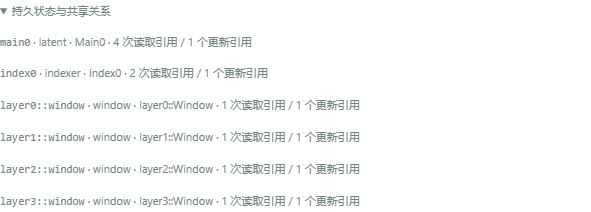
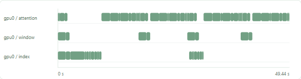
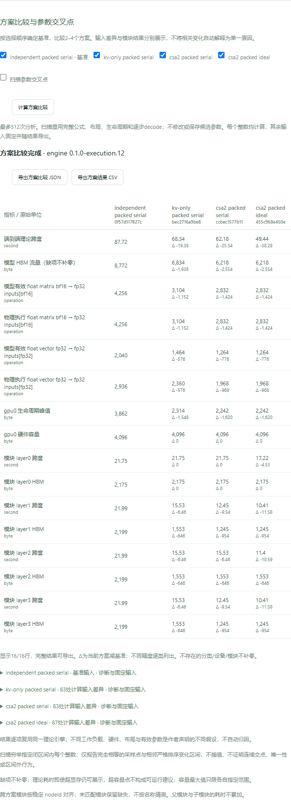

# CSA2 独立共享对象与多流研究

检查点30完成第三个 P5 研究案例：四个有序 decoder attention 片段，分别采用 Full / Reuse / Reindex / Reuse，独立表达主 KV、indexer K、Top-K 与候选掩码的创建/引用，并比较串行、理想流和 HBM 共享争用。所有计算沿普通模块、StateSpec、TensorSpec、成本公式和既有执行核心完成；未加入品牌计算分支。三研究证据见[P5研究清单](P5_RESEARCH_CASES.md)，P5其余特殊机制和P6仍未签收。

检查点31另以[压缩组件研究](COMPRESSION_RESEARCH.md)补齐ratio>1、完整组/部分组、FP32双尾部和预留容量；本篇四个decoder片段保持ratio1的原研究范围。

## 固定来源与支持边界

核对 [DeepSeek V4.1 Flash 官方推理代码](https://huggingface.co/deepseek-ai/DeepSeek-V4.1-Flash/blob/314113f8a7dadb388215396ba5fbee2c610a04d6/inference/model.py)及同提交的 [inference/config.json](https://huggingface.co/deepseek-ai/DeepSeek-V4.1-Flash/blob/314113f8a7dadb388215396ba5fbee2c610a04d6/inference/config.json)。提交 `314113f8a7dadb388215396ba5fbee2c610a04d6`、两个文件 SHA256、核对日期与事实/作者假设保存在 `references/parallel/csa2-source-lock.json`。缓存存在时生成器校验哈希；离线复算不要求下载模型、源码或权重。

本例取源码零基层号20、21、24、25：20创建主KV/indexer K及索引；21使用既有索引；24共享缓存但重算索引；25使用24的索引。各层窗口独立。后续 indexer 会使用首个 decoder indexer 产生的候选掩码。本例按 demo 的物化路径先计算完整 index scores 再掩码，因此不宣称后续 score 工作与上下文无关。

只覆盖这四个片段，省略中间层及 encoder、MoE、mHC、Engram、视觉、DSpark、全网权重/缓存总量、SWA replay/offload。实际源码仍持有浮点 cache tensor 并进行 fake quant；下述 packed cache 是另行声明的理论存储变体，不能把它当作该 Python demo 的实际峰值或数值等价实现。

作者固定小尺寸：H=4、query/output rank=2、单 attention/index head、D=16、index D=8、window=2、Top-K=2、一个宽度2的候选块。支持单 query decode 前向与多步递增上下文，已有历史缓存明确初始化；Q 的 min=max=1，其他阶段或多 query 不在此片段支持范围。H、Batch、Context 可修改。BF16矩阵/权重与 FP32 vector 代理分开；norm/rotary/量化/选择/解包均有明示代理，不代表内核指令精确计数。

人工卡为4096 B、matrix/vector各1000 operations/s、HBM100 B/s。速率/容量是手算输入。网络、真实分配器碎片、未声明的内核融合及省略组件未推导为成本。

## 可导入项目和内置资产

运行 `npm run reference:csa2`，生成[独立摘要](../examples/csa2/reference.json)、完整原始结果及每份批次边界证据：

| 项目 | 主KV/indexer K组数 | indexer调用数 | 默认跨度 | 每卡峰值 | HBM bytes | matrix / 执行vector ops |
| --- | --- | --- | --- | --- | --- | --- |
| [independent](../examples/csa2/independent-project.json) | 4 | 4 | 87.72 s | 3862 B | 8772 | 4256 / 2936 |
| [kv-only](../examples/csa2/kv-only-project.json) | 1 | 4 | 68.34 s | 2314 B | 6834 | 3104 / 2360 |
| [shared](../examples/csa2/shared-project.json) | 1 | 2 | 62.18 s | 2242 B | 6218 | 2832 / 1968 |
| [overlap](../examples/csa2/overlap-project.json) | 1 | 2 | 49.44 s | 2242 B | 6218 | 2832 / 1968 |
| [bandwidth](../examples/csa2/bandwidth-project.json) | 1 | 2 | 62.18 s | 2242 B | 6218 | 2832 / 1968 |
| [bf16](../examples/csa2/bf16-project.json) | 1 | 2 | 67.48 s | 2566 B | 6748 | 2832 / 1264 |

前三项是明确的不同图：每层独立创建缓存；只共享缓存但每层重新索引；实际来源模式的缓存和索引复用。它们不是源模型的可替换等价变体，不证明精度相同。默认 Context=5，调用结束 N=6，所有 attention 各访问两个窗口条目和两个压缩全局条目；工作量变化来自实际删除的创建/索引节点。奇数候选边界可改变有效条目数，见后文。

`csa2` 模式的 packed/BF16 两份模型、八个模块、公共硬件及全部公式正式录入 `assets/builtin`，通过文件扫描和固定引用加载；counterfactual 作为独立可移植项目。库中的型号名称含 `fragment`，无完整型号或自动 config 映射的支持声明。可直接导入上表项目；若从模型库创建方案，应将阶段设为 decode、Query=1、Context=5、Batch=1，并明确选择人工研究硬件。

导入 shared 后“展开模型结构”，可见75个叶节点、4个容器、6个持久状态；选 `layer1/gather` 可见 `TopK0` 与 `Main0`，选 `layer2/index-scores` 可见共享 `Index0`。展开“持久状态与共享关系”，主KV有四个读取者、indexer K有两个读取者，均只有一个更新者。点击“计算理论结果”，导出项目后仅靠其固定快照即可在空资产库重开复算相同 hash。

overlap 项目有 attention/window/index 三个流。界面时间线默认显示60步，可“再显示60个执行步骤”查看全部75步；横轴始终覆盖完整已知跨度，收起后比例不变。资源策略改为 shared_bandwidth 会重算为62.18 s，不能把理想重叠作为实卡保证。

## 独立对象：复用究竟减少什么

| 对象 | 创建 / 更新 | 使用 | 生命周期 / 驻留口径 |
| --- | --- | --- | --- |
| Main0 | layer0主投影、归一化、rotary/pack并append | 四层各自gather选中条目 | 一个请求的一份全局状态；不按读取者复制 |
| Index0 | layer0从未旋转latent投影/pack并append | layer0、layer2完整index score | 独立indexer状态；与主KV各有真实backing |
| layer0..3::Window | 每层自己的投影/pack/ring write | 每层自己的gather | 四个window状态，最多W条；没有随全局KV一起共享 |
| TopK0 / TopK2 | layer0 / layer2各自选择 | 各被当前层和一个Reuse层读取 | int32前向局部activation，按最后使用释放；不跨decode步骤携带 |
| Candidates | layer0选择最新候选块并物化掩码 | layer2过滤完整scores | uint8前向局部activation；与Top-K独立身份 |

StateSpec绑定将同一主KV/indexer backing 映射到不同模块，读写次数沿实际叶节点保留。Top-K和候选结果使用正式数据边连接各模块：没有为了让它们共享而错误声明为跨调用持久状态，也不从同名推断跨请求去重。Batch扩展实际数据和访问量，不能复用不同请求的数据。

每层含低秩query两投影、query norm/rotary、独立SWA投影/更新、选中条目的独立BF16 gather缓冲、QK/物化sink-softmax/AV、逆rotary、两级输出投影与残差。Full额外创建主KV与indexer K；Reindex执行query/score/过滤/Top-K；Reuse直接消费已有索引。共享KV或索引不会删掉后续gather/attention。

默认每层gather读取 `2×9 + 2×17 + 2×4=60 B`：主KV两条、window两条和两个int32索引。两次完整index score各读取 `16+6×5=46 B`。四次attention、两次索引读取都真实计费；没有将共享读取视作免费。

## Packed payload、scale与独立算术

`scripts/csa2-oracle.ts` 不导入 core、项目生成器、公式解析器或实际结果。它独立列出每个节点的 scalar operation/byte 方程，按三条分支的明确顺序求串行/理想跨度，并从手工账本的生产/最后读取区间枚举同时存活缓冲。参考生成器直接断言时间、HBM、精度分类、驻留、峰值和容量。

固定维度下 packed 每行：主KV `16/2+ceil(16/16)=9 B`；indexer K `8/2+ceil(8/32)=5 B`；window `16+ceil(16/32)=17 B`。payload与一字节scale metadata分别由 QuantizedStorageSpec计算，packing/alignment明确。缩小维度下的末尾scale块按ceil计量，是本理论变体的声明，不保证源kernel接受这些形状。矩阵仍为BF16；gather的解包/搬运有自己的BF16输出buffer和vector代理。indexer K在score叶内部显式声明寄存器内解包：每通道2 vector operations，默认两次共192，不额外分配HBM暂存。矩阵与vector计算时间按分类相加后再与HBM取max。BF16 cache变体的对应行是32/16/32 B，省去packed解包代理；其余fake-quant代理仍保留。

设 B 为batch、N=C+1，固定四层的每层公共权重为：

```text
2(HR + RD + HD + DO + OH + R + D) + 4 = 328 B
每个全局KV/indexer-K创建组：2(HD + DJ + D + J) = 432 B
每个indexer的query/weight投影：2(RJ + H) = 40 B
总权重：4×328 + globalGroups×432 + indexerCount×40
packed状态：B[globalGroups×N×(9+5) + 4×min(N,2)×17]
```

默认独立/仅缓存共享/CSA2权重为3200/1904/1824 B，状态472/220/220 B。对应同时存活activation为190/190/198 B；CSA2多保留8 B源索引到Reuse层，不能将全部峰值下降都归因于权重。总峰值3862/2314/2242 B：完整复用共节省1620 B，其中权重1376、状态252，额外源索引增加8。

matrix总量为四层query/SWA/output投影1152、四层QK+AV1024、一次主KV/indexer-K创建384、两次索引136，共2832 operations。独立baseline额外三次创建1152和两次索引272，得4256。vector执行代理1968，其中gather解包512、indexer K解包192只计执行量；模型有用vector为1264，与BF16 cache变体一致。不会用存储转换增加模型有用分子。

默认所有节点由HBM限制，因此各节点 `max((matrix+vector)/1000,HBM/100)` 的串行合计为 `6218/100=62.18 s`。四层串行为21.75、12.45、15.53、12.45 s；理想三分支为17.22、10.41、11.40、10.41 s，总49.44 s。每层 residual仍依赖前层输出，不重叠相依层；只重叠同层独立的query、window与index准备。

shared_bandwidth 在同一设备上共享已声明HBM需求。默认所有节点均为HBM限制且无无效空闲，完整6218 B仍需62.18 s；理想省下的12.74 s并非少搬了数据。这里三种策略峰值均2242 B，不能声称所有重叠都会增加或降低峰值。未建模的硬件争用不由这个简单策略推导。

## 边界、容量和跨步版本

候选只有一个宽度2的块，因此它固定保留最新块。Top-K分配槽数 `min(2,N)`；Reindex有效位置数为 `min(2,N−2floor((N−1)/2))`，剩余槽是不可达标记。源码对应完整score后mask，本例读取全部indexer K，不能把候选宽度当作其完整score扫描长度。

C=5时N6，Reindex有效两个条目；C=6时N7，最新块只有一个有效位置；C=7时恢复两个。三步串行分别62.18/60.32/63.30 s，HBM6218/6032/6330 B，峰值2242/2257/2272 B。后两层在中间一步各少读一个主KV条目，但所有主KV/indexer历史仍驻留；稀疏读取没有减少完整状态存储。逐步跨度合计185.8 s，最坏峰值2272 B，不能用单步乘三替代。

六个持久状态每步v0→v1→v2→v3；主KV/indexer K按append增加，四个window饱和后维持大小。每步重新执行两个Top-K节点，候选/索引没有跨调用版本或驻留累加。状态按call-end分配预留，沿既有core逐步实现，在同一backing里保留容量；无额外隐式重分配拷贝。

默认固定Context的串行峰值：

| 方案 | 每卡峰值关于Batch | 4096 B下边界 |
| --- | --- | --- |
| independent | `3200+662B` | B1=3862，B2=4524 |
| kv-only | `1904+410B` | B5=3954，B6=4364 |
| shared / overlap | `1824+418B` | B5=3914，B6=4332 |
| BF16 cache | `1824+742B` | B3=4050，B4=4792 |

三步shared最坏为 `1824+448B`，B5=4064、B6=4512。生成器输出指定边界范围的容量证据；改变context/步骤后须重算，范围外不由UI扫描自动证明。

八项 `tests/csa2.test.ts` 与三条 `tests/e2e/csa2.spec.ts` 覆盖来源、内置扫描、精度/metadata、独立算术、重复读取、真实共享身份、动态B/C/H与冷起点、候选边界、三步版本/局部结果、错误输入、容量、理想/共享HBM、可移植快照/空库重开。完整回归及时间线展开补测见[实施记录](PROGRESS.md)。当前只添加资产、独立参考与展示能力，引擎仍 `0.1.0-execution.12`，契约未变。






