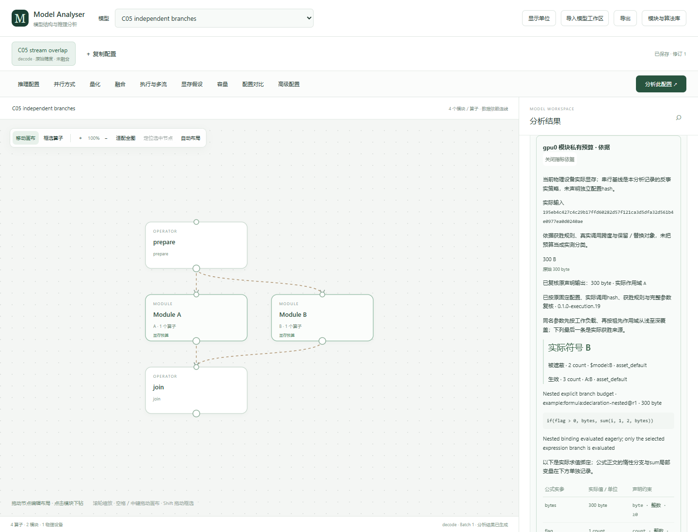
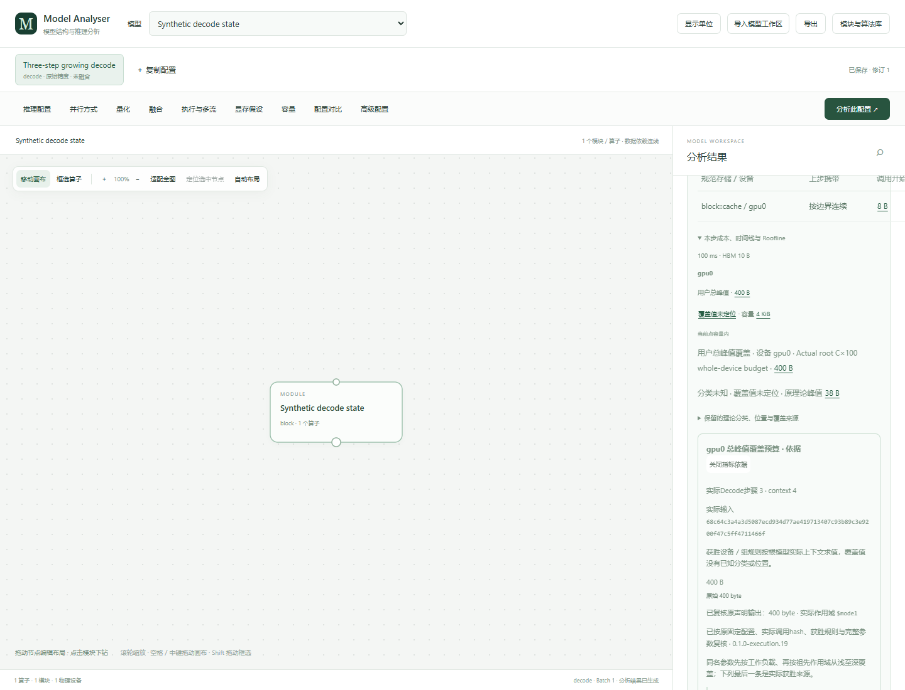
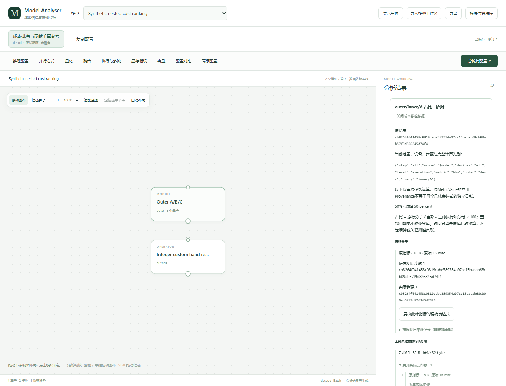

# 在画布查看预算实参与成本构成

检查点58继续在同一模型画布的分析侧栏提供数值依据：模块私有预算、设备／组总峰值覆盖、成本表占比、完整合计、已知小计及每个构成值都有直接入口。完整回归状态见[验收记录](ACCEPTANCE_STATUS.md)，本页不代表整个F10或全项目完成。

## 预算公式沿原调用复核

点击显存结果中的私有预算，或总峰值覆盖说明中的预算数值。后台使用原固定配置、资产快照、实际调用hash和stepContext重新分析，核对全部实际参数及该物理设备的获胜规则、表达式和原字节数；通过后才展示公式实参。设备／组总预算以根模型上下文求值，模块预算以该实际模块调用求值。未记录原上下文时提示重新计算，不取当前默认值。

面板分别展示固定字面量、实际符号和固定修订的公式调用。嵌套公式可以逐层打开，每个实参保留实际数值、单位和约束；同名参数列出被遮蔽值与最终生效的作用域和来源。公式正文中的if只记录实际选择的分支，sum局部变量与公式输入分别标记；公式绑定仍遵循原先的求值规则。

图片来自隔离工作区中的人工C05变体，不是实测benchmark。根B=2、模块A的B=3、模块B的B=5，预算100×B分别得到200／300／500 byte；模块私有预算重叠时为800 byte，独立根总覆盖仍为200 byte。设备规则优先于组规则，原理论值及被遮蔽规则保留。

后台复核可取消、重试。改选预算、重新分析或切换配置后，旧结果不可见，已经排队的旧回复也不能替换新选择。实参每批12、符号每批20、执行事件每批20显示，嵌套按需展开。最多记录256个ValueExpr节点、1000条实际执行事件；达到预算会明确标记部分记录，数值仍按完整受控求值复核，不把部分记录称为完整依赖链。侧栏表格固定宽度并换行，不让嵌套表格撑出可见区域。

## 引擎.19修复了短模块路径的优先级

独立用例发现旧fusionSymbols将作用域按字符串长度排序，`$model`长度为6，短模块`A`长度为1。旧顺序会先使用A的B=3，再被根B=2覆盖，错误得到200 byte。现在根作用域明确先于所有实际模块，再从祖先到具体调用覆盖，A正确得到300 byte。融合预设及局部附加成本沿同一取值函数，独立固定来源融合时间由原根参数2ms修正为实际模块3ms，加成员2ms后为5ms。

这是实际数学修复，引擎升为`0.1.0-execution.19`。普通实例化参数绑定逻辑未被改写，输入hash仍描述计算输入，算法版本独立记录；同一输入hash的历史结果必须连同engineVersion解释。本轮来源入口基于当前重算结果；查看历史旧算法结果前应先重新计算，不能仅凭hash或数值相同，把新算法的来源当作旧算法执行链。旧结果不能凭新默认值补造依据，重新复核若与原预算不一致会明确拒绝。保留的检查点56四种测量基线仍逐字段比较原MFU／MBU、时间、来源及诊断，单独核对引擎版本变化；历史基线文件不被覆盖。

## Decode必须选择真实步骤

序列汇总没有单次参数，预算来源会要求选择实际步骤。进入“本步成本、时间线与Roofline”后，分布式调用沿原步骤布局，单卡调用也可查看该步显存与设备总预算。调用hash和stepContext必须一致；第三次growing-context调用C=4、100×C=400 byte，fixed-context近似始终C=2、200 byte。不会用序列根、第一步或另一调用补填。

总覆盖保持分类未知和位置未定位，原理论值另列；模块预算仍是调用跨度内的私有预留，不冒充实测分类。单步显示使用已经记录的实际步骤显存，状态预留与理论边界保留原语义。

## 成本占比、合计和构成值

“成本排序与贡献”中的占比、所选范围执行项合计、已知小计、引擎原范围指标，以及“展开构成”里的完整／已知合计、每步构成值和原MetricValue均可点击。来源保留当前范围、真实设备、步骤和完整ComputeClass。

投影运算单独保留求和、左减右、逐设备最大值、执行区间结束减开始，以及模块首末跨度的实际操作数。每个原指标沿自己的真实步骤查看参数、诊断和固定来源；不是将所有原值无差别相加。图中逻辑有效、物理有效和物理执行的差额继续分别解释，未声明的跨模块融合分摊保持不可用。

人工排序参考中，查找A后只显示16 byte一行，但全部执行项分母仍为16＋12＋0＋4=32 byte，占比50%。查找和翻页不改变分母。矩阵执行8减物理有效4得到差值4；嵌套模块不生成重叠百分比。多流例子的节点屏障耗时预算为8.5ms，墙钟跨度6.5ms，两者不混用。零、负差、缺项或不能表示的正比例保持未定义；巨大有限分子不会仅因先乘100而导出Infinity，也不把正值下溢写成零百分比。

成本来源和CSV均按实际Decode index查找调用，缺失步骤保留缺失，不按数组位置补根hash或参数。CSV仍为原成本表的全部查找匹配项及原单位；本次私有推导树不加入公共AnalysisResult。打开来源、改排序或导出均不修改项目或计算输入。

## 独立证据与剩余工作

运行`npm run reference:declaration-sources`，从磁盘重读[七份可移植项目及独立账本](../examples/declaration-cost-sources/hand-ledger.json)，验证作用域预算、真实融合时间、增长／固定Decode、单卡总预算、排序分子／分母及多流预算／跨度，并保存固定输入复核后的实参证据。融合变体使用独立资产ID，不让不同内容占用同一固定修订。

新增16领域／契约／SSR、相关103单元及5新／25相关Chrome通过。原生内置浏览器在原Qwen r2／修订1核对embedding的16416 byte、全部395项的1205857312 byte及0.0013613550987034194%，改变查询后旧来源关闭；重载回原画布。公共Schema仍208根／88联合／225分支。完整`npm run acceptance:declaration-sources`展开56个叶命令，保留原55项并增加本轮参考。

最终完整门禁已观察受管理会话71800退出0：671单元／契约（74文件，45.44s）、7HTTP（6文件，2.80s）、191Chrome（29.9分钟）、45运行组、架构／严格编译／Schema结构正反／生产构建及全部组合参考通过，另五基础参考通过。716份冻结来源摘要无漂移，原Qwen完整解析项目与核验前相同、修订1／测量0，589资产／0扫描问题／0项目草稿；794处本地文档链接无缺失，原980片段在原位置。准确证据见`checkpoint58-result.json`、`checkpoint58-source-verification.json`和`checkpoint58-production.json`，本次仅签收列明范围。

一般成本MetricValue的Provenance仍可能是范围共用清单，不等于每个原始表达式的精确依赖链。该链的采集、其他尚未逐项核对的数值入口、同步结构准备／兼容展开、错误普通项目修复及原文最终审计继续保留在[剩余项](REMAINING_PRD.md)。

检查点59的[精确叶表达式来源](LEAF_COST_SOURCES.md)为列明的单设备串行叶字段增加实际字段选择器、固定引擎／调用复核、真实表达式与分配运算及可离线重读的报告。该专用链与范围共用Provenance分别展示；分布式／融合／Roofline耗时及场景覆盖等剩余变换仍待采集，原一般来源与最终审计没有据此关闭。
