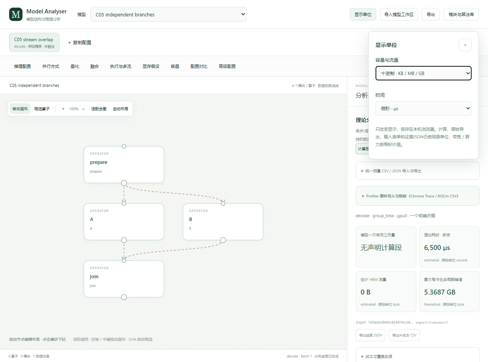
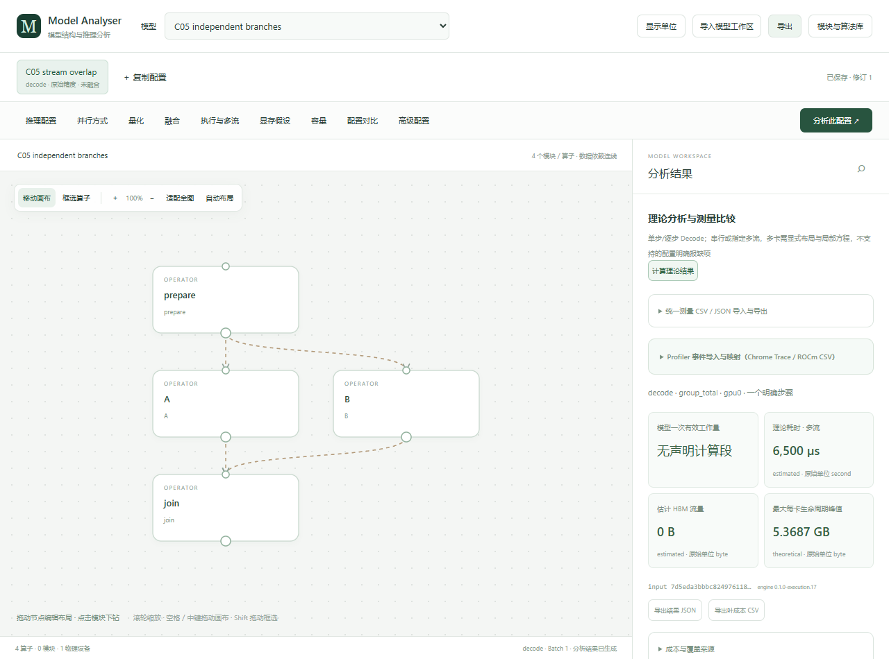

# 显示单位

模型画布右上角的“显示单位”可选择容量／流量和时间的显示方式。设置立即作用于当前结果，不需要重新计算，保存在当前浏览器；同一来源的其他标签页会同步设置。兼容维护页也提供相同入口。

| 选择 | 口径 | 示例 |
| --- | --- | --- |
| 二进制 | 每级1024，B／KiB／MiB／GiB／TiB等 | 4096 byte → 4 KiB |
| 十进制 | 每级1000，B／KB／MB／GB／TB等 | 4096 byte → 4.096 KB |
| 原始byte | 数值按byte显示，标签B | 4096 byte → 4,096 B |
| 自动时间 | 根据绝对值显示s、ms或µs | 0.0065 second → 6.5 ms |
| 固定时间 | 秒s、毫秒ms或微秒µs | 0.0065 second → 6,500 µs |

设置覆盖分析卡片、串行／多流和decode时间线、显存峰值与预算、量化／融合结果、物理设备／通信、成本排序／来源、容量搜索与配置比较、Roofline时间和流量读数，以及测量／Trace映射预览。每个转换后的值自带单位。带宽仍按B/s、算力按op/s、Roofline强度按op/B标注，固定秒的输入框和原始证据保留原单位。

只读显示使用统一格式器，最多四位小数，极小非零值使用科学计数，不把缺项显示成0。已知0仍显示0，比较的负差保留符号。显示缩放溢出时明确“不可表示”并保留原始秒值，不能产生Infinity或错误的有限数。

选择不会写入模型工作区、配置或资产，不进入Worker请求／输入指纹，不改变排序、容量判定、时间线位置和计算结果；显示舍入也不改变方案相等或交叉点的判定。项目、结果、CSV以及原始JSON证据继续使用契约的byte／second；成本来源在转换读数下另外展示原始数值和单位。输入表单的单位始终以各自标签为准，不随显示偏好转换。

浏览器缓存格式损坏或不可读时恢复二进制／自动时间。存储被禁止时仍可在本次页面会话切换，刷新后恢复默认。关闭按钮和Escape可收起设置并把焦点还给入口。

## 验证

`npm run reference:display`核对九个独立预期及C05固定参考：多流0.0065 second、每卡峰值5,368,709,120 byte。分别显示5 GiB／5.3687 GB／5,368,709,120 B，原项目、结果和inputHash保持一致；参考证据为[reference.json](../examples/display-units/reference.json)。这是作者声明的数学参考，不是硬件实测。

四个新增Chrome用例从画布验证分析／容量／同模型配置比较，逐字比较切换前后的原始JSON和CSV；检查没有新增保存POST、没有重新分析失效、图形坐标不变、偏好重开、损坏缓存回退与禁止存储降级。四项格式器测试覆盖单位边界、负差／零／未知、微小值／溢出和严格缓存格式。

组合入口为`npm run acceptance:display`，继承既有完整门禁。检查点46最终组合退出0：524单元／契约、4HTTP、122Chrome（16.2分钟）、架构／严格编译／Schema／构建和全部既有参考通过；首轮MoE旧秒值断言与其修正记录保留。执行状态与保留边界见[阶段清单](ACCEPTANCE_STATUS.md)与[实施记录](PROGRESS.md)。数学引擎保持0.1.0-execution.17，契约205根／87联合／223分支，没有增加工作区字段。
