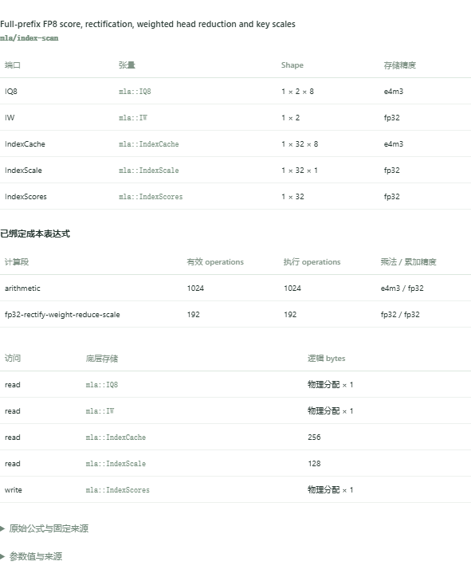
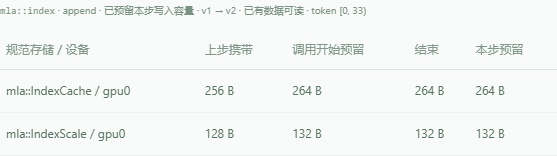
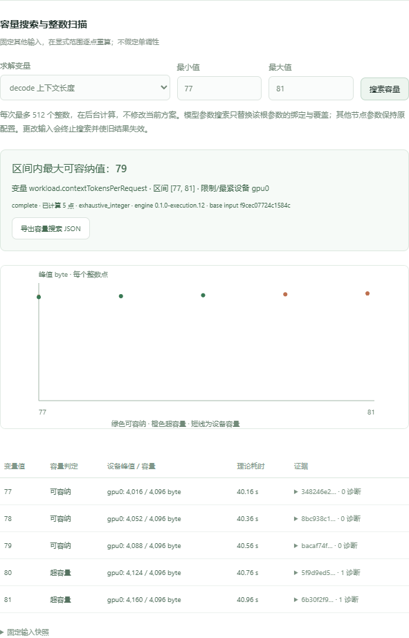
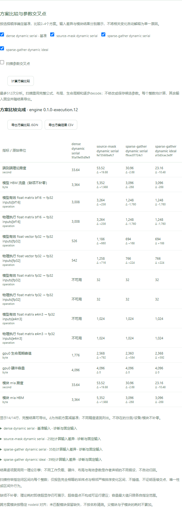

# DSA完整前缀indexer与显式稀疏路径

检查点32补齐固定来源DSA/indexer预设。范围是单层MLA的单query decode attention，包括query/cache/indexer/attention/输出投影；不含block输入norm/residual、FFN、embedding或完整语言模型。P5的KDA/递归混合和P6仍待完成，见[阶段清单](ACCEPTANCE_STATUS.md)。序列压缩、CSA2复用分别见[压缩研究](COMPRESSION_RESEARCH.md)与[CSA2研究](CSA2_REUSE_RESEARCH.md)，不能相互冒充。

## 固定来源与三条不同路径

现场读取[DeepSeek V3.2 Exp官方model.py](https://huggingface.co/deepseek-ai/DeepSeek-V3.2-Exp/blob/194c67e12b1b0d6df0ef373ddcf215bc84027409/inference/model.py)、[kernel.py](https://huggingface.co/deepseek-ai/DeepSeek-V3.2-Exp/blob/194c67e12b1b0d6df0ef373ddcf215bc84027409/inference/kernel.py)及同提交config，固定提交`194c67e12b1b0d6df0ef373ddcf215bc84027409`。四文件路径、SHA256、核对日期和事实/人工假设分别保存在[来源锁](../references/parallel/dsa-source-lock.json)。缓存原文件存在时参考脚本校验哈希；离线复算不要求下载源码、模型或权重。

源码的Indexer共享query低秩归一化结果，独立从x生成index key，经过LayerNorm、非交错RoPE、Hadamard和FP8量化。它扫描整个前缀，逐head执行FP8 dot、rectify、加权和head归约，乘key scale后写一份FP32 score，再选取`min(K,L)`个int64索引。scale即使按ue8m0规则取整，在demo缓存中仍占FP32的四字节。

源码MLA decode在Top-K mask前后仍执行完整前缀QK和AV。不能把它的einsum成本自动缩减到K。本研究分别提供：

| 固定profile | attention行为 | indexer与选择 | 解释边界 |
| --- | --- | --- | --- |
| source-mask | 完整L条latent/PE QK、稠密mask、完整L条AV | 全前缀扫描与Top-K | 对应公开demo的算术路径，临时量按下述作者分解 |
| sparse-gather | 显式gather选中KV/PE，按S=`min(K,L)`做QK/AV | 仍扫描全部L条 | 独立作者理论kernel路径，不声称demo已有这些稀疏kernel |
| dense | 完整L条QK/AV，无index mask | 无indexer | 不含indexer的dense反事实，输出语义不同，不是精度等价替代 |

source-mask为28个叶，sparse-gather为27个，dense为15个。Top-K在每次调用创建，最后读取后释放，不当作跨层或跨decode共享状态。本例不含window、sequence pooling或CSA2候选复用。

## 尺寸、精度和成本声明

人工默认B1、C31、Q1、H8，attention heads A2，query rank T4、latent rank R8、nonrotary D4、rotary P2、value V4；index heads I2、index dimension J8、量化block S8、K4。正式参数约束固定Q=1、T/R/D/P/V/J/block；可编辑B/C/H/A/I/K/M。只支持decode，不能把prefill套用这些方程。固定config本身使用128个attention heads、64个index heads、index dimension128、K2048及FP8 checkpoint矩阵；本例的小尺寸/block与普通BF16投影均为作者变体，不声称源码kernel形状兼容或完整671B型号支持。

query执行低秩投影→FP32-weight RMSNorm代理→head投影→split/RoPE→key权重吸收。cache执行独立latent/PE联合投影、latent norm与PE rotary、latent fake-FP8 round回BF16后append。attention分别计算latent与PE score，再add/scale，按profile进行mask或选中范围softmax/AV，最后value展开和输出投影。

普通projection和主attention采用BF16 multiply/FP32 accumulate。RMSNorm的weight、index LayerNorm的weight/bias以及index weights_proj保持FP32；后者显式BF16输入cast后使用FP32 matrix。index dot为E4M3 multiply/FP32 accumulate，不能按BF16峰值计费。BF16主score/probability跟随demo；norm、rotary、Hadamard和selection用明确FP32 vector代理，内部workspace声明在片上。main latent和index Q/K的量化、输入cast只增加执行算术，不增加模型有用算术。

图内中间量是作者明确的物化分解；cache-write的fake-FP8 roundtrip作为片上内部处理代理，不复刻Python中量化payload/scale与反量化临时分配。字节和峰值结论针对这些声明的存储/访问，不是demo的allocator峰值；源码算术路径对应关系也不等于逐指令或逐临时张量复现。

FP8 index kernel的每head临时logit保持片上，单叶含两个正式计算段：`2BLIJ`的FP8 matrix，以及`3BLI`的FP32 vector（rectify/weight、head reduce、key-scale）。只物化BL份FP32输出；未虚构BLI份HBM中间量。query scale已在head权重阶段乘入，scan读最终权重，不重复读取scale。Top-K选择成本是作者明确的`BL*(min(K,L)+2)`代理，不是精确CUDA复杂度或真实排序实现。单卡片段省略源码debug clone/broadcast/equality检查，不将其误报为多卡通信支持。

人工设备容量4096 B，BF16 matrix1000、FP8 matrix2000、FP32 matrix500、FP32 vector1000 operations/s，HBM100 B/s。多计算段按既有核心分别求时再相加，不能混合精度/峰值分母；HBM与计算按声明取max。所有默认叶受HBM限制。serial、ideal main/index双流、shared_bandwidth均沿原统一引擎，理想流仍遵守QR→index query、cache→attention、Top-K→mask/gather的数据依赖。

## 三个逻辑状态、四份缓存

L=C+1为有效行数；dynamic在调用开始预留调用后L行。provisioned预留M行（默认128），正式形状约束拒绝L>M。两者的batch容量仍按本次B，不能与源码max_batch_size和max_seq_len的完整预分配直接等同。

| 状态/底层存储 | 默认每行 B | 更新与读取 |
| --- | ---: | --- |
| kv / KVCache | 2R=16 | BF16 normalized/fake-FP8-rounded latent，append；source/dense由QK和AV读，sparse由gather读 |
| pe / PECache | 2P=4 | 独立BF16 rotary key，append；QK或gather读取 |
| index / IndexCache | J=8 | FP8 index key payload，append；完整前缀index scan |
| index / IndexScale | 4ceil(J/block)=4 | 独立FP32 scale，和payload同一逻辑index状态、独立storage |

总状态为`B*reservedRows*(20+12)` B，dense为`20B*reservedRows` B。默认DSA为1024 B，dense为640 B。IndexScale单独128 B，不是32 B。主cache在demo里是BF16；没有把fake-FP8 rounding当作常驻FP8内存节省。

主query、cache、key/value展开的BF16权重及FP32 norm参数共752 B；indexer新增384 B，总1136 B。wkv_b的key/value切片分别作为不相交BF16存储，总字节等于原合并矩阵，不复制整个权重，不另外常驻dequantized权重。运行时checkpoint解量化未包含在该BF16权重变体中。

Top-K为8BS B的int64 activation；完整index score为4BL B。source-mask另有4BL B的FP32 mask、BF16 latent/PE/combined scores；mask加法在combined backing内原位执行。sparse-gather分配两份共享跨head的BF16 selected-KV/PE，默认64/16 B，并显式读索引、读原cache、写staging。它减少attention访问范围，同时保留全部持久缓存和完整index scan。

## 独立账本与结果

[项目生成器](../scripts/dsa-project.ts)只输出普通模块/公式/StateSpec。[独立账本](../scripts/dsa-oracle.ts)不导入core、生成器或公式解析器，独立列出byte/operation与数据DAG，求serial/ideal时刻及出生/最后读取峰值。共享HBM在声明的memory-bound测试域用独立连续流量服务求解，重新计算实际峰值；不把ideal内存当作普遍相等。超出该独立流量账本假设的计算受限输入仍由通用引擎分析，不据此伪造oracle覆盖。[参考脚本](../scripts/dsa-reference.ts)对比统一analyzeScenario与searchCapacity，并校验正式结果。

| 项目 | 秒 | HBM B | 权重 B | 状态 B | 激活 B | 峰值 B |
| --- | ---: | ---: | ---: | ---: | ---: | ---: |
| source-mask serial | 53.52 | 5352 | 1136 | 1024 | 408 | 2568 |
| source-mask ideal | 37.48 | 5352 | 1136 | 1024 | 512 | 2672 |
| source-mask HBM共享 | 53.52 | 5352 | 1136 | 1024 | 512 | 2672 |
| sparse-gather serial | 30.96 | 3096 | 1136 | 1024 | 200 | 2360 |
| sparse-gather ideal | 23.16 | 3096 | 1136 | 1024 | 208 | 2368 |
| sparse-gather HBM共享 | 30.96 | 3096 | 1136 | 1024 | 208 | 2368 |
| dense无indexer serial | 33.64 | 3364 | 752 | 640 | 384 | 1776 |
| source-mask provisioned M128 | 53.52 | 5352 | 1136 | 4096 | 408 | 5640 |

全部是人工条件的理论值，不是实测DSA加速。provisioned超出4096 B，仍保留已知成本，但不作为可运行建议。重叠增加source-mask的104 B活跃临时量，或sparse的8 B；带宽共享消除本例理想时间收益，不能据此推断SM/cache等未声明争用。

默认source-mask的BF16 matrix3264，sparse为1248，dense为3008；前两者都有FP8 matrix1024、FP32 matrix32。source的vector有用1186/执行1258，sparse为694/766，均有72个执行专属转换。dense为526/542。FP8 scan单叶读query16 B、最终权重8 B、key payload256 B、key scales128 B，写score128 B，共536 B，并含FP32 vector192 operations。sparse gather另外读取32 B索引、80 B缓存并写80 B staging，共192 B。不存在免费格式转换或自动按K/L削减全部成本。

## 跨步和容量证据

[三调用项目](../examples/dsa/sparse-sequence-project.json)从C31开始，每步重做一个Top-K并写一行主/PE/index缓存：

| 调用前C | 完整prefix行 | index payload/scale预留 B | 秒 | 峰值 B |
| --- | ---: | --- | ---: | ---: |
| 31 | 32 | 256 / 128 | 30.96 | 2360 |
| 32 | 33 | 264 / 132 | 31.16 | 2396 |
| 33 | 34 | 272 / 136 | 31.36 | 2432 |

三步93.48 s、HBM9348 B、最坏2432 B。每步新index写8+4=12 B，主latent/PE写16+4=20 B；不能把预留全部cache当作每步写流量。三个逻辑状态v0→v1→v2→v3，index含两个storage；Top-K不在状态表。初始化warm history是明确输入假设，迁移/allocator slack未隐式推断。

4096 B设备、默认B/H/heads/K下逐整数检查：

| profile | 检查区间 | 区间内最大C | 最大点峰值 B |
| --- | --- | ---: | ---: |
| source-mask serial | 63..67 | 65 | 4064 |
| sparse-gather serial | 77..81 | 79 | 4088 |
| dense serial | 101..105 | 103 | 4080 |

每点hash、诊断和原始结果保存于[源码扫描](../examples/dsa/source-mask-context-capacity.json)、[稀疏扫描](../examples/dsa/sparse-gather-context-capacity.json)、[dense扫描](../examples/dsa/dense-context-capacity.json)。本例稀疏路径比source-mask容纳更多上下文，但indexer本身使其容量小于无indexer的dense反事实；没有输出/精度等价或区间外最大值声明。

## 复算与工作台

```powershell
npm run reference:dsa
npm run reference:research
npm run acceptance:p4
```

第一条生成八份项目/完整结果、三份容量、三调用项目/结果及[独立摘要](../examples/dsa/reference.json)。第二条在原Ulysses/MoE/CSA2/压缩组件后追加DSA共同复算。内置库新增四模型、四模块、48公式和人工硬件，共57份资产；source/dense/sparse/provisioned有独立身份，公共公式和硬件在策略变化时内容相同。所有项目导出固定快照，可在空库重开纯core复算。没有core或Schema变更，引擎仍为0.1.0-execution.12。

导入[source项目](../examples/dsa/source-mask-project.json)，展开结构并选择`mla/index-scan`，检查32行payload/scale以及两个计算段；计算后核对完整QK。导入[sparse项目](../examples/dsa/sparse-project.json)可查看gather和选中范围；三调用项目可在步骤1查看264/132 B双存储。将容量变量设为decode上下文并扫描77..81，结果79；比较dense、source、sparse与sparse ideal可分别查看新增indexer、稀疏访问和重叠的代价。

八项[研究单元](../tests/dsa.test.ts)覆盖固定来源、独立DAG/精度/流量/峰值、源码与理论路径区别、动态B/C/H/heads/K、跨步状态、预留/争用、容量及非法输入/缺精度能力/空库重开。三项[Chrome用例](../tests/e2e/dsa.spec.ts)覆盖结构与full-prefix成本、双cache状态、容量导出、四方案比较和项目纯core重开。

最终完整acceptance:p4退出0（checkpoint32-acceptance-final.log）：375项单元/契约、3项HTTP、70项Chrome、架构/严格编译、Schema/结构正反、既有独立参考和生产构建全部通过。大库同时扫描的测试worker限制为4，36组动态分析用例设置30秒时限；数值/持久化断言未放宽。主包大于500kB的Vite提示仍在，构建成功。截图已人工检查：

随后五套研究`reference:research`共同复算通过（checkpoint32-research.log），来源锁与逐项独立算术断言全部执行。








