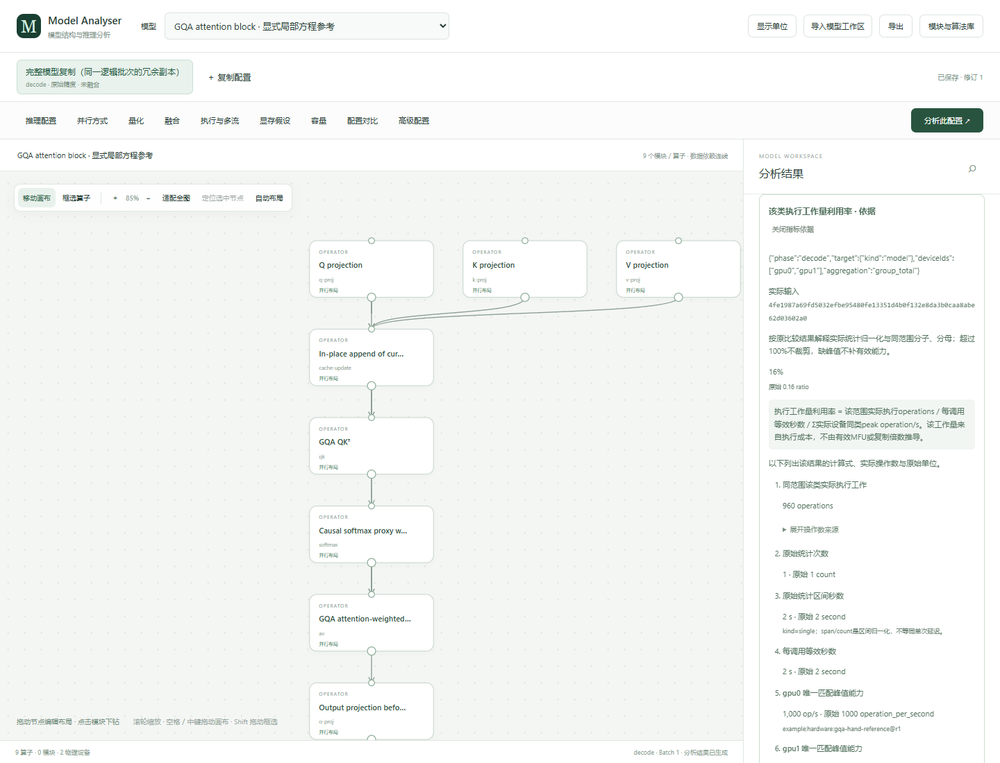
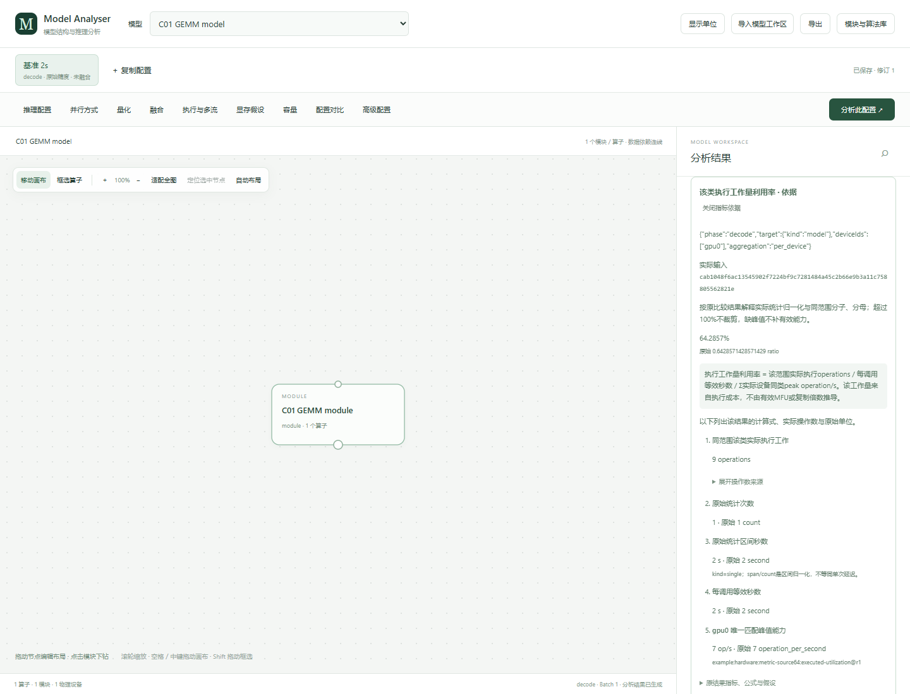
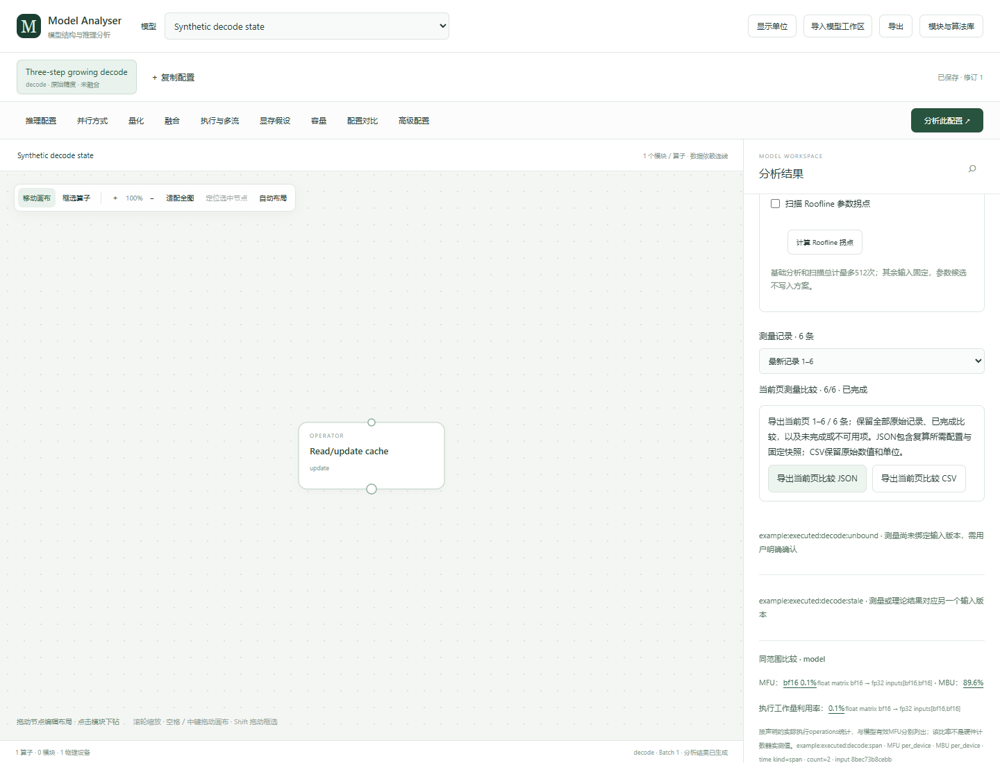

# 在模型画布比较有效工作与执行工作

检查点57为原PRD177补充独立的执行工作量利用率，并为测量比较提供当前页JSON／CSV导出。入口仍在当前模型画布的分析侧栏，同模型不同配置分别计算和保存。本文签收范围以[验收记录](ACCEPTANCE_STATUS.md)的实际终端结果为准，不代表全项目完成。

## 从当前画布操作

1. 选择模型和配置，点击“分析此配置”。在已有测量列表查看比较，或打开“统一测量 CSV / JSON 导入与导出”，选择文件后点击“预览测量匹配与指标”。
2. 每个完整计算分类分别显示模型有效MFU与执行工作量利用率。点击执行比率，查看同范围实际执行operations、原统计方式／次数、每调用等效秒数、逐物理设备的唯一匹配峰值及固定硬件修订。
3. 预览可查看相同依据；只有明确点击“加入项目”才会保存文件中的记录。重新分析、改变输入或当前配置后，旧比较／来源失效。
4. 已保存测量的比较列表提供“导出当前页比较 JSON”和“导出当前页比较 CSV”。每页最多20条，页范围和全部记录数明确显示。

图片来自隔离验收工作区中的人工GQA两卡参考，不是原Qwen工作区或实测benchmark。逻辑有效工作480 operations、物理执行960 operations、每次2秒，两卡峰值1000＋2000 operation/s，分别得到0.08与0.16。分母只统计真实设备一次，不因设备组别名重复计卡。

## 两种利用率的口径

模型有效MFU沿原逻辑有效工作计算；执行工作量利用率使用真实目标成本中的executedOperations。两者分别除以归一化后的每调用时间及同一组物理设备的匹配peak能力。不能用复制倍数推导执行成本，也不能将额外执行工作重新命名为有效工作。

完整ComputeClass包含算术类型、输入／乘法／累加精度、资源种类及可选资源键。各分类独立匹配；整数、向量和矩阵能力不相加。设备上的effective能力不能替代缺失peak。同一类别多条匹配能力保持不可用，不能挑第一条。

执行工作量利用率是声明执行成本与录入时间／硬件峰值的比较，不是GPU硬件计数器。缺失成本、峰值或合法范围明确不可用；真实零分子可以为零，正数上下溢不能补零。超过100%保留原始值，并在对应分类旁提示检查口径和能力配置。

single／mean／sum／span保持原统计定义。每调用等效时间不自动等于单次延迟；interval_total的实测HBM bytes先按count归一化。原MFU／MBU及诊断保持原算法；执行项只增加自己的指标和诊断，不覆盖旧指标。

## 实际Decode、模块与融合

目标、阶段、设备集合和inputHash必须匹配真实成本。Decode记录绑定实际调用hash及该调用的参数；序列根hash仍作为报告基线保留。不能用序列汇总、另一步或其他设备补填。完整融合目标按融合成本计一次，不能独立测量的内部成员继续不可用。

独立参考第三次调用C=4，实际useful／executed均为5 operations，2秒、1000 operation/s时得到0.0025。融合参考为5有效／6执行operations，显式额外工作只进入执行分子。混合参考另有向量2／3及整数7／9，与矩阵1024／1024分别保留。

## 当前页比较导出

JSON的公共格式是`measurement-comparison-report.1`，包含固定Scenario和资产快照、分析引擎版本、根inputHash、页范围、完成状态，以及本页每条原测量和已有比较。已完成、不可用和未完成条目全部保留；取消时可导出已有部分，未完成不会冒充成功或零值。

CSV保留原始ratio数值、完整分类和MetricScope、测量／实际比较／根输入身份、measurementHash、原时间记录、次数、归一化时间、实测bytes口径和诊断。`model_useful_mfu`与`executed_work_utilization`分行，MBU名称区分估算／实测；待计算和不可用也有专门行。CSV中的0.16就是ratio 0.16，不是显示百分数16。包含逗号、引号或换行的文本按CSV转义。

导出是点击时的当前页快照。导出期间翻页、切换输入／配置或卸载分析面板会阻止旧文件下载；后台继续完成同一页时，已经点击的部分快照保留其明确完成状态。导出不修改项目、测量或计算inputHash。它与原测量文件导出、完整分析JSON及执行成本CSV分别保留各自内容。

旧比较缺少可选执行字段时明确提示重新比较，不凭现有有效MFU补造。新字段自带`executed-utilization.1`版本；新增报告自带独立版本。分析数学、inputHash及原MFU／MBU算法未改变，分析引擎仍为`0.1.0-execution.18`。旧四种统计比较的所有原字段与冻结检查点56基线逐字段核对。

## 可移植参考与验证

运行`npm run reference:executed-utilization`，从磁盘重读[五份项目、比较报告及独立账本](../examples/executed-utilization/hand-ledger.json)，重新计算单卡、复制、混合类别、实际Decode和融合。每份项目包含四种有效时间统计及两条不可匹配记录；报告可凭固定快照离线复算。`legacy-comparisons.json`是经检查点56SHA核对后保留的回归基线，属于合成参考，不是外部实测数据。

专项14项领域／契约测试、验收执行器新增1项组合展开测试和6项主画布Chrome已通过；相关53单元及29Chrome也通过。公共Schema结构清单为208根／88联合／225分支。完整`npm run acceptance:executed-utilization`将原组合展开为55个叶命令，保留原54项的顺序、重复、参数及失败退出，并增加本轮参考。

最终完整门禁已观察受管理会话40226退出0：655单元／契约（73文件，44.67s）、7HTTP（6文件，2.79s）、186Chrome（28.9分钟）、45运行组、架构／严格编译／生成Schema与结构正反样例／生产构建及全部组合参考通过，另五基础参考通过。原生IAB在原Qwen工作区仅预览人工记录，核对执行分子与峰值后返回原画布；正式项目未加入该记录。最终摘要、原项目及文档核验见[验收记录](ACCEPTANCE_STATUS.md)和`checkpoint57-result.json`。

更细表达式依赖、公式预算专用实参、贡献明细等其他指标入口、同步结构编辑、错误普通项目修复及原文最终审计继续列在[剩余项](REMAINING_PRD.md)。
