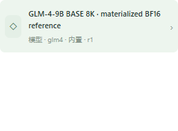
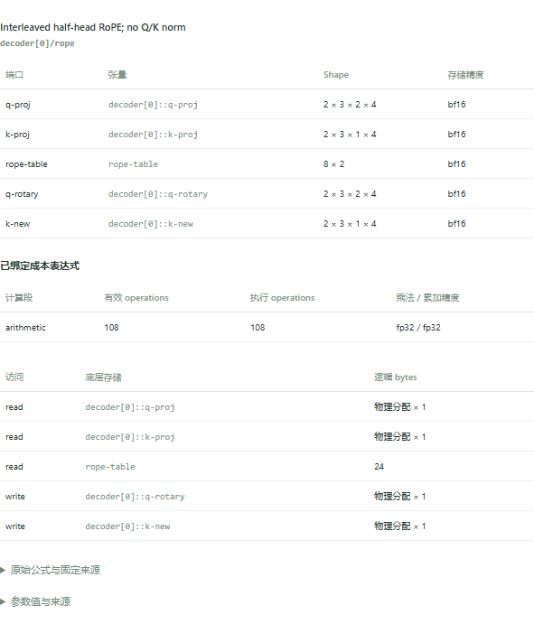

# 具体型号扩充：GLM-4-9B BASE 8K 与 Qwen3-1.7B

检查点37，来源核对日期2026-11-15。新增两份可编辑模型资产，使用现有通用图、模块、repeat、状态和公式契约；core不增加品牌分支。这里签收具体型号及明确的数学执行范围，P6其他预设和[原PRD剩余项](REMAINING_PRD.md)继续保留。

| 资产 | 固定配置 | 覆盖范围 |
| --- | --- | --- |
| `builtin:model:qwen3-1.7b@1` | H2048/I6144、28层、NH16/NK8/D128、V151936、M40960 | Dense/GQA、Q/K RMSNorm、全头RoPE、BF16、共享embedding/head；复用原Qwen3-0.6B的decoder和公式固定修订及物化attention假设 |
| `builtin:model:glm-4-9b@1` | H4096/I13696、40层、NH32/NK2/D128、V151552、M8192 | **BASE 8K**；有QKV bias、没有Q/K norm、交错配对的半头RoPE、独立embedding/head；下述显式物化数学执行 |

GLM不代表chat/128K版本或任意chatglm模型。`model_type=chatglm`只推荐有声明的结构模板，导入仍需核对全部结构约束及假设，不能凭类型名称完成适配。

## 固定来源与复现

- [GLM配置、代码与索引提交8cd2b585](https://huggingface.co/THUDM/glm-4-9b/tree/8cd2b585357ba9e702647ac4e6fa4fafe5cc7bee)。本地包含config、configuration/modeling源码、索引、README和模型LICENSE；代码另附[官方仓库固定提交024d8fd4的Apache-2.0 LICENSE](https://github.com/zai-org/GLM-4/blob/024d8fd48e62cf53785b68d657f1e018f87b5674/LICENSE)。模型参数与代码的许可分别保留，不分发权重。
- [Qwen3-1.7B配置与索引提交70d244cc](https://huggingface.co/Qwen/Qwen3-1.7B/tree/70d244cc86ccca08cf5af4e1e306ecf908b1ad5e)，附Apache-2.0 LICENSE。结构继续使用原[Transformers固定实现0720e206](https://github.com/huggingface/transformers/blob/0720e206c6ba28887e4d60ef60a6a089f6c1cc76/src/transformers/models/qwen3/modeling_qwen3.py)，不复制一套仅参数不同的模块。
- 十一份文件的URL、长度和SHA256见[扩充来源锁](../references/models/expansion-source-lock.json)。GLM第一分片仅读取8字节长度和随后2008字节JSON头，核对`inv_freq`的BF16 `[32]`与QKV权重`[4608,4096]`；不读取张量payload，不执行Python。
- `npm run reference:expanded-models`先核对离线源SHA/配置/代码事实及独立参数清单，再发布新资产和六份项目，最后与[独立摘要](../examples/expanded-models/reference.json)中的工作量、HBM、串行峰值及时间核对；日常操作不需要网络。可选在线刷新脚本为`scripts/fetch-model-expansion.ps1`，检查固定hash、Range状态和Content-Range，读取有字节上限；不改写锁文件。

本次新增28个head（两个model、一个module、25个formula），复用22个既有Qwen模块/公式引用；内置累计449个head、452份JSON（含原三个历史根修订）。发布脚本遇到同ID/修订不同内容会拒绝写入。原Qwen/DeepSeek模型及模块/公式修订保留，旧项目不自动切换模型。

复用公式保留原修订的来源及原Qwen参考背景说明；其数学表达式与参数接口必须完全一致。原Qwen背景中的“未计RoPE表构造”等范围说明只指原始参考，不能据此删去GLM图中显式的表构造、mask或KV扩展节点；当前型号的执行范围以具体根模型和实际声明图为准。

## 参数与状态账本

| 项目 | Qwen3-1.7B | GLM-4-9B BASE |
| --- | ---: | ---: |
| 唯一可训练参数 | 1,720,574,976 | 9,399,951,360 |
| BF16权重常驻bytes | 3,441,149,952 | 18,799,902,720 |
| 索引中的序列化bytes | 4,063,479,808 | 18,799,902,784 |
| 非参数旋转频率常驻bytes | 未计入本Qwen执行图 | 64，单独归入reserve |
| 每请求、每缓存token的state bytes | 114,688 | 40,960 |

Qwen每层50,336,000个参数，合计`28 × 50,336,000 + 151936 × 2048 + 2048`。检查点同时存储embedding和lm_head，运行时按固定config的tying去掉622,329,856重复bytes。

GLM每层参数为`H×D×(NH+2NK) + D×(NH+2NK) + NH×D×H + 3HI + 2H = 203,960,832`，包括QKV bias。总计`40 × 203,960,832 + 2 × 151552 × 4096 + 4096`。索引多出的64bytes是非参数BF16 inv_freq，不补到可训练参数，也不按每层重复。状态为`4×B×L×(C+Q)×NK×D`，query heads的扩展副本属于activation。

## GLM的显式执行假设

所选代码配置为SDPA；`SdpaAttention`覆盖eager forward，因此本图使用SDPA默认`1/sqrt(D)`数学缩放，不套用eager分支的逐层缩放。这是可编辑的**数学/物化执行参考，不是实际SDPA内核或Python分配器复现**：

- QKV采用同一带偏置矩阵的工作/权重清单，但作者把Q/K/V输出显式建成三个缓冲，不模拟源融合输出split视图的底层存活关系。
- RoPE旋转D/2个维度，余下维度直通；D须被4整除，NH须被NK整除。根图生成完整M位置的FP32表并转BF16，表和uint8因果mask由全部层共享一次，不重复分配。频率/外积/三角函数、norm、softmax、SiLU的vector计数均为明示代理，arange及真实算子细节没有推断成实际指令数。
- 每层预分配NK组头K/V状态，仅写入本次Q位置；不模拟源Python warm-cache的`cat`及cold-cache的跨层pack双份/旧新分配。读出后显式扩展到NH头activation，再进行attention。
- 物化BF16矩形scores、FP32缩放scores/概率、BF16概率、输出；真实SDPA后端可以融合这些对象。mask在本图显式分配，不声称源SDPA在Q=1或无padding时也分配它。矩阵乘加按两次操作，矩阵与FP32 vector类别分开。
- useful因果token对为`C×Q + Q×(Q+1)/2`；executed attention仍为矩形`Q×(C+Q)`。转换与mask构造的非数学辅助工作可以有零useful、非零executed。
- 每个声明缓冲读写的HBM factor=1；embedding只计选中行读取，输出head读取全部权重。RoPE应用只读本次BQ位置的表；实际缓存命中、分配器、线程/网络、训练和dropout未建模。
- `LAST=0`输出全部Q位置logits（源forward默认）；`LAST=1`输出最后一个位置（源generation设置）。它只改变head工作、访问与logits，不缩减前面层的Q。config不自动决定LAST。
- Decode逐步携带每层真实状态，step_end容量已经包含本步query；两步C=2/Q=1的40层状态为122,880/163,840 bytes，不能把每步常驻容量相加。

## 独立计算与页面操作

`scripts/glm-oracle.ts`不导入图生成器、core或公式解析器，直接建立标量缓冲/工作账本，按生产者消费者推导稳定FIFO拓扑顺序并扫描生存期。独立的表/mask构造会与首层工作交错，不能假定根节点全执行完后才开始各层。时间为每叶`max(matrix时间 + vector时间, HBM时间)`之和，使用虚构1 TOP/s与1 TB/s硬件，不是实卡性能预测。

小尺寸H4/I6/D4/NH2/NK1/V10/M8/L2，B2/Q3/C1：

| 指标 | LAST=0 | LAST=1 |
| --- | ---: | ---: |
| 参数 / weight bytes / state bytes / reserve bytes | 468 / 936 / 256 / 2 | 468 / 936 / 256 / 2 |
| matrix useful / executed operations | 5,664 / 6,048 | 5,344 / 5,728 |
| vector useful / executed operations | 2,067 / 2,467 | 2,067 / 2,467 |
| HBM bytes | 9,392 | 9,280 |
| 生命周期峰值bytes | 1,810 | 1,810 |

峰值都出现在第一层mask-softmax，故缩减logits不会必然降低峰值。完整GLM B1/Q1/C2的理论峰值为18,803,212,480bytes，完整prefill B2/Q3/C1为18,803,474,520bytes；M8192的共享RoPE构造会影响峰值，不能只加权重与KV。

1. 资产库的家族筛选选择`glm4`或`qwen3`；具体型号可创建用户副本并修改图/参数/公式，保留原内置修订。
2. 在项目中新建方案，选择具体模型和具备所需BF16 matrix、FP32 vector能力的硬件。B/Q/C默认绑定工作负载，点击展开结构或计算；两型号分别为686/395个叶节点、40/28个KV状态。
3. 可直接导入[GLM decode](../examples/expanded-models/glm-4-9b-decode.json)、[GLM prefill](../examples/expanded-models/glm-4-9b-prefill.json)、[Qwen decode](../examples/expanded-models/qwen3-1.7b-decode.json)、[Qwen prefill](../examples/expanded-models/qwen3-1.7b-prefill.json)。这些项目自带虚构硬件和完整固定快照。
4. [小尺寸full](../examples/expanded-models/glm-4-small-full.json)和[last](../examples/expanded-models/glm-4-small-last.json)用于复算。高级项目JSON可修改scenario的`numericOverrides`中LAST（0/1），自动保存后重算、导出并重开；不会编辑库中模型。其他整数参数同理，非法维度、超过M或LAST>1均拒绝分析。

九项单元/领域回归覆盖离线来源、旧修订复用、两种输出策略独立账本、完整型号、组缓存/扩展激活、两步decode、非法几何/config审查，以及两型号在空资产库重启后的快照复算。Chrome覆盖资产家族筛选、新建实际型号、结构/计算及full→last修改和可移植重开；完整组合门禁记录见[当前验收状态](ACCEPTANCE_STATUS.md)。

完整模型暂维持单卡数学范围，未从型号名称自动推出TP/EP/PP或真实kernel/fusion。更多硬件/通信/量化预设、具名并行快捷入口与其他原PRD缺口仍需各自的产品交互和独立验证。
