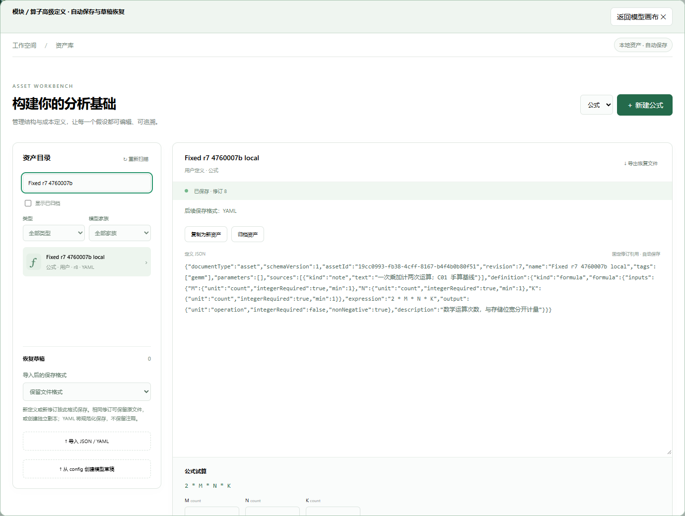
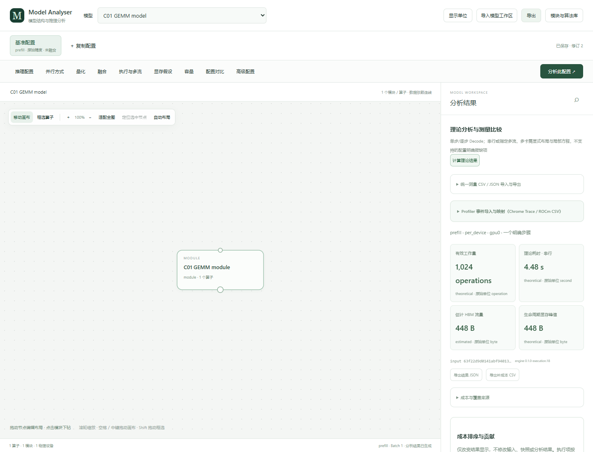

# 固定修订导入与历史引用

检查点49区分文件导入和普通编辑。画布仍是主工作区；入口为“模块与算法库”→“高级定义、导入与可恢复草稿”。导入独立资产文件时保留其ID、修订号及依赖引用，JSON／YAML遵守相同规则。[保存格式选择](YAML_STORAGE_FORMAT.md)只决定序列化。

## 实际行为

| 输入与本地状态 | 行为 |
| --- | --- |
| 新ID的r7文件 | 发布该ID的r7，不归一化成r1；依赖缺失则保留草稿，补齐后恢复提交 |
| 本地head=r1，导入尚不存在的r7 | 冲突界面明确说明保留文件修订；确认后head=r7 |
| 本地head=r7，补入尚不存在的r3 | 确认后发布历史r3，head仍r7；其后普通编辑从当前head继续为r8 |
| 同ID／修订的内容不同 | 原文件不改写；可明确创建本地下一修订或独立副本 |
| 同内容但格式不同，或重新打开固定历史 | 明确保留已有修订或创建独立副本；打开历史后继续编辑使用当前head作为基线 |
| 普通新定义／编辑 | 从r1或当前head+1提交，内容未变仍去重；首次导入成功后不再携带固定导入意图 |

独立副本使用新ID和本地r1，提交回执记录来源ID／修订。原库、已打开配置和项目快照不因导入新head而自动升级。内置ID仍须先创建用户副本；正式提交与预备文件恢复都检查这一规则，恢复拒绝后原预备文件和内置字节保留，新ID副本仍可恢复。

## 发布、回执与恢复

`AssetDraft.importIntent`是可选字段：`{source: AssetRef, mode: 'preserve' | 'next'}`。preserve必须与正文的ID、类型和修订一致；next表示明确创建本地下一修订或新ID副本。该元数据留在草稿／操作回执，不加入正式AssetDocument和数学inputHash。

新的head记录`publishedRevisions`，明确列出正式发布成员，且唯一、最大值等于head。例：r1跳到r7只发布`[1,7]`；目录中事先存在的r2不会隐式发布。补入历史r3得到`[1,3,7]`，不回退head。未发布文件仍出现在扫描诊断与显式恢复清单；一次恢复只发布所选成员，损坏head和重复权威文件仍隔离。

旧head没有成员列表时保持既有读取语义；第一次新发布把原head范围内已有修订冻结成显式列表，随后跳高不扩大旧文件的发布范围。旧JSON回执和普通草稿兼容；旧程序不能安全处理新列表时会严格拒绝未知字段，不能删掉列表后猜测发布状态。

提交先验证依赖、写不可变文件和固定回执，再原子发布head。回执固定保存格式、导入来源和当时的head基线；响应丢失／重启重放返回同一结果，不回退较新的head，不删除后来的草稿，不为请求重试增加版本。修改过的来源身份或head基线会被拒绝。

`CommitResponse.headRevision`可选，表示该次提交固定的后续编辑基线；`asset.revision`表示实际保存版本。历史r3/head r7在界面显示“已保存 · 修订3”，下次编辑以7检测冲突。旧响应没有该字段时沿用资产修订。重放旧回执不会悄悄把编辑器基线更新到后来出现的head。

## 可复算证据

`npm run reference:fixed-import`使用两个独立临时库，分别验证JSON／YAML的完整r7依赖、r3历史、r8本地修改、r2孤立隔离、服务对象重启及显式依赖升级。[账本](../examples/fixed-revision-import/reference.json)、[r7项目](../examples/fixed-revision-import/project-r7.json)、[升级项目](../examples/fixed-revision-import/project-upgraded.json)及对应结果可独立复算；临时库退出后清理，项目快照不是第二份独立定义。

C01独立算术：`2×4×8×16=1024` operations，`(4×16+16×8+4×8)×2=448` B。人工1000 op/s、100 B/s下为4.48 s；显式升级公式为`20×M×N×K`后为10240 operations、10.24 s。旧r7项目的inputHash和值保持不变，JSON／YAML基线相同。这是软件与理论算术验证，不是实卡测量。

13项新增领域／客户端测试、6项全部HTTP测试及5项新增Chrome已通过。浏览器完整流程先乱序导入模型／模块／算子，再补公式与硬件，恢复草稿后在画布选择模型、设置硬件、分析／导出并离线核对4.48 s／448 B和同一inputHash。首次用例只选取第一份公式造成缺依赖，修正为全部固定依赖后通过；没有放松引用校验。

完整`acceptance:fixed-import`第二轮退出0：563单元／契约、6HTTP、137Chrome（24.2分钟）及全部原有型号／预设／研究／文件参考通过。首轮在旧契约结构样例校验停下，重新生成后通过，日志保留。随后审计发现既有恢复路径遗漏内置ID检查，以新增单位／HTTP用例实际复现，再补同一只读守卫；全部564单元／契约和7HTTP、严格编译及原探针拒绝均通过。这次局部修复发生在完整组合结束后，其浏览器恢复专项结果另记[验收状态](ACCEPTANCE_STATUS.md)，不把先前完整组合称为已执行后续代码。

完整组合入口为`npm run acceptance:fixed-import`，包含YAML及全部原有门禁；最终状态见[验收记录](ACCEPTANCE_STATUS.md)。数值引擎仍0.1.0-execution.18。运行规模基线与原PRD最终逐条审计继续按[剩余项](REMAINING_PRD.md)推进。
