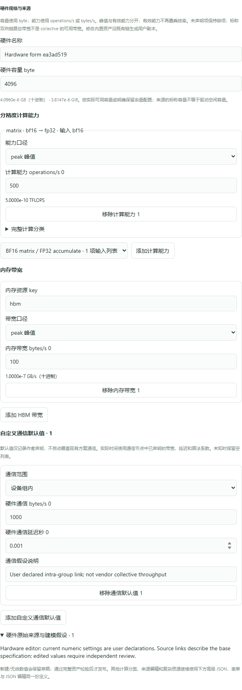

# 硬件预设、编辑与固定快照

检查点25（2026-11-14）补齐P4的首批官方来源硬件与表单操作。支持范围为两种明确的整卡SXM变体；检查点26已补充[方案差异与整数交叉点](SCENARIO_COMPARISON.md)，检查点27的[P4验收](P4_ACCEPTANCE.md)已逐项通过，P5/P6仍未完成。

## 来源与数值口径

| 预设 | BF16/FP16 dense矩阵，FP32累加 | FP32非Tensor峰值 | HBM带宽 | 容量建模值 |
| --- | --- | --- | --- | --- |
| NVIDIA A100 80GB SXM | 312 TFLOPS | 19.5 TFLOPS | 2039 GB/s | 80,000,000,000 byte |
| NVIDIA H100 80GB SXM | 989.4 TFLOPS | 66.9 TFLOPS | 3.35 TB/s | 80,000,000,000 byte |

A100使用[官方datasheet](https://images.nvidia.com/data-center/a100/a100-datasheet.pdf)第1页SXM列。H100计算能力使用[Hopper白皮书v1.04](https://resources.nvidia.com/en-us-hopper-architecture)表3第39页明确列出的dense值与FP32累加方式；内存使用[H100 Sep24 datasheet](https://resources.nvidia.com/en-us-gpu/h100-datasheet-24306)第2页SXM列。各文档对应PDF、版本、页码、SHA256和仅含必要数值的事实清单固定在 `references/hardware/source-lock.json`。已逐页渲染检查列与脚注，未使用搜索摘要或第三方规格表作为录入依据。

H100 SXM r2 增加 FP8 E4M3FN 矩阵、FP32 累加分类，稠密峰值为 **1,978.9 TFLOPS**。r1 项目可继续按已保存快照复算，并可在「设备」切换到新版。 [Hopper 白皮书表 3](https://resources.nvidia.com/en-us-hopper-architecture)

容量是把标称80GB按十进制SI换算的**建模假设**，不是驱动报告的可分配或空闲容量。HBM的GB/s、TB/s也按十进制换算。实际项目应按明确可用容量、运行时保留和效率重新配置。整卡预设不自动表达MIG、降频、温度或功耗限制。

本预设使用对应 SXM 整卡的稠密峰值。FP32 非 Tensor 值作为通用向量计算的上界代理。计算分类需要匹配设备声明的能力，缺少相应算力时理论耗时保留缺项。

BF16与FP16各自提供 `inputDtypes=[dtype]` 和 `[dtype,dtype]` 两种明确的同精度分类，分别匹配现有模型与C01的记录方式；峰值相同，不按输入个数翻倍。其他混合类型或不同累加方式仍须作者声明，分类不匹配时保留缺项。

communicationDefaults保持空列表。NVLink标称双向总带宽不直接等于collective有效bytes/s，资料也未给出本分析场景的启动延迟；不填伪精确参数。现有通信节点继续使用其明确保存的带宽、延迟与算法系数。

## 新建与编辑

在资产库选择“硬件”并新建，或打开内置硬件预设。表单可编辑名称、byte容量、精确分类的operations/s、HBM bytes/s、peak/effective口径及组内/组间自定义通信默认值。常见BF16/FP16 matrix与FP32 vector可直接添加；完整计算分类、其他通路和来源仍可在高级JSON编辑。

输入列表、乘法精度、累加精度和资源类别参与完整分类匹配。只声明一种生效口径；同一计算分类、内存key或通信scope重复时不允许发布。effective能力已经包含折减，不能再叠乘效率；没有真正peak时MFU/MBU不会以effective冒充峰值。若要保留峰值作为利用率分母，可使用峰值硬件与已有节点效率覆盖来研究耗时。

新增行的未知数值为空，保留草稿，不填0。空/零/负速率等无效输入沿原自动保存链持久化为草稿；正式修订保留最近有效版本。重开可从“恢复草稿”按资产ID继续。硬件参数修改会附一条用户声明说明，原来源仍表示基础规格，需要核对当前编辑值。

编辑内置资产会创建用户副本。可展开“硬件原始来源与建模假设”检查链接、核对日期、页码、哈希、标称容量及代理能力假设。来源不是对用户修改后的数值的自动认证。

## 应用到项目

新方案可直接选择库中的硬件。已有方案在“并行预设与物理设备”中，为具体deviceId选择项目快照或库中固定修订；同名用户副本与内置条目有来源和ID提示。读取成功后固定所需依赖并只更新该设备，设备身份、组成员、其他方案与通信数值不改变。

读取期间切换项目/方案或编辑内容，晚到快照不会覆盖新内容。项目引用固定的硬件修订；以后编辑库硬件或其副本不会自动改变旧项目，须明确重新选择。项目完整导出包含硬件快照，空库也能复算。

## 独立复算与门禁

`npm run reference:hardware` 离线生成两份内置硬件及 `examples/hardware` 的C01可移植项目、结果、人工测量比较和摘要；原PDF缓存存在时先检查锁定的SHA256，缓存不在仓库中，不要求测试时联网。这个命令不下载或自动采用更新后的厂商数字。

C01仍为1024 operations、448 byte生命周期峰值；零额外启动开销的HBM理论下界分别为 `448/(2039e9)` 与 `448/(3.35e12)` 秒。人工录入1微秒时，MFU按 `1024/(peak*1e-6)` 核对；这不是GPU实测。独立GQA单卡参考也以848 byte流量核对两种硬件，并验证单项精度输入分类能匹配。缺失FP8分类仍保留工作量，耗时不可用。

证据为 `tests/hardware.test.ts` 与 `tests/e2e/hardware.spec.ts`：官方列/稀疏区别/单位/缓存哈希、两类输入约定、缺失能力、歧义拒绝；表单草稿恢复、内置副本与旧快照隔离、明确应用与重开、延迟读取保护。

最终验证：完整门禁310项单元、3项HTTP、47项Chrome通过；数值显示补测后311项单元、构建及3项硬件Chrome通过。完整记录见[检查点25](PROGRESS.md)。表单截图：

检查点47新增的MI300X OAM与人工两级通信硬件，具体来源／数值口径／独立算术和边界见[P6预设扩充](PRESET_EXPANSION.md)。本页首批A100／H100记录继续保留，不把人工链路或理论上界当作硬件测量。
