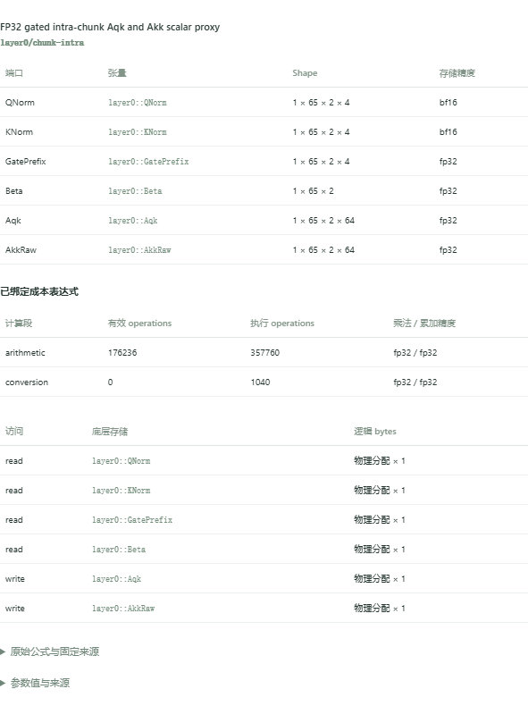
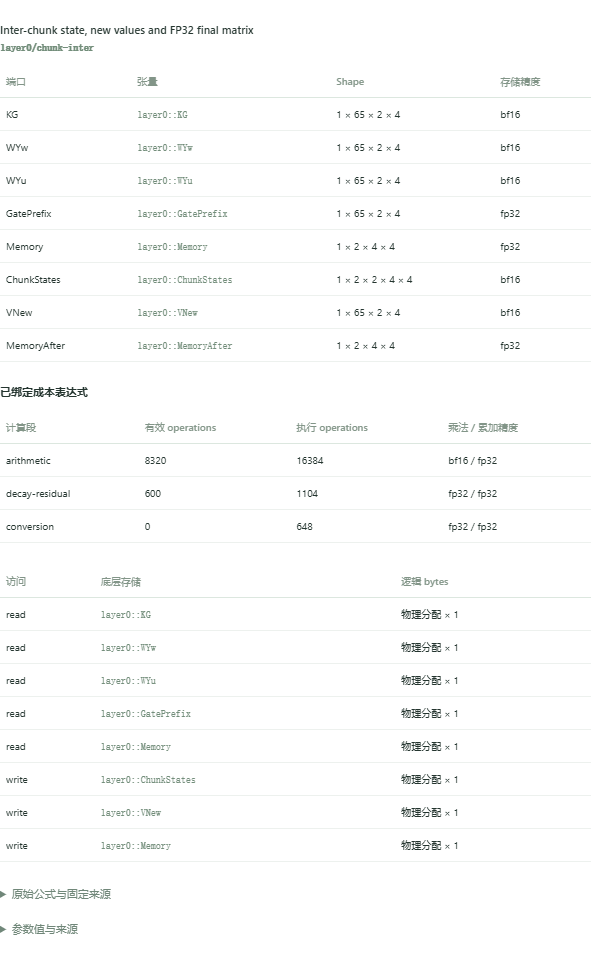
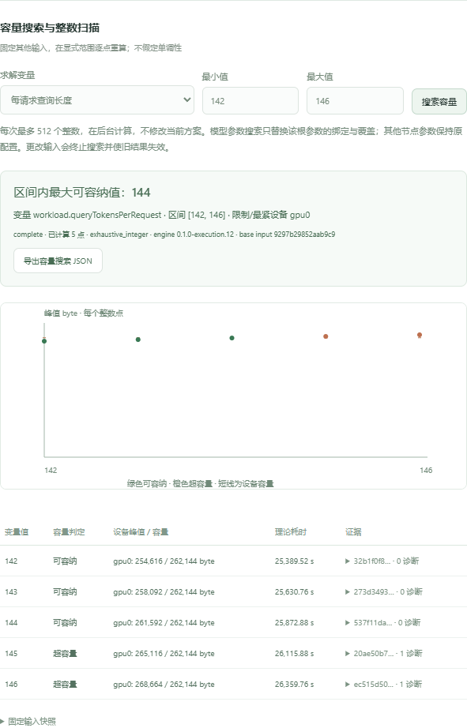
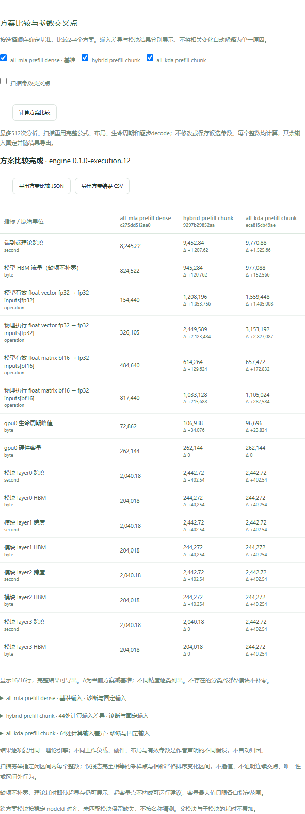

# KDA短prefill、64-token chunk与混合MLA

检查点34补齐原PRD F04要求的KDA prefill/decode不同公式。原[decode研究](KDA_RESEARCH.md)及固定资产保持原样；新预设使用独立身份，分别表达短prefill和chunk，并与expanded MLA组成首组三KDA/一MLA片段。P5逐项证据见[P5验收](P5_ACCEPTANCE.md)，P6不由本研究自动完成。

## 来源、阶段与边界

沿用[Kimi/FLA来源锁](../references/parallel/kda-source-lock.json)的8个文件，追加固定FLA v0.4.0提交`2e0f6c31f9db50f010cb157c712c048b8a3a89d2`的7个文件。路径、SHA256与假设保存在[prefill来源锁](../references/parallel/kda-prefill-source-lock.json)。重点读取[chunk编排](https://github.com/fla-org/flash-linear-attention/blob/2e0f6c31f9db50f010cb157c712c048b8a3a89d2/fla/ops/kda/chunk.py)、[intra/solve](https://github.com/fla-org/flash-linear-attention/blob/2e0f6c31f9db50f010cb157c712c048b8a3a89d2/fla/ops/kda/chunk_intra.py)、[WY](https://github.com/fla-org/flash-linear-attention/blob/2e0f6c31f9db50f010cb157c712c048b8a3a89d2/fla/ops/kda/wy_fast.py)、[inter-state](https://github.com/fla-org/flash-linear-attention/blob/2e0f6c31f9db50f010cb157c712c048b8a3a89d2/fla/ops/common/chunk_delta_h.py)及[输出](https://github.com/fla-org/flash-linear-attention/blob/2e0f6c31f9db50f010cb157c712c048b8a3a89d2/fla/ops/gla/chunk.py)。

源模型按本次query长度选择：Q≤64使用fused recurrent，Q>64使用chunk；chunk长度固定64。卷积只有Q1使用原位step，Q>1的forward会生成新的最终W槽缓存。新预设明确限制：

| 资产路线 | 正式约束 | 表达的算法 |
| --- | --- | --- |
| 既有decode | Q1，按原研究的C范围 | 单query、原位conv和递归矩阵 |
| short prefill | Q2..64，C0 | 批量projection/conv，整段递归核，矩阵读写一次 |
| chunk prefill | Q65..256，C0 | L2 norm、局部gate prefix、intra、solve、WY、inter-state、output |
| 全MLA反事实 | Q2..256，C0 | eager dense causal prefill，与KDA路线无关 |

改变short的Q至65会正式拒绝，选择chunk资产后才能计算；不会在core内按品牌自动换算法。Q1继续使用decode预设。当前为冷prefill、显式零初始化的已有状态；不模拟None-cache首次分配/zero-fill、warm-prefix prefill、varlen、训练/反向或完整模型。H8、N2、D4、W4、R4、P2及BF16/FP32声明同decode人工片段，省略FFN/MoE和实际权重加载，**已声明的权重成本与分配仍完整计入**。

## 批量公式不同于重复decode

所有projection按BQ工作，但权重在一个批量叶内只读一次。输入/输出norm与gate采用批量代理；state不按Q复制。短递归核在序列内部保留FP32矩阵，只有一次初始读取、一次最终写回：

| 项目 | short prefill |
| --- | --- |
| 矩阵常驻 | `4BND²` B |
| 矩阵HBM读写 | `8BND²` B/整段序列 |
| 递归有用算术 | `BQN*(7D²+8D+2)` |
| 输入/输出转换 | `4BQND`，只加执行工作 |
| 完整递归叶HBM | `12BQND + 4BQN + 8BND²` B |
| source新增最终矩阵分配 | `4BND²` B临时空间，不再收一份复制流量 |

默认Q8递归叶1088 B，低于8次decode递归的2880 B；Q投影384 B，权重128 B只读一次。不能将每token算术、所有权重读取、所有state写入一并乘Q。

卷积采用明确的direct-stencil逻辑访问假设，不推断cache命中。令m=`min(Q,W−1)`，历史stencil引用数h=`m(W−1)−m(m−1)/2`：raw读取`2BND*(QW−h+min(Q,W))`，旧state读取`2BND*(h+max(0,W−Q))`，权重`2NDW`，输出`2BQND`，最终state写`2BNDW`。默认Q8每个卷积832 B。

prefill的负位置为因果zero padding：有用卷积代理为`BND*(2(QW−h)+3Q)`，执行代理为`BQND*(2W+3)`，另加操作数/输出转换`BQND*(2W+1)`。新卷积缓存与旧tuple可能同时存在，本研究保守在该KDA attention模块期间保留`6BNDW` B allocation-only workspace；这是明确上界模型，不是Python指针/allocator逐次模拟。

## Chunk阶段、dtype与部分块

设n=`ceil(Q/64)`，完整块数f=`floor(Q/64)`，余数r=`Q mod64`。有效因果pair为`f*2080+r(r+1)/2`，strict pair为`f*2016+r(r−1)/2`。数学有效工作按实际块长计算；执行工作采用固定64-token tile代理。D4的channel/Tensor Core内部padding、launch与autotune不从这些公式推断，不能当作实际CUDA指令计数。

| 阶段 | 输入/输出与成本角色 |
| --- | --- |
| qk-norm | BF16 Q/K→BF16 normalized Q/K；FP32归约代理与执行专属转换 |
| gate-prefix | chunk内FP32 cumulative gate；加法数`BND*(Q−n)` |
| chunk-intra | gating后的Aqk/Akk；FP32 scalar dot/exp代理，valid pairs为有用、64列为执行 |
| chunk-solve | unit-lower triangular inverse代理；FP32处理，BF16 solved Akk输出 |
| chunk-wy | BF16 dot/FP32 accumulate生成W/U/KG，门和转换另列FP32 vector段 |
| chunk-inter | 按块推进FP32 state，生成BF16 history与VNew，写一份FP32 final state |
| chunk-output | BF16 causal intra dot加跨state输出；gating和Aqk FP32→BF16等转换另计 |

源逻辑存储不是整块行数一律向上取整：

| 张量 | dtype | 元素数 |
| --- | --- | --- |
| Aqk、raw Akk各一份 | FP32 | `B*Q*N*64` |
| solved Akk | BF16 | `B*Q*N*64` |
| W/U/KG/VNew各一份 | BF16 | `B*Q*N*D` |
| gate prefix | FP32 | `B*Q*N*D` |
| chunk-state history | BF16 | `B*ceil(Q/64)*N*D²` |
| 最终矩阵 | FP32 | `B*N*D²` |

Q65时每份Aqk/raw Akk为33280 B，solved为16640 B；history为128 B；不能给它们错误分配128行或把矩阵状态存成BF16。raw Akk在solve后释放，solved在WY后释放；Aqk保留到output，history只在output前存活。最终矩阵和旧conv tuple的额外allocation均不重复收HBM写入。

每个实际块长t的三角逆代理工作为`t(t²−1)/3+t`；执行代理按n个完整64块计。WY、inter/output的matrix段使用源实现转换后的BF16 operands/FP32 accumulate，gating、归约、solve和格式转换按FP32 vector分开；不会免费混用精度峰值。所有非线性、tile执行量及HBM重用都是明示的数学阶段模型，不声称实卡kernel吞吐或源码Python allocator峰值。

## 混合MLA的Q×Q成本

MLA沿HF NoPE、直接Q和expanded K/V路径；C0写完所有Q行。一个共享BF16 causal mask按`2BQ²` B创建，含MLA的模型保留到最后一个reader；全KDA反事实不创建无用mask。未来位置的QK/AV矩阵仍实际执行：useful使用`Q(Q+1)/2`因果pairs，executed使用Q²。

本图作者声明mask加法在BF16 score backing内原位完成；HF eager Python表达式会生成新的加法结果，不能将本图物化选择当作该allocator的逐次复现。随后物化FP32概率，再通过独立节点转成BF16；FP32临时概率不是片上免费张量。Q8、N2时单层QK有用864、执行1536 operations。shared mask并不使每层的score/probability缓冲变成共享对象；四MLA各层单独创建并按最后使用释放。

## 独立数值和成本复核

[生成器](../scripts/kda-prefill-project.ts)沿用已有模板的权重/状态声明，以独立ID重写phase、shape和成本，并清理未可达公式；旧decode源文件和固定修订不变。[独立账本](../scripts/kda-prefill-oracle.ts)不导入core、生成器或公式解析器，按手写DAG、byte、分类算术与生命周期核对。[参考脚本](../scripts/kda-prefill-reference.ts)同时调用统一分析与容量函数并验证完整结果。

数值另用独立的chunk三角系统求解：以gate累计量G，构造strict coefficient `β_i Σ_d k_i,d exp(G_i,d−G_j,d) k_j,d`，求每token的delta，再求输出及块末state。这条实现不调用逐token递归。Q2/63/64/65/127/128/129与递归输出/state逐项对照，65-token夹具最大误差`5.551115123125783e-16`。它验证数学关系和部分块，不代表BF16/FP32 kernel逐位等价；输入已L2归一化。

人工硬件为262144 B（256 KiB）、BF16 matrix2000 operations/s、FP32 vector1000 operations/s、HBM100 B/s。与decode的8192 B设备区别明确，不将两者容量边界直接相除。默认H8/N2等维度下：

| 项目 | Q | 秒 | HBM B | 权重 B | 状态 B | 激活 B | workspace B | 峰值 B |
| --- | ---: | ---: | ---: | ---: | ---: | ---: | ---: | ---: |
| hybrid short | 8 | 302.96 | 30296 | 3736 | 1280 | 1216 | 320 | 6552 |
| hybrid short | 64 | 3604.72 | 360472 | 3736 | 3520 | 50176 | 0 | 57432 |
| hybrid chunk | 65 | 9452.84 | 945284 | 3736 | 3560 | 99450 | 192 | 106938 |
| hybrid chunk | 128 | 22100.72 | 2210072 | 3736 | 6080 | 211968 | 192 | 221976 |
| hybrid chunk | 129 | 22333.48 | 2233348 | 3736 | 6120 | 213882 | 192 | 223930 |
| all-kda short | 8 | 316.16 | 31616 | 4224 | 1280 | 1088 | 320 | 6912 |
| all-kda chunk | 65 | 9770.88 | 977088 | 4224 | 1280 | 91000 | 192 | 96696 |
| all-mla dense | 8 | 259.52 | 25952 | 2272 | 1280 | 1024 | 0 | 4576 |
| all-mla dense | 65 | 8245.22 | 824522 | 2272 | 10400 | 60190 | 0 | 72862 |

本例人工D4下chunk并不必然更快或更省峰值。Q64→65同时改变算法/中间量，不能当成单纯多一个token，也不从人工秒数推真实框架加速。峰值类别来自同一时刻，不分别取最大后相加。

默认hybrid short的matrix有用24992/执行26112，vector17904/25616；Q65 chunk为matrix614264/1033128、vector1208196/2449589。padding、causal future work、solve tile和格式转换的分子区别保留在原始结果，不能合成同精度之外的平均FLOPs。

## 状态衔接与容量

prefill后每KDA conv仍三份64 B，矩阵128 B；混合还有expanded MLA的K/V。Q8时各层状态合计1280 B，和下一decode上下文C8的carried allocation角色/形状一致。单元测试同时对照下一调用的carriedBytes；这证明成本模型的分配衔接，不声称本分析器执行或传输了真实hidden state数值。

在固定B1及人工256 KiB下逐整数搜索：

| 预设 | 检查Q区间 | 区间内最大Q |
| --- | --- | ---: |
| hybrid chunk | 142..146 | 144 |
| all-kda chunk | 181..185 | 183 |
| all-mla dense | 128..132 | 130 |

hybrid Q144为261592 B、Q145为265116 B。逐点输入hash、诊断和原始结果见[摘要](../examples/kda-prefill/reference.json)与各`*-query-capacity.json`。只签收明确范围，不证明范围外最大长度或实际可运行性。

## 使用和验证

```powershell
npm run reference:kda-prefill
npm run reference:research
npm run acceptance:p5
```

参考生成九项目/完整结果、三份query容量及数学夹具摘要；共同研究命令现在复算七套。内置新增五模型、三模块、62公式和一硬件，共71份资产。全MLA模板跨short/chunk比较保持同一身份，三个KDA实例仍有独立权重与状态；所有项目可在空库重开纯core复算。

导入[short项目](../examples/kda-prefill/hybrid-short-project.json)，Q改64核对边界，Q65会显示约束诊断，恢复64可重算。导入[chunk项目](../examples/kda-prefill/hybrid-chunk-project.json)，查看`layer0/chunk-intra`的65×64 FP32系数和`chunk-inter`的两份BF16 history；展开后为86叶/7状态。容量选“每请求查询长度”142..146得144。三方案比较使用同一Q65，保留all-MLA/all-KDA的不同输出语义和机制差异。

八项[单元](../tests/kda-prefill.test.ts)覆盖15文件pin、旧decode不变、33组边界/部分块账本、独立数学交叉、状态衔接、dtype/共享mask、动态B/H/N、容量、错误阶段和离线重开；三项[Chrome](../tests/e2e/kda-prefill.spec.ts)覆盖Q64/Q65错误/修复、chunk inspector、容量、比较、导出纯core复算及重开。完整acceptance:p5退出0（checkpoint34-acceptance.log）：391单元/契约、3HTTP、76Chrome、架构/严格编译、Schema/结构正反、生产构建、既有独立参考及七研究共同复算全部通过；逐项范围见[P5验收](P5_ACCEPTANCE.md)。core引擎/Schema不变；主包大于500kB提示仍在，构建成功。截图已人工检查：








