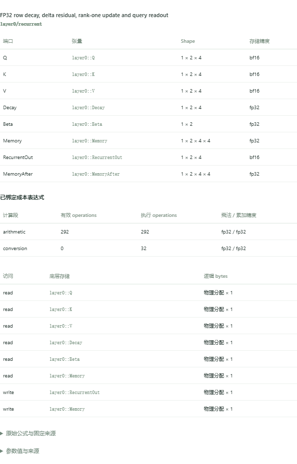
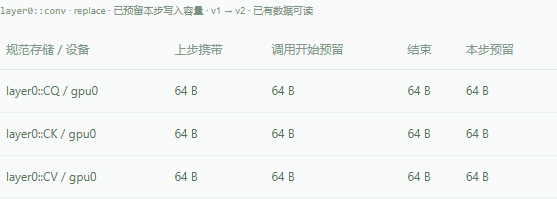
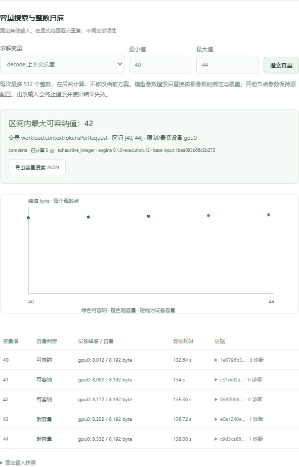
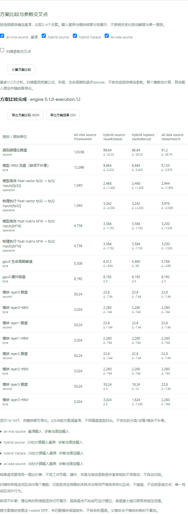
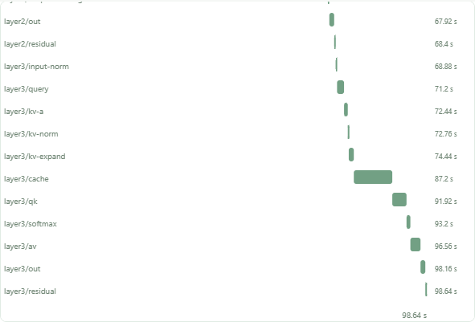

# KDA递归状态与KDA/MLA混合decode

检查点33实现单query decode的KDA预设及前三KDA/第四MLA attention片段。本页固定decode资产继续拒绝prefill；检查点34以独立资产补齐[短prefill与chunk](KDA_PREFILL_RESEARCH.md)的不同公式，P5整体证据见[P5验收](P5_ACCEPTANCE.md)。P6仍待完成，见[阶段清单](ACCEPTANCE_STATUS.md)。不能以decode本身证明训练、chunk prefill或完整Kimi型号支持。

## 固定来源与范围

读取[官方Kimi Linear模型代码](https://huggingface.co/moonshotai/Kimi-Linear-48B-A3B-Instruct/blob/e1df551a447157d4658b573f9a695d57658590e9/modeling_kimi.py)、configuration与config，固定提交`e1df551a447157d4658b573f9a695d57658590e9`。另外读取[官方FLA v0.4.0递归实现](https://github.com/fla-org/flash-linear-attention/blob/2e0f6c31f9db50f010cb157c712c048b8a3a89d2/fla/ops/gated_delta_rule/fused_recurrent.py)、KDA wrapper/gate、short convolution与gated norm，固定提交`2e0f6c31f9db50f010cb157c712c048b8a3a89d2`。八文件路径/SHA256、来源事实和人工假设分开保存于[来源锁](../references/parallel/kda-source-lock.json)。缓存文件存在时参考命令校验哈希，离线复算无需下载模型/权重或安装PyTorch/FLA。

固定config的层号为**一基**，前三层KDA、第四层MLA；全27层的full列表为4/8/12/16/20/24/27，末组不应机械重复3:1。KDA为32 heads、head dimension128、short conv width4；模型hidden2304、MLA latent512、NoPE、query无低秩。预设只取首个四attention片段，保留各自input RMSNorm与attention residual，省略实际层间的FFN/MoE、embedding及完整网络其他开销。all-kda/all-mla是四片段反事实，输出和精度不等价。

人工默认B1、C15、Q1、H8、heads N2、KDA key/value D4、conv W4，MLA latent R4、extra key P2、value D4。可编辑B/C/H/N；Q/D/W/R/P固定，拒绝prefill与Q≠1。所有状态作为已初始化输入；C0也表示显式零初始化的已有缓冲，不模拟None-cache的首次分配、zero-fill或权重加载启动。

## 递归方程与短历史

KDA从输入独立生成Q/K/V，各经过自己的depthwise short convolution和SiLU。源缓存保存完整W槽，并在decode内原位shift/update；不是只分配W−1槽。衰减门由两级F投影、A_log和dt_bias生成，beta由head投影及FP32 sigmoid生成。Q/K在递归核内L2归一化，q乘`1/sqrt(D)`。

令H为key×value矩阵，归一化后的q/k为向量，α=`exp(g)`为每key通道衰减：

1. `Hdec = diag(α) * Hprev`，按key行衰减。
2. `delta = beta * (v - transpose(Hdec) * k)`。
3. `Hnext = Hdec + outer(k, delta)`。
4. `o = transpose(Hnext) * q / sqrt(D)`。

beta是head标量，不是把所有通道衰减折成一个标量。输出再经两级G投影产生的sigmoid gate、RMSNorm及输出投影。source kernel的最终矩阵是新分配的FP32张量，输出跟随v为BF16。

[独立数学夹具](../scripts/kda-oracle.ts)以`Hprev=[[2,4],[6,8]]`、α=`[0.5,0.25]`、k=`[1,0]`、q=`[1/√2,1/√2]`、v=`[2,3]`、beta0.5，得到`Hnext=[[1.5,2.5],[1.5,2]]`和输出`[1.5,2.25]`。它验证先衰减再delta、矩阵方向和query scale；输入已归一化，不声称模拟FP32舍入或真实权重推理。

每个KDA有两个逻辑状态：conv含CQ/CK/CV三个独立BF16 storage，matrix含一个FP32 storage。默认分别64/64/64和128 B，合计320 B；与上下文C无关。三个KDA实例有三套独立状态与权重实例，不因复用同一模块模板而跨层去重。混合方案再有一份MLA cache逻辑状态，含独立K/V storage，因此共七个逻辑状态、14份持久storage。

## MLA参考路径与分配变体

固定HF实现的MLA是直接Q投影、latent norm、K/V展开后的full attention，NoPE路径没有执行rotary。不能借用其他DeepSeek preset的query LoRA、RoPE或absorbed latent cache。缓存保存展开后的per-head K/V，默认每token每请求为`2N*(2D+P)=40` B，长度L=C+1。eager路径的score/probability为BF16，softmax内部FP32代理。

| 变体 | KDA矩阵更新 | MLA cache更新 | 范围 |
| --- | --- | --- | --- |
| source | 读旧/写新FP32矩阵；额外一份state-sized临时分配 | 拼接旧与当前K/V，读旧C行并写完整L行 | 对应源码操作角色，采用下述保守原子生命周期 |
| inplace | 无新矩阵临时分配 | 预分配展开后K/V，仅写当前行 | 独立作者理论实现，不声称发布源码已这样执行 |

source将K/V拼接作为一个原子叶，保守保留整个旧/新tuple：常驻状态按调用末L预留，叶内另有旧前缀C行workspace。Python实际先后赋值key/value列表项，可能更早释放其中一份旧张量；因此本例是明确的原子估算，**不是Python allocator精确峰值**。矩阵更新则额外保留一份完整FP32新状态workspace。StateSpec的固定名称表示逻辑携带分配，不代表跨调用物理地址不变。

流量在语义state read/write中计一次；allocation-only workspace只记录同时驻留，不再收一次读写费用，不凭空加第三份复制。默认MLA source cache叶读32 B current expanded、4 B extra key及600 B旧cache，写640 B新cache，共1276 B；inplace为36+40=76 B。差1200 B和本例12 s。KDA source/inplace的state读写流量相同，去掉新矩阵临时分配只改变峰值。

## 算术、精度与独立账本

普通projection、conv及norm参数声明BF16；A_log/dt_bias显式FP32，衰减和beta为FP32。矩阵状态FP32、三份conv cache BF16、输出BF16。矩阵投影按BF16 multiply/FP32 accumulate，卷积/非线性/递归按FP32 vector代理，不把递归标成Tensor Core矩阵。

- 每个短卷积有用工作`BND*(2W+3)`，含dot及SiLU代理；操作数/输出转换另加`BND*(2W+1)`执行工作。
- decay代理有用`BN*(5D+2)`，beta代理`4BN`；BF16→FP32转换分别加BND、BN执行工作。
- 递归有用`BN*(7D²+8D+2)`，来自row decay、delta预测/校正、outer update、readout和Q/K norm/scale代理；三输入与输出转换加`4BND`执行工作。
- 默认递归叶有用292、转换32、执行324；输入/输出state加Q/K/V/g/beta共360 B。内部归约与门计算在片上，source新增矩阵128 B独立列为workspace。

这些非线性是明确代理，不是逐指令精确FLOPs。结构inspector保留两个原始计算段，结果按精确相同FP32-vector分类汇总为有用292/执行324；格式转换不增加模型分子。

[生成器](../scripts/kda-project.ts)使用普通模块/图/StateSpec，未加入core品牌分支。[独立账本](../scripts/kda-oracle.ts)不导入core、项目生成器或公式解析器，单列权重、持久状态、每节点算术/流量、FIFO拓扑执行以及出生/最后读取和临时workspace。[参考脚本](../scripts/kda-reference.ts)对照统一analyzeScenario/searchCapacity并校验结果。

人工硬件容量8192 B、BF16 matrix2000 operations/s、FP32 vector1000 operations/s、HBM100 B/s，serial执行，无网络或隐式融合。默认每叶受HBM限制；硬件值不是实卡预测。每KDA权重1056 B、每MLA568 B；混合3736 B，全KDA4224 B，全MLA2272 B。默认其他尺寸下，混合状态`B*(3*320+40L)` B，全KDA`1280*B` B，全MLA`160*B*L` B；权重不随B重复增加。

| 四片段项目 | 秒 | HBM B | 权重 B | 状态 B | 激活 B | workspace B | 峰值 B |
| --- | ---: | ---: | ---: | ---: | ---: | ---: | ---: |
| hybrid source | 98.64 | 9864 | 3736 | 1600 | 76 | 600 | 6012 |
| hybrid inplace | 86.64 | 8664 | 3736 | 1600 | 144 | 0 | 5480 |
| all-kda source | 91.20 | 9120 | 4224 | 1280 | 136 | 128 | 5768 |
| all-kda inplace | 91.20 | 9120 | 4224 | 1280 | 136 | 0 | 5640 |
| all-mla source | 120.96 | 12096 | 2272 | 2560 | 76 | 600 | 5508 |
| all-mla inplace | 72.96 | 7296 | 2272 | 2560 | 144 | 0 | 4976 |

表内激活/workspace是全局峰值时相应类别，不能分别取最大后相加。默认短上下文下，hybrid source峰值高于all-mla source，KDA的更多权重和有限状态不能免费抹除。随着上下文增长，MLA仍增长而KDA状态不增长；all-kda固定成本也不代表它与混合模型输出等价。

hybrid BF16 matrix3584，vector有用2468/执行3242；全KDA为3200、2944/3976；全MLA为4736、1040/1040。每KDA转换258，只加执行量；四KDA为1032。source/inplace算术相同，省掉的是显式历史复制和同时分配，不按层比例直接缩放整网。

## 跨步与有界容量

[三步项目](../examples/kda/hybrid-sequence-project.json)从C15开始，七个逻辑状态各自v0→v1→v2→v3：

| 调用前C | 三份conv/每KDA B | 矩阵/每KDA B | MLA K/V B | 秒 | 峰值 B |
| --- | --- | ---: | --- | ---: | ---: |
| 15 | 64/64/64 | 128 | 384/256 | 98.64 | 6012 |
| 16 | 64/64/64 | 128 | 408/272 | 100.00 | 6092 |
| 17 | 64/64/64 | 128 | 432/288 | 101.36 | 6172 |

总300 s、HBM30000 B、最坏6172 B。状态帧保留每storage的上步携带、调用开始预留、结束及版本；conv是固定槽短历史，不是保存整个前缀的KV。

8192 B下使用统一逐整数扫描：

| 项目 | 检查区间 | 区间内最大C |
| --- | --- | ---: |
| hybrid source | 40..44 | 42 |
| hybrid inplace | 69..73 | 71 |
| all-mla source | 26..30 | 28 |
| all-mla inplace | 32..36 | 34 |

source混合C42峰值8172 B、C43为8252 B。四份原始点/hash/诊断见[独立摘要](../examples/kda/reference.json)与对应`*-context-capacity.json`。全KDA在C0/15/127/1000保持同一成本/峰值，有限扫描[125,129]全部fits只能报告129为该区间最大，不证明上下文无上限。容量和时间都基于声明的原子生命周期，不能直接推成真实推理框架吞吐或最大可运行长度。

## 运行、工作台与未完成项

```powershell
npm run reference:kda
npm run reference:research
npm run acceptance:p4
```

生成六份可移植项目/完整结果、四份容量扫描、三步项目/结果与独立摘要。共同研究命令在原五套后追加KDA。内置库增加六模型、四模块、37公式和一个人工硬件，共48份资产，公共KDA/MLA模板在多个模型间固定同一身份/内容，实例权重和状态仍独立。Schema/core数值语义不变，引擎保持0.1.0-execution.12。

导入[hybrid source](../examples/kda/hybrid-source-project.json)，展开65叶/7状态，查看`layer0/recurrent`的FP32状态与两个计算段；切换三步项目查看固定conv/matrix与增长的MLA。容量选decode上下文40..44可复算42。比较all-mla source、hybrid source/inplace与all-kda source可查看四片段的不同开销。

单卡串行时间线补齐每批60项展开/收起，输入结果更新时重置；横轴按全部已知结束时间计算，零时间不伪造正范围。浏览器核对60→65→60与98.64s完整轴，完整JSON继续保存全部条目。界面使用滚动区域浏览长时间线。

八项[研究单元](../tests/kda.test.ts)覆盖来源、独立账本、数学夹具、动态尺寸、常数/增长状态、跨步版本、容量与非法输入/缺能力/空库重开。三项[Chrome](../tests/e2e/kda.spec.ts)覆盖结构/状态/转换、长时间线、容量、四方案和导出纯core复算/重开。

完整acceptance:p4退出0（checkpoint33-acceptance.log）：383单元/契约、3HTTP、73Chrome、架构/严格编译、Schema/结构正反、既有独立参考和生产构建通过。随后增强末条viewport验证的3项Chrome、严格check和六研究共同复算再次通过（kda-e2e-qa.log、checkpoint33-check-final.log、checkpoint33-research.log）。Vite大于500kB提示仍在，构建成功。已检查的截图：











**阶段区别：** 检查点34另行实现[KDA及混合prefill](KDA_PREFILL_RESEARCH.md)的阶段专用成本、Q64/Q65与部分块边界；旧decode修订保持不变。不能把Q=1方程乘Q充当chunk prefill。P6真实文件适配/更多型号不因研究通过而完成。
