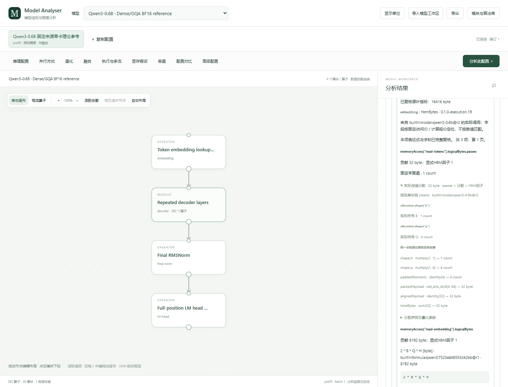

# 画布中的精确叶表达式来源

检查点70更新：当前画布导出为schemaVersion2，增加[实际参数绑定图](PARAMETER_BINDING_SOURCES.md)；schemaVersion1旧报告继续离线复核，下文旧格式说明属于原增量范围。

检查点69已在同一画布入口接入[实际叶Roofline耗时来源](ROOFLINE_TIMING_SOURCES.md)，支持能力匹配、效率、实际计算段顺序、max／串行与启动耗时的有界运算图及固定离线复核；量化HBM上游明确为部分边界。下文59关于Roofline尚未采集的记录属于历史范围，一般参数绑定及局部／分布式／融合等F10链仍未全部完成。

版本更新：检查点60的[量化作用域数学修复](QUANTIZATION_SCOPE.md)已把当前引擎升至`.20`，完整门禁状态见验收记录。下述59的`.19`记录为当时证据；旧版精确来源须重新计算，不能直接当作新算法依赖。

检查点59为成本数值面板和“成本与覆盖来源”检查器增加“复核此叶指标的精确表达式”。这些入口仍依附当前模型画布和当前配置。成本排序的行、构成和占比保留原合计／差／最大值／执行区间；展开到原叶指标后，可以按需复核其具体表达式。范围共用的旧Provenance另列，不作为逐表达式贡献。

## 固定身份与实际调用

选择器在读取原成本字段时形成，包含实际nodeId、完整MetricScope、字段及完整ComputeClass，随成本投影的运算边保留。原组成值入口沿保留的运算边和原对象身份取得选择器，不按相同数值、公式列表顺序或计算类别数组索引猜测。

后台任务携带原Scenario、固定资产快照、实际Decode stepContext、inputHash、engineVersion和完整原MetricValue。先复算并逐字段核对原指标、单位、诊断及范围；版本不同即要求重算，即使hash和数值相同也不解释历史算法的执行链。实例化的可选观察器在ValueExpr折叠成literal之前，只捕获指定的实际调用。数值求值和普通AnalysisResult保持原算法及契约，引擎仍为`0.1.0-execution.19`。

重复节点使用该实例真正绑定的符号，包括参数覆盖及重复展开上下文，不从最终共用参数表反推。固定公式的嵌套实参、声明约束、实际算术／函数运算、惰性if分支和sum局部变量由原求值器记录。符号值用于说明实际计算；此增量没有把每一个参数绑定过程本身扩展为完整来源DAG。

## 当前实现范围

- 单设备串行、未进入distributed结果的实际叶节点：HBM、逻辑读／写、按完整类别归并的有效／执行工作、fixed或custom_formula耗时。
- HBM显式字节表达式或显式factor；每个访问按原accessId定位，每个计算段按原segmentId定位，按原顺序求和。未声明类别的零值不会被编造为某个真实计算段。
- storage_allocation访问保留passes、实际本地到规范存储的绑定、规范分配、原shape／bytes／辅助计数公式及其实际作用域。由同一allocateStorage记录元素乘积、payload填充、位打包、对齐、各辅助张量和总字节。内嵌量化声明可复核；访问分别计数，alias共享分配不被当成额外分配。
- passes为零时记录实际提前返回零，不读取或补造未执行的存储分配。被边界绑定直接规范化的alias以实际规范目标呈现；这里不声称重建全部资产绑定声明的历史路径。
- 真实Decode步骤使用自己的Scenario和stepContext；序列汇总不能借第一步或当前默认参数充当一次调用。

局部／分布式变换、融合额外成本、通信、Roofline能力／效率／max耗时、场景量化／存储分配覆盖以及节点成本覆盖，尚未全部采集精确变换边。遇到这些路径明确说明待复核，保留原数值和原范围记录，不能展示覆盖前或全局表达式冒充实际来源。模型／模块聚合的底层精确选择器也尚未全部接通。因此此增量不关闭原F10的一般来源要求。

## 分页、取消及可移植证据

任务按需启动Worker，可取消、重试。来源对象／固定配置／实际步骤／字段／页身份变化时立即隐藏旧证据，晚到回复不能覆盖当前选择。每页最多20个实际成本字段；单存储最多64个原表达式和256个分配运算记录；每个表达式最多256个ValueExpr节点及1000条执行事件。达到预算说明部分证据，数值仍完整复算，不把截断或某一页称为完整指标链。界面分批展开嵌套公式；本轮没有以此承诺最大图的固定帧率或所有序列化无长任务。

只有第一页覆盖本指标全部字段、所有表达式记录完整且原顺序贡献求和严格等于原指标时，才显示“本项表达式与求和已完整复核”。这表示本项已支持的计算表达式，不代表全部参数绑定、所有模型指标或原PRD最终签收。

“导出此页固定输入与来源”保存原选择、完整原指标、固定输入、版本和该页证据，不写模型工作区。可在无外部资产库的环境重读：

```powershell
npm run verify:leaf-source -- examples/leaf-cost-sources/qwen-embedding-source.json
```

复核器只使用报告内固定快照，重算后比较整份报告，修改显示贡献、公式证据、原指标或不支持的报告版本均会拒绝。大指标的分页报告仍各自标为部分，不能把最后一页当作全指标完成。

## 独立数值参考

[固定账本](../examples/leaf-cost-sources/hand-ledger.json)及三个项目／结果／来源报告由`npm run reference:leaf-sources`生成并重新读盘验证：

| 实际指标 | 独立参考 |
| --- | --- |
| Qwen B1 Q4 embedding HBM | int64 tokens为4×8=32B，gathered bf16 embedding为4×1024×2=8192B，hidden写回8192B，合计16416B |
| C01 GEMM有效工作 | 2×4×8×16=1024 operation |
| 嵌套成本参考outside HBM | 两个bf16元素为4B |

参考采用固定来源模型结构和显式理论公式／合成硬件，不是实测性能。浏览器截图使用隔离测试工作区；原Qwen用户工作区另作只读核验。

完整组合验收与当前结果见[验收状态](ACCEPTANCE_STATUS.md)。原980段要求和935项最终证据复核继续保留；同步画布编辑准备、错误普通项目修复及其余一般指标来源仍须继续。

浏览器专项还使用9,999个引用算子的合成模型复核最后一个叶节点：只返回该节点一个固定时间表达式，复核期间定时器可执行、显示时间单位可编辑，完整项目与导入值相同。该用例不是复杂表达式／大快照的普遍延迟保证，也不关闭原同步结构编辑长路径要求。

## 本轮验收记录

完整57叶命令观察受管理会话2254退出0：685单元／契约、7HTTP、196Chrome（30.2m）、45运行组及全部组合参考通过，另五基础参考通过。735份产品／配置／固定证据SHA一致；公共契约208根／88联合／225分支及.19数学算法保持。原生用户Qwen报告独立重读一致，项目与原快照完整解析相同。最终边界和证据见[本轮记录](../_local/history/checkpoint59-result.json)。

以下截图来自当前完整门禁的隔离Qwen参考工作区，不是用户原工作区截图：



冻结期间另在59支持范围之外复现既有量化辅助公式作用域错误：根P2覆盖短节点局部P3，使每份应14B的分配变为12B，见[独立探针](../_local/history/checkpoint60-quant-scope-probe.json)。未量化原Qwen不受此例影响；此错误未因本轮既有门禁通过而关闭，下一增量优先按数学版本策略修复。
