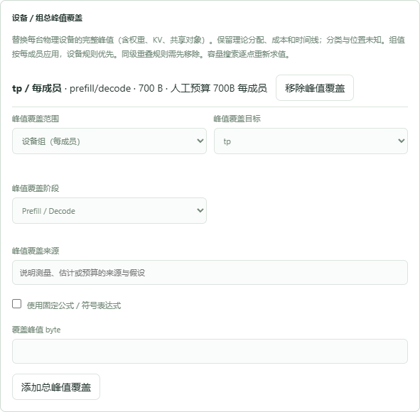
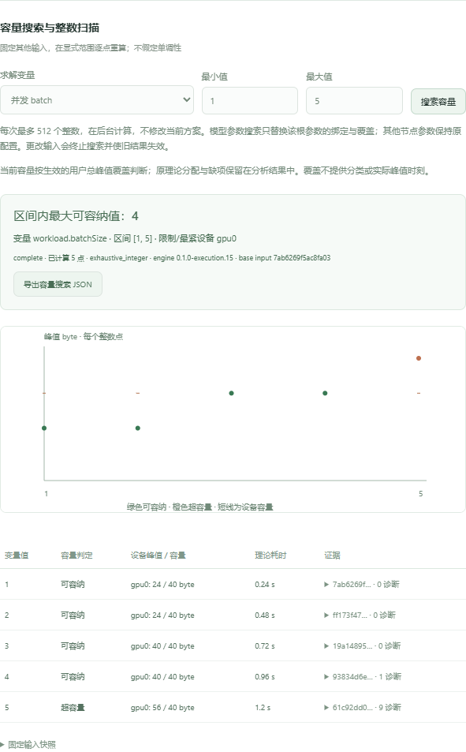

# 设备与设备组总峰值覆盖

检查点41实现 F04 的**设备／设备组总量覆盖**。检查点43另增[模块私有预算](MODULE_PEAK_OVERRIDES.md)，以真实调用和canonical归属为基础；不能用本总量功能替代其共享对象归属和多流生命周期证明。

在模型画布的“显存假设”中的“设备／组总峰值覆盖”选择实际设备或组、阶段、byte 值与来源，添加后随项目自动保存。高级输入接受现有 `ValueExpr`：字面量、符号或固定公式修订。公式必须存在于项目快照内，结果须为非负安全整数 byte。表单支持移除；移除最后一条规则恢复原有输入结构及计算 hash。



## 作用范围

| 项目 | 明确语义 |
| --- | --- |
| 设备规则 | 替换该物理设备的整个峰值，包括权重、状态、激活、工作区、通信、runtime/reserve 等全部部分 |
| 组规则 | 同一个值分别用于该组每台实际设备，单位为 byte/成员；不是组总和，也不按组别名增加设备数 |
| 优先级 | 同一设备上，设备规则优先于组规则，结果列出被遮蔽的规则 ID。同级有效规则重叠拒绝计算；不同阶段可分别配置 |
| 覆盖前估计 | 独立保存在 `totalOverride.theoretical`，保留分类、真实时刻／顺序、设备容量和缺项；若配置模块预算，物理原理论另在其 `moduleOverrides.theoretical` 中保留 |
| 有效分类 | `categoryBreakdown: []` 且 `totalOverride.classification: "unknown"`。空数组表示总量覆盖没有分类证据，不能解读为各类零分配 |
| 有效位置 | `peakPoint.kind: "unlocated"`，不沿用理论峰值时刻；序列结果另记获胜调用的 `decodeStepIndex` |
| 来源 | 完整规则、求值 byte、实际设备列表、遮蔽规则、公式引用、根参数来源与假设进入结果；指标标为 `estimated`，不冒充实测 |
| 其他结果 | 底层规范存储及 alias、物理 copies、工作量、流量、通信、时长与执行计划均保留原有计算 |

这是用户对**整个显存模型的总量替代假设**，因此可以小于原理论常驻分配，甚至为零；这不表示权重或 KV 被引擎取消。若只是改变某项分配，继续使用已有存储 `memory_bytes` 覆盖。模块局部峰值不能以设备总量规则代替。

原来接受但未接入计算的 `numericOverrides` 中 `target.kind: "device", field: "memory_bytes"` 现在走同一总量语义，规则 ID 为 `legacy-device:<deviceId>`。与新设备规则重复时拒绝，不静默选择。

## 公式、解码与容量

覆盖公式绑定当前 workload 数值字段及有效模型根参数，根参数使用已有默认／绑定／覆盖优先级；不访问未明确指定的子模块局部参数。每个实际 decode 调用及容量候选点重新求值。活动规则即使被更具体的设备规则遮蔽，公式和单位错误也会报错。

逐步 decode 先从每次调用的原理论峰值出发，加上唯一规范状态对象的 `max(before, after)` 预留增量，再保留这份理论结果并应用总量覆盖。总量覆盖不再加一次状态增量。序列分别选取**有效峰值最大值**和**原理论峰值最大值**，两者可以来自不同调用；原理论位置按序列绝对时刻／顺序转换。

容量搜索使用有效总量与每台实际设备的真实容量逐点比较，原有穷举整数、舍入、非单调、缺项和限制设备规则不变。总量已知不补全未知的理论分配、HBM 或耗时；原理论诊断保留，覆盖超过容量另报 `override_capacity_exceeded`。覆盖本身是当前点结果，不能冒充已完成区间搜索。



## 独立证据与可移植样例

以下是人工预算和已声明数学图的核对，不是新增硬件 benchmark。

| 样例 | 原理论 | 有效总量／边界 |
| --- | --- | --- |
| [单卡](../examples/memory-peaks/single-total-project.json) | 256B weight + 128B input + 64B output = 448B，4.48s | 700B；成本与耗时相同 |
| [PCP 两卡及组别名](../examples/memory-peaks/pcp-two-card-project.json) | 每卡320B，7.394s；原实际分配与 AllGather 保留 | 组每卡400B，第二卡设备规则700B；别名不新增设备 |
| [多流](../examples/memory-peaks/streams-total-project.json) | 2GiB 与3GiB scratch 重叠为5GiB；串行最大3GiB，6.5ms | 有效多流与串行均6GiB；两份不同原理论结果分别保留 |
| [三步 decode](../examples/memory-peaks/decode-total-project.json) | 含状态预留14/16/18B，序列18B，0.24s | 每步40B，序列40B；不把状态增长重复加到40B上 |
| [动态预算](../examples/memory-peaks/decode-formula-project.json) | 同一14/16/18B原理论 | `ceil(B/2)*16 + C*2`：三调用 C=2/3/4 得20/22/24B |
| [容量证明](../examples/memory-peaks/capacity-proof.json) | 使用动态预算项目的固定快照 | 每卡容量40B，三步序列按最后调用 C=4：B=4为40B，B=5为56B；1–5穷举最大4 |

每个项目都带完整资产快照，可直接导入并离线复算；同目录有完整分析结果及[参考账本](../examples/memory-peaks/reference.json)。容量证明的公式与资产使用上述动态预算项目快照，不依赖用户库。生成器以独立常数、舍入式和整数边界核对结果。

专项覆盖单卡零值／旧输入、真实两卡 canonical 共享／通信不变、异构容量、组别名与优先级、未知原理论、多流与串行对照、逐步 KV 预留、根参数及公式依赖 hash、阶段／单位／冲突／遮蔽错误、独立结果篡改校验。Chrome 覆盖表单错误、自动保存、旧结果失效、项目／结果导出、离线复算、刷新重开、移除恢复、多流与公式容量链。

```powershell
npm run reference:memory-peaks
npm run acceptance:memory-peaks
```

组合门禁包含此前全部 context-pipeline／parallel／costs／models／files／P0–P5 链；具体运行结果记录于[实施记录](PROGRESS.md)和[验收状态](ACCEPTANCE_STATUS.md)。模块私有预算与调用跨度、常驻／跨模块共享保留及decode预留已在检查点43另行实现并独立记证；本总量检查点仍不代表整个项目完成。
