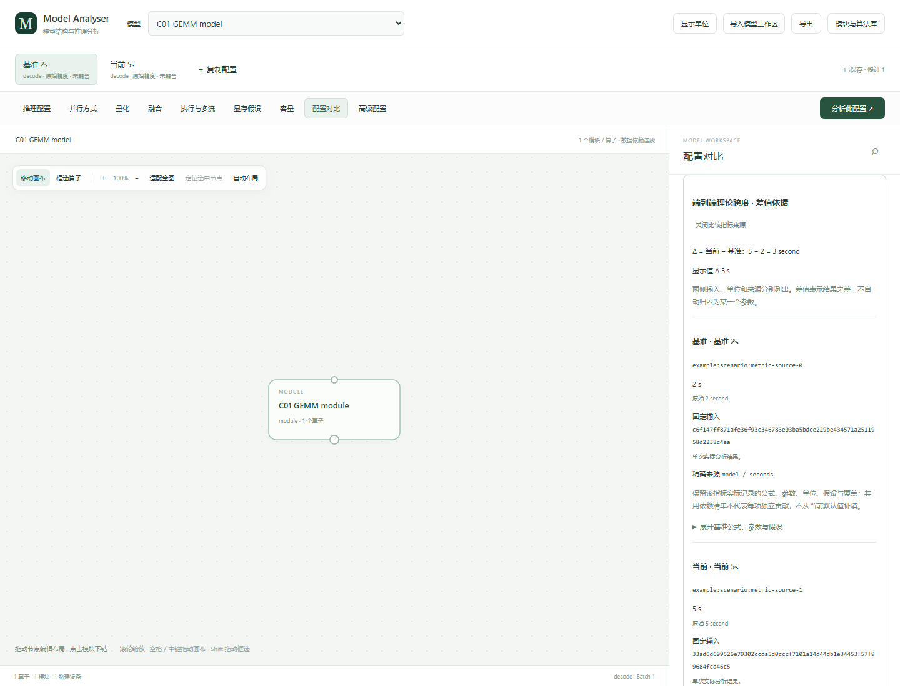
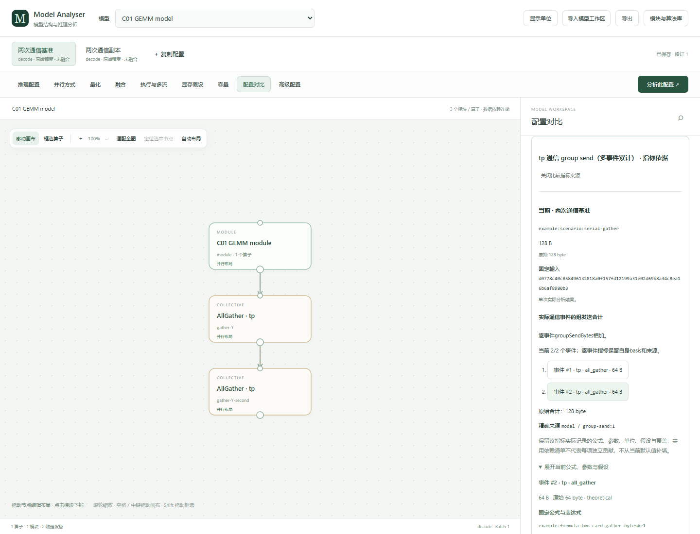

# 从画布配置对比查看指标与差值来源

检查点55继续沿同一模型画布工作。打开“配置对比”，选择配置并计算，点击结果单元格可查看该配置的指标依据；点击Δ可查看当前值减基准值的算式和两侧各自的依据。不同配置的来源不会按名称或显示顺序混用。

## 单个指标与差值

直接入口覆盖对比表当前已有的端到端跨度、HBM、逐完整ComputeClass的模型有效／物理执行工作、每物理设备峰值和硬件容量、通信组累计发送量、模块跨度与HBM。CSV与完整报告导出保留原数值和原单位；显示单位只改变呈现。

差值先列出两侧数值、原始单位、配置ID和真实输入hash，各自展开固定公式／修订、实际参数、假设／覆盖、固定资产依赖和原始指标。Δ表示两个结果之差，不自动认定由某一个参数导致。某一侧缺失时不能补零；不存在的类别、模块或设备不会打开其他可用指标。

固定资产与公式按实际记录的ID／revision查找，缺快照不改用最新版本。原Provenance可能是范围共用清单；这里保留真实清单和明确说明，不能将它当作每个分量的独立公式依赖链。原始记录按需展开，不提前渲染完整JSON；公式／资产依赖、参数和通信事件都有分批展示。

## 物理设备与通信合计

每设备峰值沿结果的实际设备范围找到原指标，不依赖memory数组顺序。多个设备组复用相同设备不会增加物理卡数；缺少某卡结果不能改用另一卡。

硬件容量不是现成的公式指标：直接显示该配置物理设备的固定hardware引用、对应快照的容量、作者来源和原声明，并核对结果记录值是否一致。快照缺失或值不符会说明，不能用声明去补填未知结果。

同一通信组可能有多个事件。来源面板列出每个真实事件的groupSendBytes、完整合计过程及逐事件来源选择；选择第二个事件不会把合计变成第二个事件的值。存在未知事件或合计溢出时，整体保持不可用。

## 计算精度与Decode

模型概览中的多个计算分类各自显示有效工作和来源动作，类别数量本身不再打开第一类工作量。每个动作绑定当前结果中的完整ComputeClass；逻辑有效量与多卡物理执行量分别沿实际结果读取，例如复制执行的480有效／960物理operations不能相互替代。

整个Decode序列的对比来源继续指向序列结果，不静默选择某一步。序列成本按原累计口径，显存仍按原最坏步骤口径；不把某一步的参数套到整个序列。三步3＋4＋5＝12 operations与第三步5 operations分别保留；逐步参数需在实际步骤分析中查看。

重新计算、更改比较输入或设置、切换报告，会清理旧来源选择。新报告中重新点击单元格后才能查看它的来源。打开／关闭来源、切换单位和导出不会修改模型、配置、布局、测量或项目修订。

## 从差值下钻到实际运算

在基准或当前一侧打开成本运算来源。端到端跨度、模型 HBM、物理执行工作量、模块跨度及模块 HBM 使用该侧的固定配置和资产。复核聚合页后，可继续打开该侧的实际算子、融合组、通信或 Decode 步骤。Decode 汇总保留序列数值，用户选中具体步骤后可查看该步数值和参数。两侧分别打开、复核和导出。

通信合计中的单个事件可打开其实际布局、消息表达式和物理设备。事件按所在步骤和该步原顺序定位，并核对完整消息记录。同组同量的两次通信仍有各自的来源。显存峰值可打开当前配置的设备峰值位置、分类和预算依据。

聚合与通信来源页沿用各自的固定输入导出，可用 `npm run verify:leaf-source -- <文件>` 复算。[模型与模块聚合](AGGREGATE_COST_SOURCES.md)、[通信步骤的实际来源](COMMUNICATION_COST_SOURCES.md)

## 独立复算与实际验证

`npm run reference:metric-sources`生成[四份同模型项目与独立账本](../examples/metric-sources/hand-ledger.json)：2→5 s／Δ3 s、64→128 B、M4→5的1024→1280 operations；独立向量段2有效／3执行；两卡两次通信64＋64＝128 B／2.946 s；三步Decode12 operations。每份项目写入后重新读取，在空库快照上复算并核对真实输入hash。

新增9项领域／SSR与5项Chrome；原来源／画布规格／对比及所选显存专项继续覆盖。最终完整 `npm run acceptance:metric-sources` 已观察终端退出0：621单元／契约（70文件）、7HTTP（6文件）、173Chrome（27.8分钟）、45运行组、架构／严格编译／Schema结构正反／生产构建和全部旧参考通过，另五基础参考通过。443份冻结文件SHA一致，207根／88联合／225分支保持；原Qwen r2／修订1、量化／融合／测量0，589资产／0扫描问题／0项目草稿。准确状态以[验收记录](ACCEPTANCE_STATUS.md)及 `checkpoint55-result.json` 为准。数值核心、契约字段与引擎 `0.1.0-execution.18`保持。

后续检查点56已补列明范围的[显存／状态、利用率、Roofline及整数扫描依据](SCALAR_SOURCES.md)，可用指标的实际warning文字也已展示；该页按自己的测试时点和完整组合记录签收。贡献比例／明细等其他尚未核对的标量及精确分量来源粒度继续保留。同步结构准备／兼容展开、普通错误项目修复和原文最终核对也未完成。具体见[剩余项](REMAINING_PRD.md)，本页不签收全部F10或整个项目。
