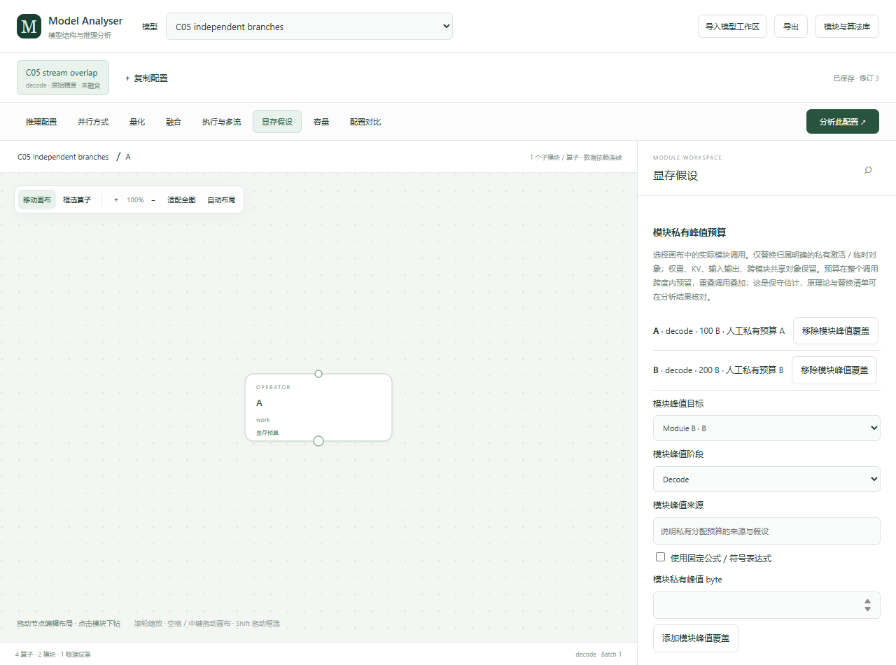
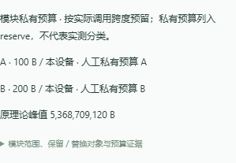

# 模块调用的私有峰值预算

检查点43补充F04的模块范围覆盖，与[设备／组总量覆盖](MEMORY_PEAK_OVERRIDES.md)分别保存。主入口是模型画布：进入实际模块调用，在节点详情点击“配置此模块显存预算”，或打开“显存假设”。表单直接选中当前调用，保存到当前模型配置；导出工作区时带上规则及固定公式修订。



## 明确范围

`Scenario.modulePeakOverrides` 的每条规则包含 `overrideId`、完整调用路径 `nodeId`、适用阶段、`ValueExpr` byte值和来源／假设。目标是当前阶段存在的实际结构化模块调用；重复层的汇总容器不是一次调用，请进入具体实例，如 `decoder[0]`。不同配置可以保存不同预算。移除最后一条规则删除可选字段，恢复原输入。

引擎先展开真实图、canonical alias、物理分配和执行，再确定每台设备的实际模块参与。预算值按该模块在每台参与设备上应用一次；不乘设备组别名数量，不按卡数猜测局部量。固定表达式绑定当前工作负载和该调用有效的根／祖先／本地参数；每个decode调用及整数容量候选点重新求值。

| 对象 | 处理方式 |
| --- | --- |
| 规范私有激活／workspace／communication | 只有该规范对象的全部实际使用都属于目标模块，且不是边界或常驻对象，才从有效峰值扫描中替换 |
| 权重、state/KV、graph、runtime、既有reserve | 保留原物理分配与生命周期；即使只在模块内部使用，也不属于可删除的私有临时峰值 |
| 模块输入输出、模型输入输出 | 按真实端口绑定识别规范对象，保留其原生命周期；alias不创建额外分配 |
| 跨模块使用的规范对象 | 保留，不通过名称或某一模块的最大值分摊 |
| 未使用或归属不明对象 | 保留原生命周期规则，不凭模块位置删除 |
| 底层计算、流量、通信、耗时、物理copies | 保留原方程和证据；此功能改变的是有效容量假设，不修改数学图或取消实际内核访存 |

覆盖值表示**上述私有部分的预算**，不包含权重、KV等已保留对象。引擎在该设备的完整实际调用跨度内预留这笔预算。串行按真实数学事件序号扫描，多流按真实执行起止扫描；重叠调用的预算同时存活，不能用“全模型最大值减模块最大值再加覆盖值”替代。

预算在整个调用跨度内都预留，因此结果是明确假设下的保守估计，不声称知道私有真实峰值发生时刻。有效分类将这笔不透明预算列为 `reserve`，其他保留分类按实际扫描；这不是实测分类拆解。结果的 `moduleOverrides.policy` 固定为 `private_budget_reserved_for_call_span`，保存实际模块成员／执行节点、边界、保留与替换规范对象、原分配和生命周期、扫描坐标，以及完整原理论结果。



## 冲突、解码与缺项

相同或父子嵌套的有效模块范围拒绝叠加，避免重复替换。融合完全位于覆盖模块内时，模块跨度使用真实融合执行节点；融合横跨模块边界时拒绝覆盖，要求先调整融合或覆盖范围。固定公式必须为非负安全整数byte，求值、叠加溢出或缺失引用不生成伪造的数值。原时间／分配缺项不会因为填了局部预算而变成已知整卡峰值。

逐步decode保留KV规范存储的 `max(before, after)` 预留。该状态增量同时进入有效预算峰值和保留的原理论峰值，只增加一次；预算本身按该次调用重新求值。序列有效峰值取各次有效峰值最大值；`sequenceTheoretical` 独立保留全序列原理论最大值，可来自另一次调用，不能与获胜调用的局部证据混淆。

若另有设备／组总量规则，先求模块预算及持久状态预留，再由总量规则替换整台设备。`totalOverride.theoretical` 保留总量覆盖之前的模块预算结果，其 `moduleOverrides.theoretical` 保留原物理理论；总量规则之后不再次加KV或模块预算。总量的分类／位置仍明确未知。

容量搜索逐候选点使用有效峰值与实际设备容量比较，保留穷举整数、非单调、限制设备和缺项语义。规则保存成功本身不代表该点可计算或已证明容量上限。

## 可移植参考和验证

这些是独立人工预算和已声明执行图的核对，不是新增硬件测量。

| 固定项目 | 独立参考 |
| --- | --- |
| [重叠调用](../examples/module-peaks/overlap-project.json) | 原2GiB、3GiB私有scratch重叠为5GiB；100B、200B预算重叠为300B，6.5ms耗时不变；同范围串行预算200B |
| [串行调用](../examples/module-peaks/serial-project.json) | 原最大3GiB，预算最大200B；不是两模块之和 |
| [三次decode](../examples/module-peaks/decode-project.json) | 8B权重、每token 2B KV、20B私有scratch；原理论34/36/38B，5B私有预算后19/21/23B |
| [动态容量](../examples/module-peaks/capacity-project.json) | A预算100×batch，B预算200B，450B设备；batch=1–4逐点300/400/500/600B，最大2；[完整容量证据](../examples/module-peaks/capacity-proof.json) |

同目录保存四份完整结果与[独立账本](../examples/module-peaks/reference.json)。13项领域用例另覆盖完整固定来源Qwen调用及严格JSON Schema、内部融合附加事件归属、缺项/整卡规则不能遮蔽非法模块公式、实际两卡独占／复制参与、组别名、端口边界与alias、常驻权重、零时长瞬时预算、本地参数覆盖、重复和真实父子范围、跨边界融合、原理论缺项、结果篡改及整卡总量叠加。浏览器用例从默认画布完成上下文选择、错误提示、保存、重开、移除恢复、结果／工作区导出、离线复算、公式容量和decode。阶段切换及模型导入会重置表单阶段，避免沿用上一配置的阶段。

```powershell
npm run reference:module-peaks
npm run acceptance:module-peaks
```

最终 `acceptance:module-peaks` 退出0：498单元/契约、3HTTP、110Chrome（浏览器14.4分钟）、架构/严格编译/构建、Schema/结构正反及既有全部型号/成本/并行/七研究/真实文件参考通过；另五项局部成本/串行/融合/原生通信/decode参考通过。两张最终截图已目视核对，本机工作台已更新。失败修正与原始日志范围见[实施记录](PROGRESS.md)与[验收状态](ACCEPTANCE_STATUS.md)。本次签收范围是这里声明的模块私有预算语义；P6其余预设、Ascend量化描述导入与最终原PRD逐条审计仍见[剩余项](REMAINING_PRD.md)。
