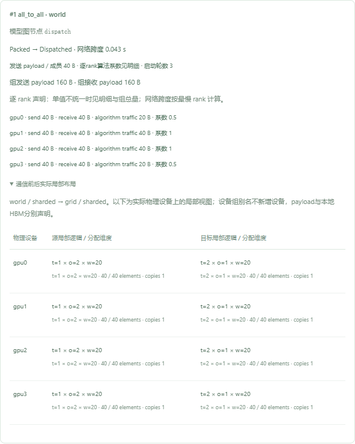
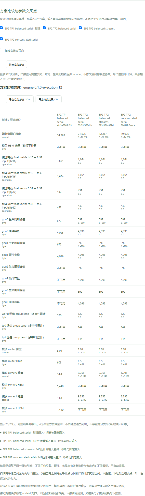

# MoE SP / EP / 专家 TP 混合并行研究

检查点29完成 P5 的第二个完整研究案例：SP router → TP×EP dispatch → 两个 EP owner 内的 TP gather / grouped gated FFN / reduce-scatter → 两次 owner 逆交换 → SP 加权合并与残差。它复用原模块、局部方程、图内通信、执行及生命周期核心；不在 core 中添加 MoE 专用计算分支。检查点30已补齐[CSA2复用](CSA2_REUSE_RESEARCH.md)及[三案复核](P5_RESEARCH_CASES.md)；P5其余特殊机制资产和P6仍待完成。

## 来源和明确范围

按 [NVIDIA Megatron-LM 固定提交中的 token dispatcher](https://github.com/NVIDIA/Megatron-LM/blob/76cf2e2d64bbfa466d50de64d036db23395dc5af/megatron/core/transformer/moe/token_dispatcher.py)核对 EP 交换、TP gather、专家计算、TP reduce-scatter 与逆交换的角色；flex 路径提供 TP×EP 组的参考。提交、SHA256、核对日期与事实/作者假设分别保存在 `references/parallel/moe-source-lock.json`。本地来源缓存存在时生成器校验哈希，离线复算不要求下载。

本例是人工声明的 E=4、top-k=2、EP=2、TP=1 或 2 的前向 gated FFN 子图，包含 router logits、top-k 代理、打包/拷贝、三个专家矩阵乘、SiLU/乘积代理、合并及残差。每个 token 在每个 EP owner 恰有一个 assignment；不执行路由分数或动态负载均衡。`extensions.routing` 保存固定 token 顺序、专家归属、规则和概率，仅是作者说明，通用引擎不解释这份扩展并据此推导成本。

- balanced：前半 token 选专家 [0,2]，后半选 [1,3]；每个 owner 触及两个专家。
- concentrated：所有 token 选 [0,2]；每个 owner 触及一个专家。assignment 总量仍为 2T。
- 每个 owner 的两个专家始终全部驻留；A 只控制读取的权重。A 的 min=max 固定为该 profile 的值，不允许单改 A 假装改变路由。
- BF16 激活和矩阵输入、FP32 logits/概率、int64 专家索引。每条 packet 含 `2H+12` 字节，token 顺序隐含在固定映射中，无额外 token ID。合并概率均为 0.5。

这是分离缓冲、一次 TP×EP dispatch、两次独立 owner combine 的显式方案，未复现融合生产 dispatcher。top-k `3TE`、SiLU+乘积 `5TI`、加权合并 `3TH` 是作者的 operation 代理；不代表真实内核指令数。额外 transport workspace=0 是理想缓冲假设；通信本地 HBM 与 reduce-scatter 归约算术仍缺项，不用网络 bytes 填补它们。

人工设备各为 4096 B 容量、matrix/vector 各 1000 operations/s、HBM 100 B/s；网络 1000 B/s、每轮 0.001 s。全部为手算常量，不能当作厂商规格或实测性能。支持 tokenwise prefill/decode 前向；上下文不改变无缓存的 FFN。所有 token 和专家中间维度必须精确整除对应分片，不隐式 padding。

## 项目、操作与默认结果

运行 `npm run reference:moe` 生成[独立摘要](../examples/moe/reference.json)、每份原始结果和批次容量证据：

| 项目 | 实际设备 | 理论跨度 | 每卡峰值 | 每卡驻留权重 | 每卡已知叶 HBM | 批次容量 |
| --- | --- | --- | --- | --- | --- | --- |
| [EP-only](../examples/moe/ep-only-project.json) | 2 | 34.363 s | 672 B | 416 B | 1984 B | 14 |
| [mixed](../examples/moe/mixed-project.json) | 4 | 21.525 s | 392 B | 224 B | 1208 B | 23 |
| [mixed-overlap](../examples/moe/mixed-overlap-project.json) | 4 | 12.267 s | 392 B | 224 B | 1208 B | 23 |
| [mixed-concentrated](../examples/moe/mixed-concentrated-project.json) | 4 | 19.605 s | 392 B | 224 B | 1112 B | 23 |

将 JSON 通过“导入项目文件”打开，计算理论结果，再“解析设备布局”。查看 dispatch 的实际源/目标形状及各 rank 流量；展开 owner0/gather 和 owner0/scatter 可查看 T2→T4 的 gather，以及 partial→T2 分片的归约。world 与 grid 使用相同实际成员，两个 tp 组各用其中两张卡；四张卡始终是四张，不相乘组别名。

单个项目可编辑 Batch、Query tokens 和 H/I 参数。默认 mixed 的 Batch=2 为 560 B/卡，dispatch 完整 payload 为 80 B/rank。Query=3 无法在四个源 rank even 分片，保留错误；恢复 Query=4 后可计算。容量变量选择 Batch、范围 [22,24] 得最大23，并可导出完整逐点证据。项目导出包含全部固定依赖快照，纯 core 复算 hash 与重开结果相同。四份项目可合并方案/去重快照，直接在方案比较中选择四项。

## 通信：完整 payload、自身份额和最慢 rank

默认 B1、Q4、H4、I8，T=BQ=4，packet=20 B/assignment。mixed 中 dispatch 每卡 send/receive 为40 B，但远端流量为 `[20,40,40,20]` B：只有 gpu0/gpu3 有一半 self 份额。取平均30 B 会低估跨度；正确为 `max(20,40,40,20)/1000+3×0.001=0.043 s`。

| mixed 通信 | 调用数 | 每次组远端 bytes | 每次跨度 |
| --- | --- | --- | --- |
| TP×EP dispatch | 1 | 120 | 0.043 s |
| owner 内 TP all-gather | 2 | 80 | 0.041 s |
| owner 内 TP reduce-scatter | 2 | 32 | 0.017 s |
| owner 逆交换 | 2 | 60 | 0.043 s |

mixed 共七次通信，组远端合计464 B、串行网络合计0.245 s。group send payload 累计608 B，包含 self 份额；不能用它替代远端流量。combine0 的 send 为 `[40,40,0,0]` B，receive 为 `[20,20,20,20]` B，remote 为 `[20,40,0,0]` B。combine1 对称。EP-only 共三次通信，远端合计160 B、网络0.123 s。

为保留这些差异，通用 `CommunicationDefinition.perDevicePayloads` 新增可选完整逐设备声明：deviceId、sendBytes、receiveBytes 和 trafficFactor。必须唯一覆盖集体通信全部实际成员；send_recv 继续使用显式端点路径。逐设备声明优先于 uniform payload/系数，后者仍要求结构/表达式有效；每个成员只应用其系数一次。组总量求和；统一 per-member 标量仅在各成员完全相同才可用，否则 `nonuniform_member_quantity` 指向明细，不提供平均值。bandwidth_latency 使用最慢 rank 与声明启动轮数；fixed/custom_formula 仍沿显式作者模型。

图内声明的公式在所属模块参数帧展开，原始定义、实际 ledger、组总量与诊断都进入结果。独立结果校验核对唯一成员、常量声明、系数、合计、统一标量和最慢 rank 时间；拒绝伪造的平均值/重复 rank。旧 uniform 路径保持原计算，数值语义扩展使引擎更新为 `0.1.0-execution.12`。契约目前 schemaVersion=1，新增字段可选，旧文档仍可读；所有结果/当前参考随引擎重算，不把旧 hash 当作新引擎结果。

## 独立计算与成本解释

`scripts/moe-oracle.ts` 不导入 core、项目生成器或公式解析器，以标量方程独立核验。设 p=TP、n=2p、A 为每 owner 触及专家数：

- 每卡驻留权重 `W=8H+12HI/p`。router 权重在所有 rank 复制；两组专家权重按 I 分片。每次专家 GEMM 实读 `Wa=2AHI/p` 字节，三次合计；减少 A 不改变 W。
- 模型有效与已声明物理 matrix 都为 `8TH+12THI=1664`，已声明 vector 为 `12T+10TI+4TH=432`（不含未建模通信归约算术）；TP/EP 仅划分工作，不新增完整冗余请求。
- mixed 的已知叶 HBM 组小计为 `4×1208=4832 B`，EP-only 为 `2×1984=3968 B`。额外 TP gather/metadata 副本和重复读取 router 权重会增加物理流量。完整模型 HBM 保持 unavailable。
- concentrated 每卡比 balanced 少读 `3×(64−32)=96 B` 专家权重；四卡合计少384 B，三个专家矩阵节点各缩短0.32 s/owner，两 owner 串行共缩短1.92 s。计算、网络和峰值不变。

独立的逐卡 HBM 分解可用以下式子复算：

```text
X = 2HT/n                  # 源 SP 激活
L = T(2H+12)/p             # TP 分片 owner packet
G = T(2H+12)               # gather 后完整 owner packet
D = 2TH; M = 12T; F = 2TI/p
R = G/n; U = (2H+4)T/n
router = 2X + 8H + 80T/n + L
owner  = 3L + 2G + (3+1/p)D + 3Wa + 36T + 6F
root   = 2(R+U) + 6X + 8T/n
```

每个计算叶耗时为 `max(operations/1000, HBM/100)`；显式打包/解包与拷贝也计算 HBM。mixed router=1.68 s、每 owner 已知叶=9.2 s、root=1.2 s，总叶21.28 s，加网络0.245 s 得21.525 s。EP-only 对应3.04+2×14.4+2.4+0.123=34.363 s。

双流方案把两个 owner 分配到不相交 tp 组，其余 world 流保留依赖顺序；resourcePolicy=ideal。每个 owner 含 gather/scatter 为 `9.2+0.041+0.017=9.258 s`，两个 owner 重叠消去一个跨度，得到12.267 s。它不表示真实互连、HBM 或内核可无争用重叠。

## 生命周期、容量和证据

owner prepare、gather、unpack、三个专家中间激活、reduce-scatter、repack 及逆交换均使用明确独立 backing。源/目标交换期间同时存活；没有用逻辑 view 伪造零空间搬运。oracle 枚举每个节点的同时存活候选，并与生命周期峰值核对。

默认 mixed 峰值在 owner unpack：驻留权重224 B、持续输入X8 B、完整 gather packet80 B、解出的激活32 B+索引32 B+概率16 B，合计392 B。EP-only 峰值在 activation：权重416 B、X16 B、metadata48 B、G/U/F三份64 B，共672 B。

默认形状下，mixed 每卡峰值 `224+168B`，EP-only 为 `416+256B`。4096 B 下：mixed B23=4088、B24=4256；EP-only B14=4000、B15=4256。因此边界扫描分别证明23与14。Query 的 [92,96] 包含不能四卡整除的93/94/95，容量保持 unknown；不会跨缺口声称最大长度。

证据为 `tests/moe-research.test.ts` 的八类场景、`tests/member-payloads.test.ts` 的四类通用通信/反向校验与 `tests/e2e/moe-research.spec.ts` 的三条 Chrome 流程。涵盖固定来源、驻留/触及、精度/工作量、逐 rank 网络、独立缓冲、动态维度/decode、错误输入、容量、固定快照身份、纯 core 复算和重开。最终完整门禁记录见[实施记录](PROGRESS.md)。




