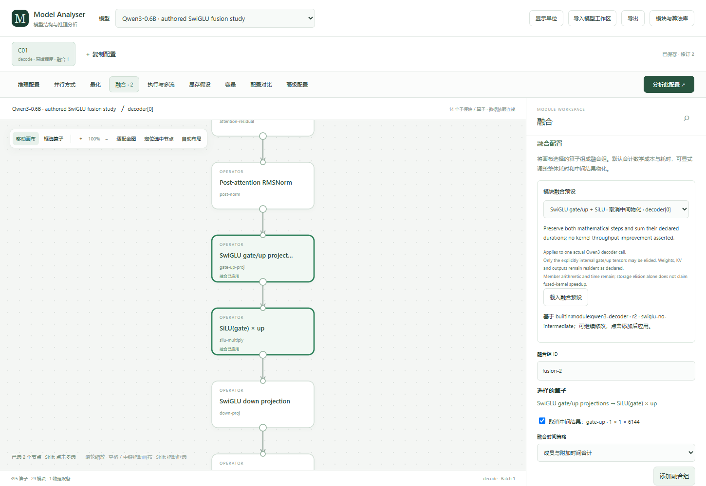
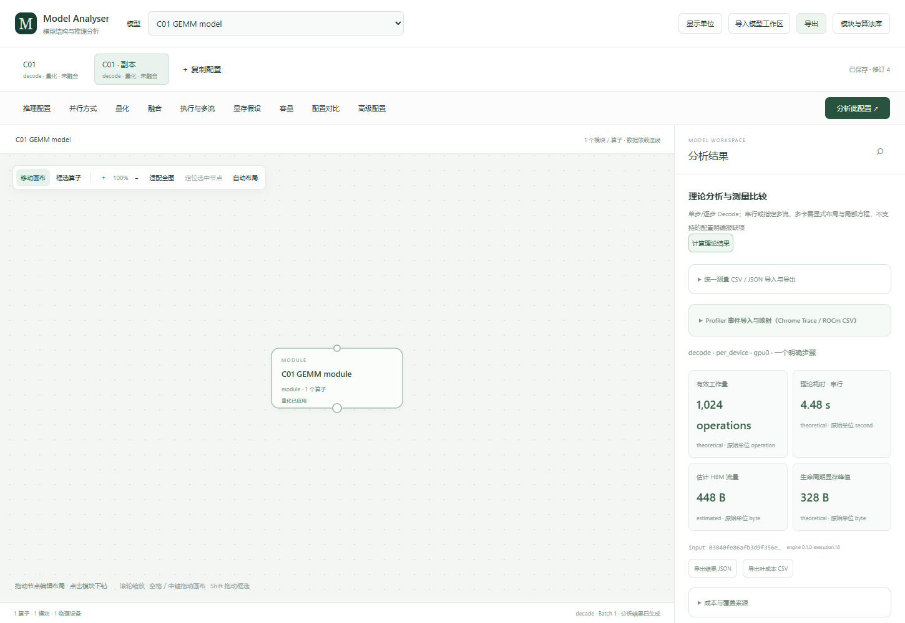

# P6 可编辑预设扩充

检查点47补充明确型号硬件、两级通信假设、量化资产和模块融合预设。模型画布按家族分组，新增的研究变体保持明确命名；原项目与固定修订继续保留。以下是实际支持范围，不表示全系硬件适配、量化质量结论或真实 kernel 性能。

| 预设 | 实际内容 | 来源与边界 |
| --- | --- | --- |
| AMD MI300X 192GB OAM | dense BF16／FP16 矩阵、FP32 vector、容量与HBM峰值 | 官方两页数据表第1页及版本固定的ROCm架构表；标称容量按十进制换算，通信能力缺项保留 |
| 人工通信研究硬件 | 两张实际设备，组内1000 B/s＋1ms、跨组100 B/s＋10ms | 作者选择的独立算术输入，不是物理网络测量或标称链路规格 |
| GEMM／AllGather链路研究 | BF16列分片、动态每rank payload、200 B通信临时空间；两个可编辑链路入口 | 从模型选择器可直接新建，手工配置实际设备池后预览／确认；不把并行度机械相乘为卡数 |
| Weight 4／8 bit group32 | 权重payload、每32元素一个FP16 scale，末组ceil；不加zero point | 作者声明的连续打包／字节对齐假设，保持原内部计算精度；不是某权重文件格式或精度质量保证 |
| Qwen3-0.6B SwiGLU融合研究变体 | 每个实际decoder调用提供保留／取消gate-up物化两种候选 | 使用decoder固定r2；图与公式与r1一致，仅增加预设元数据，原模型继续固定r1 |

硬件来源为[AMD数据表](https://www.amd.com/content/dam/amd/en/documents/instinct-tech-docs/data-sheets/amd-instinct-mi300x-data-sheet.pdf)和[ROCm 6.4.0架构说明](https://rocm.docs.amd.com/en/docs-6.4.0/conceptual/gpu-arch/mi300.html)。本次下载的PDF为1,855,742 byte，SHA256为`60d78bc2849cd7c3a34aa17fdbcd263c44c0447d597895ab41d2832ab740c7ab`，表格与脚注已渲染核对。固定事实与建模说明见[来源锁](../references/presets/source-lock.json)。双向Infinity Fabric／PCIe标称值没有作为collective有效单向带宽，未推断启动延迟。FP32 vector仅作通用计算上界代理，未取得的能力保持不可用。

## 在画布中使用

量化侧栏直接选择W4／W8预设及当前子树／算子范围，明确应用后只更新当前配置；来源固定到工作区快照。复制配置可分别保留不同格式。源资产或其用户副本的后续编辑不静默改变已经固定的配置，源定义可在辅助定义编辑器中修改。

通信研究模型位于研究／合成参考分组。选择后，将推理阶段切换为decode，在“并行方式”指定硬件、添加第二张实际设备、用实际设备建立组，再选择组内／跨组入口。“载入链路参数预设”只填入可编辑带宽和延迟，预览与应用分开；参数可继续覆盖，应用后保存在当前配置。两种设备组角色复用所选设备，不创建额外物理卡。普通入口所需的专用payload公式也包含在固定快照中，无需先导入研究文件。

融合研究模型位于Qwen分组。进入某个实际decoder调用，打开“融合”，选择模块预设并载入；画布高亮实际成员，可用“定位选中节点”移动／缩放到对应算子。候选的中间物化、附加成本和时间策略均可修改，点击“添加融合组”后才应用。默认时间合计成员，不声明融合kernel加速；取消的只是该组内部gate-up张量，权重、KV与外部结果仍保留。

FusionPresetTemplate属于模型／模块的固定资产修订；成员与张量按该调用的对象绑定定位，重复层不会混用ID。已应用组记录来源资产、预设ID与调用范围。附加成本／整体时间公式使用实际调用的参数，参数变化后重新求值；来源标记表示候选基线，不自动认证后续用户修改。

新元数据引用的公式会随快照、结构副本与显式依赖升级带入和重写；尚未应用的预设元数据不进入数学输入指纹。计算与导出仍使用完整的可复现快照闭包，未应用候选的专用公式不会被提前剔除；数学canonical输入单独保留活动定义与生效公式。已应用的真实成本、公式、调用范围仍影响计算。缺少范围、来源、单位或融合约束不成立时拒绝；多设备未声明局部附加成本时沿原核心保留缺项。

## 独立算术与验证

`npm run reference:presets`离线检查来源缓存摘要、验证依赖闭包，发布新增不可变修订并生成七份项目、七份结果及[参考账本](../examples/preset-expansion/reference.json)。重复执行不改写同ID同修订的已有内容；遇到冲突直接拒绝。

- C01有128个权重元素：W4为64＋8 B、W8为128＋8 B，生命周期峰值分别264／328 B。C01原始HBM公式仍明确声明448 B，因此耗时仍4.48 s；不把存储节省伪造成流量收益。另以144元素检查不满group32的尾组取整。
- 相同C01在MI300X标称带宽下的理论下界为448／5.3e12秒，峰值仍448 B；这是人工方程的硬件上界换算，不是GPU测量。
- 两卡GEMM后AllGather为2.88＋32／1000＋0.001＝2.913 s，或2.88＋32／100＋0.01＝3.21 s，每卡峰值392 B。M改变后payload公式继续求值；不声明本地collective HBM已知。
- Qwen单个decoder、batch1/query1的合并gate-up张量为2×3072×2＝12288 B，取消内部一次写入与一次读取减少24576 B估计HBM。全部计算分类的有效／执行工作保留，其他层不应用此组。

十二项新领域用例验证包括固定r1/r2隔离、局部参数重算、元数据专用公式的快照／升级与内容冲突副本、未知阶段／范围／非法物化拒绝。五个新Chrome用例从画布验证型号／硬件副本、独立量化配置、普通模型入口的两级通信和实际Qwen模块融合、导出与重开；整模块候选在画布高亮实际模块、摘要展开到数学叶子，原模板校验与展开图校验各在对应作用域执行，非法成员仍被拒绝。组合门禁入口为`npm run acceptance:presets`，最终536单元／4HTTP／127Chrome及全部组合参考退出0；最终状态见[阶段清单](ACCEPTANCE_STATUS.md)。

数值引擎为0.1.0-execution.18，增加已应用融合来源的实际调用作用域求值；旧输入的方程不变。契约206根／87联合／223分支。资产数量、最终门禁及保留要求见[实施记录](PROGRESS.md)；P6阶段条件与全项目原PRD验收分别核对。
