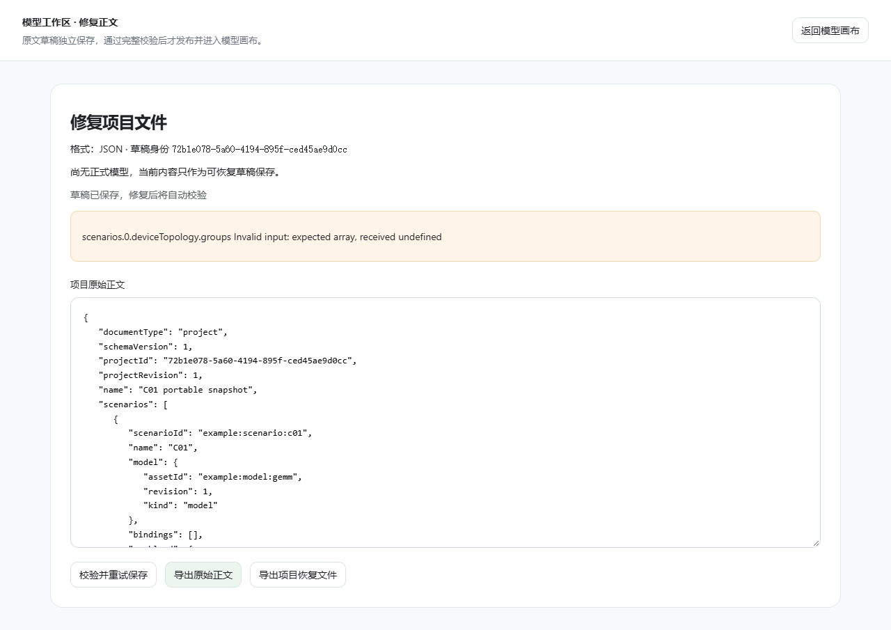

# 模型工作区的原文修复

检查点63将普通错误项目的恢复接入主画布入口。导入已识别的v1项目时，缺失字段、未知字段和关联校验错误会进入修复界面，原始正文作为独立草稿保存；有效模型仍通过原正式提交路径打开。

修复界面保留JSON或YAML正文，包括注释、CRLF和UTF-8 BOM。不可解析的正文以临时草稿身份保存，不推断其原项目身份或版本，也不进入实例化与分析。已解析的未来版本继续明确拒绝；非项目数据和损坏的恢复文件封装不自动转成正式项目。无效UTF-8拒绝导入，避免替换字符后再误称原文保留。

修复后仍执行版本、完整Schema、项目身份、关联、固定资产快照和修订基线校验。正文可以导出为原文或恢复文件，刷新后继续修复，也可返回已保存模型，从画布的恢复草稿入口重新打开。原始文件本身不被修改。正式保存沿用项目既有的存储格式；草稿正文格式与资产库的YAML存储选择分别保留。

正文项目ID与临时身份不同，提交会阻止。用户可显式修改正文ID，或先查看该ID对应的已保存模型及修订，再确认采用该身份。已有正式模型在修复期间被其他编辑更新时，旧草稿不会覆盖新修订；恢复导出仍携带草稿捕获的旧基线快照。只有再次读取并确认最新基线后才会尝试按当前正文提交。旧临时草稿或旧基线草稿仍保留，不静默删除。

项目自动保存使用一份原文字符串作为candidate，不重复保存一份解析对象。后端提交按草稿声明格式解码，仍兼容历史对象candidate。请求重试沿用已准备的请求ID，丢失提交响应不会重复发布。新导入、当前配置编辑和迟到的融合回复按工作区、导航、正文及会话身份隔离。

验证范围：全量713单元／契约（78文件，42.81s）、7HTTP（6文件，2.83s）、构建／架构／类型／Schema及结构覆盖208根／88联合／225分支通过。12项新增修复Chrome与8项相关来源／旧项目Chrome通过（20项，1.2m），另9项核心画布Chrome通过（30.7s）。覆盖JSON／YAML重开、原文逐字符导出、正式模型保护、显式身份采用、旧快照恢复往返与确认换基线、丢失回复幂等、迟到导入／融合、未来版本和无效UTF-8拒绝。领域测试将修复后正式项目的完整分析结果与原项目比较。

本轮没有重跑完整58步组合门禁；检查点62的完整703单元／7HTTP／203Chrome仅是此前源码的证据。本轮772份来源冻结，核心计算源码相对62未变，数学引擎仍为.20；公共草稿／恢复契约新增可选editorFormat，不能声称契约源码未变。原工作区只读核对保持修订1、1配置、0测量、589资产、0问题、0草稿。

检查点63时的限制：源文件与正文受32MiB限制，实际请求还受64MiB序列化封装限制；该时点未证明包含正式快照的临界尺寸恢复包往返。检查点66现已实现并验证[恢复文件独立限额与紧凑导出](RECOVERY_SIZE_BOUNDARY_AUDIT.md)：普通源仍32 MiB，恢复封装256 MiB、编辑正文64 MiB，正式基线保留原32 MiB规则，各项及聚合限额同时生效。17 MiB正文加基线与32 MiB高转义正文均经实际保存／刷新／导出／重导入验证，超限输入在写入前拒绝；新增可取消后台文件读取。损坏恢复封装仍明确拒绝。一般精确来源变换、其他数据处理及DOM长路径、原PRD逐项最终证据复核仍待完成，整个目标保持进行中。

下图来自隔离4311测试项目，原用户模型未被替换。

执行证据：[增量结果](../_local/history/checkpoint63-result.json)、[产品来源变化](../_local/history/checkpoint63-domain-change.json)、[原工作区核验](../_local/history/checkpoint63-production.json)、[修复与联动浏览器日志](../_local/history/checkpoint63-chrome4.log)、[核心画布浏览器日志](../_local/history/checkpoint63-canvas-chrome.log)。
