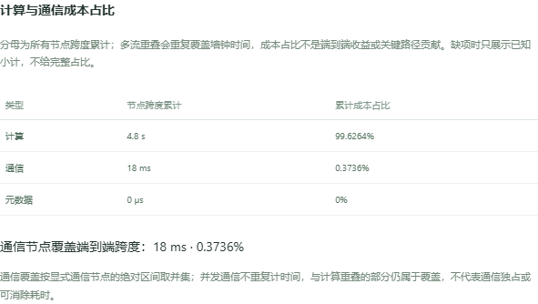

# 范围 Roofline、参数拐点与通信占比

检查点27补齐 F08 的节点、模块、模型视角，以及硬件/有效屋顶和有界整数拐点证据。它复用原分析和容量扫描，不运行真实内核，不把曲线当作实测。

## 操作与范围

计算理论结果后，在“范围 Roofline 与参数拐点”选择模型、模块或活动叶节点。融合后的组可作为节点研究，已被替代的成员不能独立生成执行点。多步decode须选择具体步骤：报告保留该步骤上下文、步骤hash和完整序列的原始分析，不将不同上下文或效率合成一个屋顶。

点击“计算 Roofline 拐点”显示：

- 物理执行operations、范围流量、算术强度和预测性能。不同精度按完整ComputeClass分别列出；不是模型有效FLOPs的MFU分子。
- **硬件声明屋顶**：唯一物理设备的匹配能力，每卡只计一次；标明peak/effective/mixed。effective表示硬件资产本身已声明有效值，不再冒称厂商峰值。
- **有效屋顶**：叶节点使用现有分析中按显式计算/带宽效率处理的屋顶；模块/模型只有每设备、每精确分类的局部屋顶唯一时才池化。不一致或缺项保持不可用，不猜平均效率。原始硬件屋顶独立保留。
- 两种屋顶各自的强度拐点、计算与搬运分量时间、限制侧。图中虚线为硬件声明、实线为可确定的有效屋顶，圆点为理论预测；数值与原始来源在表格中保留。

每个屋顶的强度拐点为 `compute operations/s ÷ bandwidth byte/s`，单位operation/byte。限制侧比较 `operations/compute` 与 `bytes/bandwidth`；两者严格相等时标平衡。空工作、零能力、数值溢出/下溢或缺项时，不声明有限拐点。这个限制侧只针对当前Roofline假设，不是实际内核、通信或关键路径瓶颈的自动识别。

模块/模型点使用整个选定范围的物理工作、流量和跨度；同一分类的屋顶池化实际设备，可能掩盖异构、负载不均和局部瓶颈，不承诺线性加速。混合分类各自使用完整范围流量作为共享流量假设，不能将这些流量再次累加为总HBM。HBM未知时，沿现有Roofline保留标明`logical`的逻辑流量代理；它不是完整物理HBM，未知HBM没有补零。通信不会被伪装成一个HBM屋顶。

屋顶不将多流争用折算成一个恒定效率，预测点仍保留原执行计划的时间。串行、多流、量化、布局、硬件或工作负载变化后须重新计算。

## 整数参数扫描

勾选“扫描 Roofline 参数拐点”，选择batch、query长度、阶段历史/上下文长度或模型根整数参数，填写闭区间。其余输入固定，基础分析与全部候选合计最多512次；不修改正式方案。

扫描复用`searchCapacity`的同一候选生成和`analyzeScenario`，每个点保存实际hash、上下文、分类指标与诊断。每种分类、每种屋顶独立记录：

- 平衡采样点；连续平衡的整数合并为采样范围。
- 相邻两个可用整数的限制侧改变区间；不插值，不证明不连续公式中存在相等实根。
- 已知点未发现事件；不能据此推断整数之间或范围外没有拐点。

允许多个事件、无事件和缺项，不假设单调或唯一拐点。缺失点断开，不跨缺口建立变化。样本表另列容量：超容量点可用于公式研究，但不构成设备可运行建议。容量及完整序列仍沿原始逐点结果判断。

取消保留已完成证据；未开始的扫描没有样本，中断扫描不声明最大容量。修改范围、选项或源输入后终止旧计算并使结果失效。分类筛选只改变展示。表格最多显示200类、图最多20类，可筛选查看；JSON导出包含完整数据、场景、固定依赖、请求、公式和诊断。长样本表默认折叠。

## 独立算术与可移植项目

运行 `npm run reference:roofline` 生成[独立摘要](../examples/roofline/reference.json)、[原始屋顶项目](../examples/roofline/peak-project.json)、[半计算效率项目](../examples/roofline/half-compute-project.json)及结果。这些为人工C01，非硬件实测。改变硬件/效率的定义及其反向依赖使用独立资产身份，保留原C01；两份项目身份也分别固定。

固定N=8、K=16，变化M：

| 项 | 独立公式 |
| --- | --- |
| 执行工作 | 2×M×8×16 = 256M operations |
| HBM读写 | 2×16M + 2×16×8 + 2×8M = 48M+256 byte |
| 硬件屋顶 | 400 operations/s、100 byte/s，强度拐点4 op/B |
| 原始平衡 | 256M/(48M+256)=4，M=16；两分量均10.24 s |
| 计算效率e、带宽效率1 | 强度拐点4e；该明确有理式的代数平衡M=1024e/(256−192e) |
| e=0.5 | 强度拐点2，代数M=3.2，通用整数扫描只报告[3,4]侧改变；硬件平衡仍为16 |

代数连续值仅适用于上表明确给定的公式，不是通用扫描器插值得到。另测非单调人工工作 `100(M−10)²`，保留[5,6]和[16,17]两次侧改变；带宽效率0.5时，本例选定区间内有效屋顶均为带宽侧。缺失能力保留已知工作，未知时间/拐点不补值。

## 通信成本与时间覆盖

显式执行时间线下新增“计算与通信成本占比”：按compute/communication/metadata累计节点跨度，再除以全部节点跨度累计。多流可能重叠，该成本分母不是端到端墙钟时间，不能据百分比认定可节省相同时间。

“通信节点覆盖端到端跨度”另对通信节点绝对区间取并集，再除以端到端跨度。并发通信不重复累计；与计算重叠的部分仍属覆盖，不代表通信独占或关键路径贡献。没有完整范围、时刻、正分母或可表示数量时，不给完整占比，只保留已知小计。

独立GQA参考：4.8 s计算、0.018 s通信，总跨度4.818 s，通信成本/覆盖占比均为 `0.018/4.818≈0.3736%`。独立重叠案例中两通信区间[0,3]与[2,4]累计5 s、并集4 s，另有5 s计算和5 s总跨度：累计通信成本占比50%，覆盖占比80%，两者不混淆。

证据为`tests/roofline-study.test.ts`、`tests/execution-shares.test.ts`、`tests/e2e/roofline-study.spec.ts`及`tests/e2e/v01-workflow.spec.ts`。独立语义验证检查拐点算术、原始硬件池化、输入/hash、连续样本和变化事件；结构Schema/联合正反对照沿完整门禁执行。当前阶段签收见[P4验收](P4_ACCEPTANCE.md)。

