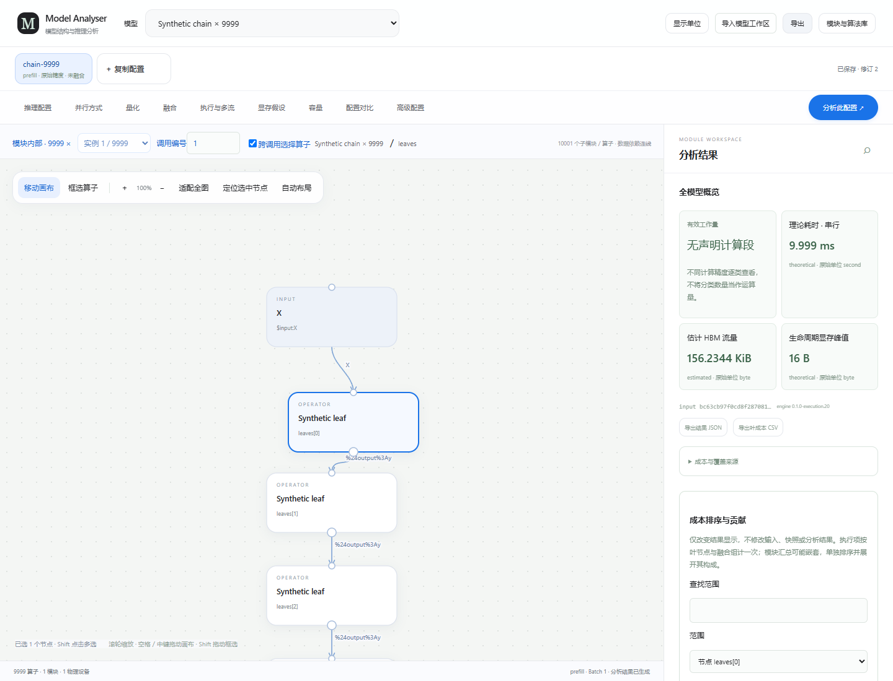

# 软件运行规模基线

检查点50按原PRD9补充代表模型与实际展开预算边界的本机观测。[运行表](../examples/runtime-baseline/summary.md)由[完整原始记录](../examples/runtime-baseline/observations.json)生成，包含六份Qwen／DeepSeek／GLM固定项目及三份紧凑合成项目。它衡量本地软件开销；模型理论秒数、GPU内存与本地进程内存分别记录。

## 方法与输入

运行`npm run reference:runtime`：先确认浏览器回归端口4311未运行，再为每个输入／操作启动独立Node子进程，顺序测量。每组一次预热、三次正式采样，使用单调`performance.now`毫秒；磁盘读取、初始解析／结构准备、GC和结果断言不计入相应操作的计时。子进程明确使用`--expose-gc --import tsx`，每次采样前GC。原始记录保留全部样本、输入／所测源码SHA256、实际Node参数、引擎版本、CPU／系统／内存环境。

五种操作分别是JSON＋严格契约解析、完整实例化、完整`analyzeScenario`、根画布投影＋布局、实际最密层级画布投影＋布局。最密层级由真实可见直接子节点确定，不虚构“同时展开全树”模式。节点数是一阶段实例化的数学叶节点数，不是多步decode的累计调用数；分析计时执行固定输入中的全部步骤，原始workload可查。

`process.memoryUsage`在操作前／后采样，单位byte，操作后保留返回对象；表中的RSS是三个操作后快照范围，包含运行时、准备数据及结果。它不是分配增量、真正峰值、浏览器内存或GPU显存。本机是共享Windows桌面，并非隔离压测环境；不设由单台机器推出的性能承诺。

## 实际预算边界与修复

默认`maxNodes=10000`同时限制已追加叶节点和内部展开工作单位，根展开也消耗一个单位。紧凑重复的内联叶、引用算子及真实数据连线三种输入均实际展开9,999叶；增加为10,000叶时返回`expansion_limit`，不返回部分图。内联叶同样调用预算扣除；根和repeat外壳两个输出容器不能直接再与叶节点数相加推导工作单位。引用路径含根／模块／算子64个资产可通过，65被明确拒绝。

三份合成输入：[内联](../examples/runtime-baseline/synthetic-inline-9999.json)、[引用算子](../examples/runtime-baseline/synthetic-operator-9999.json)、[真实连线](../examples/runtime-baseline/synthetic-chain-9999.json)。连线案例包含9,999算子、10,000数据边（含两个图边界）、10,000存储；每叶显式声明1µs固定耗时及16B流量，模型总量为0.009999理论秒／159,984理论B。该固定耗时用于软件规模实验，不是实际硬件测量或自动Roofline预测。

首次连线探针在预算内触发图校验递归调用栈溢出。现在使用显式栈保持原DFS顺序及环路径；完整9,999连线链可展开，末端回边仍报依赖环。五项边界／深度／真实环测试覆盖这些结果；未通过扩大预算、缩短图或增加JavaScript栈解决问题。

## 浏览器与画布

Node投影／布局耗时不包含DOM、SVG或绘制。新增Chrome流程实际导入最大连线项目，下钻到9,999算子／9,998可见内部边，核对首末节点适配边界、平移缩放、选中定位及节点拖拽保存，再完整分析／导出，独立核对0.009999秒／159,984B和固定inputHash。另有取消／重试及迟到旧模型任务不能替换新选择的验证。

模型展开已移到独立后台线程，按确切输入与运行代次接收严格结构结果；用户可以取消、重试或选择其他模型。布局和SVG元素缓存避免每次局部平移／缩放都重建整个场景。首次“适配全图”受5%缩放下限影响，[首末节点超出画布](../examples/runtime-baseline/browser-before-fit.json)已实际复现；现在依据真实几何范围适配，保留可读的低于1%缩放标签，并接受该视图恢复。两项几何测试同时覆盖长图、宽图和无效坐标。

专项[浏览器观测](../examples/runtime-baseline/browser-targeted.json)记录一轮实际流程的RAF间隔及支持时的Long Task数据，包含加载／DOM／导出／自动化和共享主机影响；仍有约一秒量级的长任务和帧间隔，不能称为流畅帧率保证或线程内纯算法时间。保存原始观察，后续优化按具体阶段继续测量，不把Node布局毫秒数当作浏览器交互时延。

## 验收范围

七项新增领域／几何测试、严格编译／构建、三项新增Chrome及八项原画布专项通过；拖拽坐标导出、固定数学指纹、分析仍进行时显示设置可操作，以及取消／迟到保护都保留具体断言。完整`npm run acceptance:runtime`退出0：45组重测、571单元（63文件）、7HTTP、140Chrome（24.8分钟）及全部原有参考通过；另五项基础参考通过。[完整组合中的浏览器记录](../examples/runtime-baseline/browser-acceptance-run.json)、[数学／拖拽证据摘要](../examples/runtime-baseline/browser-math-proof.json)及[编辑后项目](../examples/runtime-baseline/edited-project.json)分别保留，不存一份含义不清的资产权威副本。

组合结束后发现显存／量化编辑器在外部图尚未就绪时会同步回退。新增SSR红测后，以明确的`resolveIfMissing=false`只在主画布禁止回退，兼容维护调用仍保留原行为；输入不因等待／取消而卸载，图相关目标等待就绪，确认映射按钮不提前生效。修复后全部573单元（64文件）、7HTTP、构建和19项相关Chrome通过（1.7分钟），覆盖量化原文保存、显存未完成值保留及取消／重试。[局部修复后的浏览器记录](../examples/runtime-baseline/browser-post-guard.json)单列；先前完整组合执行较早代码，不把两次运行合并冒充一次新完整门禁。所测Node算法源码未改，报告器已重新核对源码SHA。

本页检查点50初版不宣称任意张量／公式复杂度、任意型号或所有辅助路径都达到同样响应性能。该轮结束后Node探针发现六候选同步约9.89秒，不能当作Chrome输入时延。检查点51已将候选／预设／应用校验放入可取消Worker，真实最大图六候选计算期间可操作设置，见[画布规格与来源](CANVAS_EVIDENCE.md)。当前检查点52的acceptance:canvas-context第二轮重新生成45组Node基线并完整通过591单元／7HTTP／152Chrome（25.8分钟）及全部参考；本页原浏览器记录仍明确保留50轮时点，新轮融合观测另列，不混同Node计时、RSS快照、DOM间隔与理论性能。其余同步长路径、画布上下文与原文最终审计见[剩余项](REMAINING_PRD.md)。

2026-11-16 检查点62：重复模块默认下钻单个实际调用，重复算子可显式开启跨调用选择。Node大图基线的synthetic canvas-expanded选择与UI相同的跨调用算子视图，仍严格验证9999算子；连接案例额外显示2个真实张量边界、10001个可见节点及10000条边。真实模型基线仍使用默认单实例模块视图。不能将默认折叠视图的节点数量或时间冒充9999算子的布局代价。原完整运行在旧断言处失败，三种实际child的严格计数与每种3次采样复算现均通过；完整58步最终会话79629已观察退出0，45运行组与全部703单元／7HTTP／203Chrome通过，前两次失败／中止日志独立保留。
