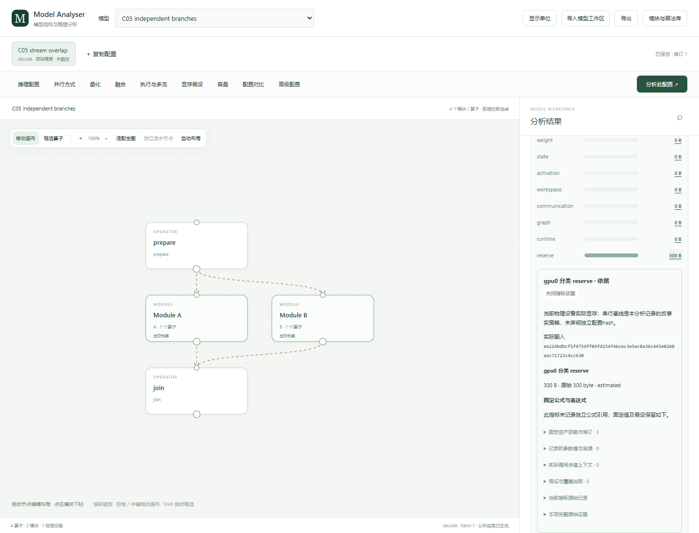
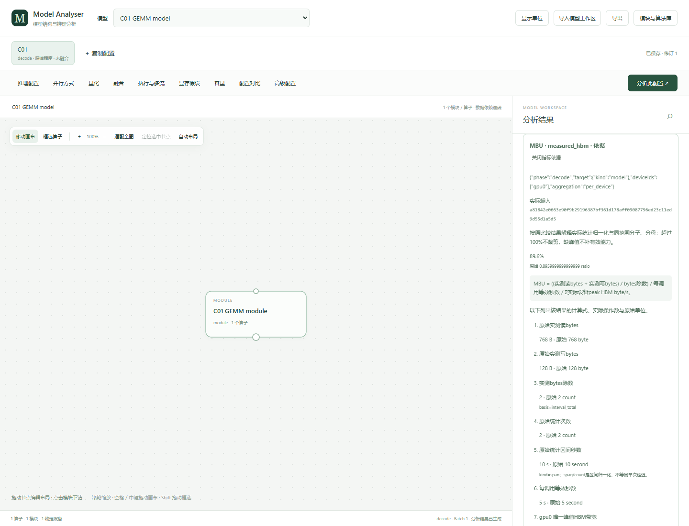
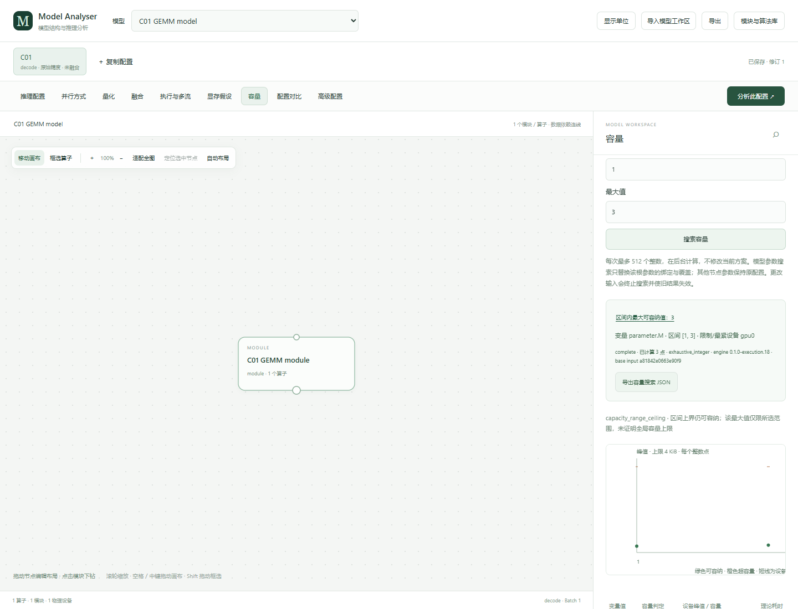
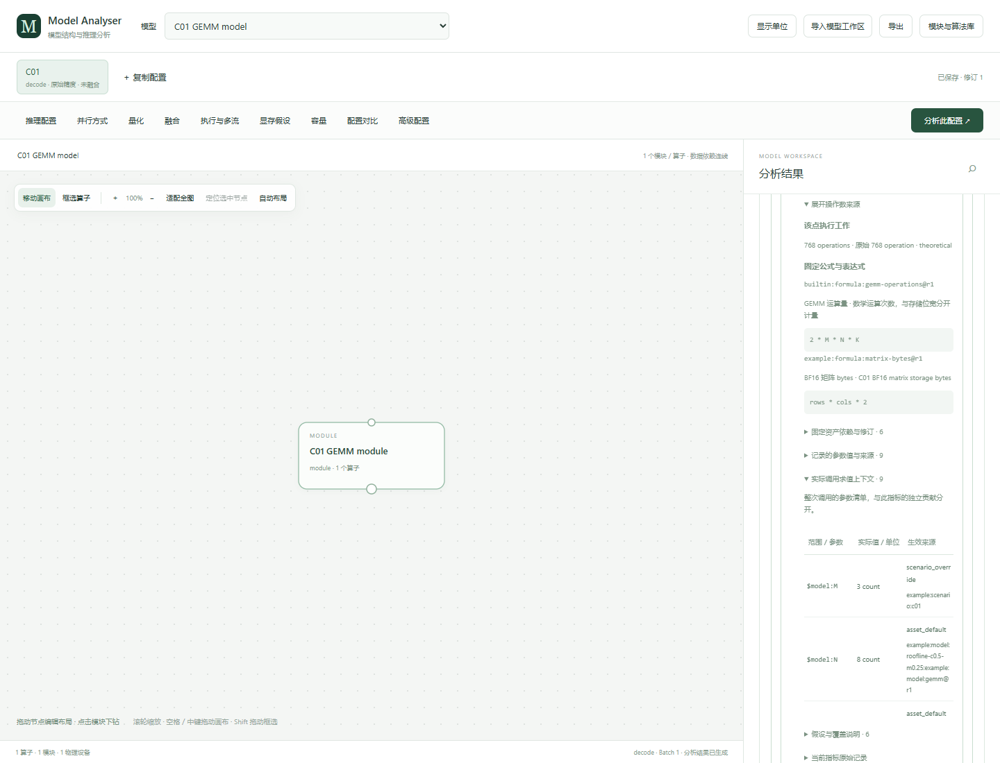

# 在模型画布查看显存、利用率和扫描数值的依据

检查点56继续以模型结构画布为主界面。分析、容量与配置对比均在当前模型的侧栏中展开；点击数值可查看原始值、单位、输入身份、固定来源和实际调用参数。打开依据不会更改模型、配置、测量或保存修订。

## 显存和逐步Decode

“分析此配置”中的设备显存峰值、位置、硬件容量和各分类均可点击。总峰值覆盖、覆盖前原理论、模块私有预算、预算前原理论、串行基线和序列原理论分别保留。私有预算不是实测分类；它按真实调用跨度计入reserve。分类不确定或覆盖未定位时，依据保持未知，不能从覆盖数值反推分解或时刻。

逐步Decode中的上步携带、调用开始预留、结束和本步预留，以及每步含状态预留峰值，绑定该步的真实输入和参数。调用开始分配与整步状态预留可能不同。例如人工参考第三次调用C=4，开始峰值16 B、本步预留峰值18 B；扫描初始C=3后第三次调用C=5，对应18 B与20 B。不能用序列汇总、第一步或另一设备补填。

声明类数值不伪造成MetricValue。检查点56的声明入口保留获胜规则、原表达式和完整预算记录；检查点58进一步提供[公式预算专用实参复核](DECLARATION_COST_SOURCES.md)，沿原固定输入、实际调用hash、获胜规则与完整参数复算，再展示嵌套绑定和实际控制流。普通MetricValue已有实际调用参数上下文，一般成本的范围共用Provenance仍不等于独立表达式归因。

## MFU、MBU和统计归一化

同范围测量比较的每个计算分类和MBU均有单独入口。MFU列出同范围逻辑有效工作、实际设备逐卡唯一匹配的peak能力与等效单次时间；复制执行的物理工作不会被当作模型有效工作。设备组别名不重复计卡，异构设备保留各自峰值，缺峰值不能改用effective能力。

MBU区分估算HBM与实测读写bytes。实测interval_total先除以原count，再与每调用等效时间比较；single、mean、sum、span的原次数、统计区间和归一化均保留。原始浮点数不截断成期望小数，显示可按比例格式化。利用率超过100%保留原值和口径提示。

独立参考：1024 / (1000 × 5) = 0.2048；448 / (100 × 5)约为0.896。两次合计读768 B、写128 B时，interval_total除以2得到448 B／调用；10秒区间对应5秒／调用。

## 容量点和比较扫描

“容量”中的区间最大值、每个整数的设备峰值／容量和理论时间均可点击。“配置对比”中的各配置扫描最大值和逐整数时间也使用相同复核入口。

区间最大值依据原capacityStatus和完整已计算点集合，不假定单调，不声明范围外极值；取消或证据不完整时不补零。逐点来源按原扫描的固定配置、变量、取值和资产快照后台复核，检查基线hash、该点hash及全部记录值、设备、范围和诊断。只有通过核验才显示实际参数；它不是使用当前默认配置重新猜测来源。Decode点可明确选择完整点或某个实际步骤，整步峰值沿含状态预留的step.memory。

来源复核可取消、重试和关闭。改选点、切换配置、变更扫描输入或重新计算，会使旧来源失效；已排队的旧回复不能替换新选择。原完整报告仍可导出，关闭重开后可独立复算。

## Roofline

范围研究表中的执行工作、流量、强度、硬件／有效计算屋顶与带宽、拐点、计算／搬运分量时间和理论预测性能均有依据。整数扫描的强度和限制侧也绑定对应样本，复核在可取消后台任务中完成。基础分析图的预测点支持点击或键盘Enter／Space。

运算强度是operations / trafficBytes，拐点是同一屋顶的计算能力 / 带宽，两者单位为operation/byte；计算／搬运分量单位为second。原记录不是普通无量纲ratio。人工参考硬件400 op/s、100 B/s的拐点为4 operation/byte；有效200 op/s、25 B/s的拐点为8 operation/byte，分别保留。零分母、空工作、溢出及原不可用原因不会被替换为有效数字。

混合计算类别按完整分类保留；池化和共享流量沿原sourceNodeIds／trafficBasis解释，不选择第一叶节点替代池化范围。Decode严格选实际步骤，缺失时明确说明并可改选，不退回序列结果。

## 验证与仍保留的范围

`npm run reference:scalar-sources`从磁盘重新读取[五份可移植项目及独立账本](../examples/scalar-sources/hand-ledger.json)，核对100个容量整数、三个完整点复核、四种测量时间统计、Decode实际状态预留、重叠模块预算及两套Roofline屋顶。C01有256×M operations、48×M＋256 B，4096 B容量下最大整数80、81首次超出。

新增16项领域／SSR测试、3项验收执行器测试和7项主画布Chrome通过，相关领域共62项通过。可用指标的warning现在解析并展示实际诊断文字，例如precision_estimate；缺少文字时明确保留诊断ID。公式／资产、参数与操作数分批显示，完整原始记录按需展开。

最终完整`npm run acceptance:scalar-sources`已观察终端退出0：640单元／契约、7HTTP、180Chrome（28.7分钟）、45运行组、架构／严格编译／Schema结构正反／生产构建及全部旧参考通过，另五基础参考通过。471份冻结文件SHA一致；原Qwen r2／修订1与589资产／0扫描问题／0项目草稿保持。完整组合先展开原54个叶命令再按序执行，保留重复、参数和失败状态，避免深层npm生命周期链。首次命令环境失败与修正证据保留，详情见[验收记录](ACCEPTANCE_STATUS.md)及`checkpoint56-result.json`。

容量候选构造和点投影从原循环提取为共用纯函数，搜索与复核使用同一语义；引擎仍为0.1.0-execution.18，公共契约未新增字段。独立数学、hash及旧参考须通过完整回归，不以“只是重构”代替验证。

Provenance仍可能是作用域共用清单，不等于每个具体表达式的独立依赖链。更细分量归因、其他尚未逐项核对的指标、同步结构编辑／兼容展开、错误普通项目的修复入口及原文最终审计继续列入[剩余项](REMAINING_PRD.md)。本页只签收列明入口，不代表整个F10或全项目完成。

检查点59的[精确叶表达式来源](LEAF_COST_SOURCES.md)为列明的单设备串行叶字段增加实际字段选择器、固定引擎／调用复核、真实表达式与分配运算及可离线重读的报告。该专用链与范围共用Provenance分别展示；分布式／融合／Roofline耗时及场景覆盖等剩余变换仍待采集，原一般来源与最终审计没有据此关闭。
