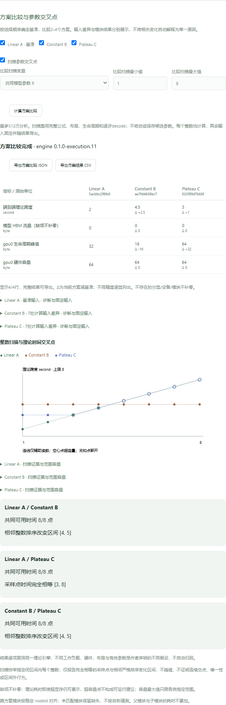

# 方案比较与整数交叉点

检查点26实现 P4 的方案结果表、输入差异、整数扫描与时间交叉证据。检查点27已按原F06–F08/F10及V0.1全流程签收[P4](P4_ACCEPTANCE.md)；P5/P6仍待实施，本文不表示整个项目完成。

## 操作

在同一项目创建或复制至少两个方案，修改名称、硬件、工作负载、并行、量化或融合等假设。项目中的“方案比较与参数交叉点”按选择顺序比较2–4个方案，第一个是基准。先取消勾选再勾选可调整顺序。

点击“计算方案比较”会在 Worker 中使用同一个 `analyzeScenario` 计算当前固定快照。结果包含：

- 理论端到端跨度、完整 HBM 流量、每卡生命周期峰值与硬件容量；缺失项不补零。
- 各精确 ComputeClass 的模型有效工作与物理执行工作，分别列出，不合计不同精度。冗余执行不增加模型有效分子。
- 通信 group send 字节、稳定模块 ID 对齐的模块跨度与 HBM；父子模块不再累计成端到端时间。不匹配的模块保留缺失。
- 原始单位与“当前减基准”的有符号差值。表格最多显示300行，CSV含全部行。

每个方案可展开固定输入、诊断与 JSON Pointer 差异，并打开“成本与覆盖来源”查看已有公式、参数、数值覆盖与假设。计算输入差异使用与 hash 相同的归一化输入，排除显示名称等编辑元数据；不同资产身份/修订和实际定义变化保留，不按相似名称猜测相同模块。界面显示前200项差异，JSON包含全部差异。

输入差异和结果变化是并列证据，不是对变化的自动因果归因。相同参数名在不同模型中也可能含义不同，须查看固定定义。不同工作负载的单次时间/峰值也保留其原始范围，不自动换算成等价吞吐量。

## 画布所选范围的成本

选择模块、算子或完整融合组后打开“配置对比”。“所选范围成本”列出理论跨度、逻辑读写、估算 HBM、有效工作和物理执行工作。计算量按完整计算类别对齐，同一类别的多个计算段可逐段核对。点击数值或差值可打开对应配置的固定输入与成本来源。

Decode 可切换序列汇总和实际步骤。融合组按成员身份匹配，独立算子进入融合后会在该配置标出无法单独计时。选择“导出所选范围 CSV”可保留当前表格的配置、步骤、输入哈希、数值与差值。导出的 `stepIndex` 从 0 开始。

## Roofline 对比

在画布侧栏打开“配置对比”，计算后展开“Roofline 对比”。范围跟随画布上选中的模块、算子或完整融合组，也可切换到整个模型。选择运算强度、理论预测性能、硬件声明或有效屋顶等指标。当配置使用 Decode 时，按实际步骤选择，列头会显示每个配置在该步的上下文和输入标识。

差值为当前配置减基准。只有推理阶段、物理设备集合、聚合方式、完整计算类别和流量口径一致的点才对齐。同一行里的配置可能采用不同硬件能力或工作负载，具体值与依据可按单元格打开。缺失步骤与不同物理范围保留独立显示。模块和模型的池化屋顶可能掩盖局部瓶颈。

“导出 Roofline 对比 JSON”包含所选范围、实际调用、固定资产快照、各配置的原始观测及当前指标的值和差值，空值以 `null` 表示。

## 扫描与交叉点

勾选“扫描参数交叉点”，选择 batch、query长度、当前阶段历史/上下文长度，或所有所选模型共同声明的整数参数。填写明确的闭区间。比较的基础分析与全部扫描合计最多512次，例如两个方案最多各255个扫描点。扫描需要相同推理阶段；其他参数、硬件、布局、公式等固定，随报告保存。

扫描复用容量搜索，逐整数重算完整公式、布局、通信、生命周期和逐步decode。它不修改正式方案，不假设单调，也不只检查端点。

每对方案分别报告：

- **采样点时间完全相等**：只使用实际返回的秒值严格相等，不将近似值或显示舍入视为相等。连续相等的整数合并为一个采样范围，不声明整数之间也恒等。
- **相邻整数排序改变区间**：两点时间都可用且严格快慢关系反转。仅记录这两个整数，不线性插值，也不证明不连续公式在中间存在相等实根。
- **已知点未发现事件**：仅针对当前已知整数。范围外、两个整数之间、未完成或缺失点不作结论。无事件、多个事件和相等采样段分别保留，不预设唯一交点。

缺失点处曲线断开，不能跨过缺口推导排序改变。曲线颜色对应图例，连线仅辅助读数；空心点表示超出容量。理论耗时可在超容量点展示，不能据此认定设备可实际运行。每个方案独立展示各设备容量判定与范围内最大可容纳整数；未完成或证据不足时不声明最大容量。

取消会保留已完成的基础分析/扫描证据；若在扫描开始前取消，该方案没有扫描结果。只有完整扫描的方案才可能保留已证明的范围容量，取消中的扫描不会产生最大容量结论。修改项目、快照、方案或比较选项后，Worker 终止，旧结果失效；重开后明确重新计算。

## 导出与复算

“导出方案比较 JSON”包含 `scenario-comparison.1`、引擎版本、请求、完成状态、原始方案、可达固定资产快照、完整分析与逐点 hash/成本/诊断、输入差异和成对交叉证据。“导出方案结果 CSV”以长表输出原始数值、单位、方案 ID、输入 hash 和基准差值；缺项写 `unavailable`。它们是结果文件，项目继续通过原项目导入/导出入口保存与恢复。

完整 JSON、结果 CSV、所选范围 CSV 和 Roofline JSON 由后台线程生成。范围文件沿用点击导出时的范围、步骤和指标。生成期间可继续查看结果、调整显示单位或取消导出，取消后可用同一轮结果重试。修改比较输入、重新计算或离开比较面板会使旧导出失效。界面只下载与本轮比较和导出任务匹配的文件。

运行 `npm run reference:comparison` 生成 [可移植项目](../examples/comparison/project.json)、[完整结果](../examples/comparison/result.json) 和[独立摘要](../examples/comparison/reference.json)。人工定义如下，非实测性能：

| 方案 | 理论时间 second | 常驻 byte | 64 byte容量下，在X=1..8中的最大整数 |
| --- | --- | --- | --- |
| Linear A | X | 16X | 4 |
| Constant B | 4.5 | 8X | 8（区间上界） |
| Plateau C | max(3,X) | 32X | 2 |

A/B、B/C 在相邻整数[4,5]改变排序，A/C在整数3..8完全相等。默认X=2时，时间2/4.5/3秒、峰值32/16/64 byte。额外独立测试将A改为 `abs(X-4)+1`、B改为2.5，验证[2,3]、[5,6]两个排序变化区间；缺失、取消和范围外不伪造事件。GQA两卡参考继续验证模型有效矩阵480 operations，TP物理480、冗余复制物理960；通信HBM缺项保持不可用。

实现证据：`tests/scenario-comparison.test.ts`、`tests/e2e/scenario-comparison.spec.ts`。结构 Schema 与正反分支沿原完整门禁生成和核对；独立语义验证拒绝伪造覆盖数量、错误方案/引擎/hash、重复方案对和无采样依据的交叉事件。完整门禁通过319项单元/契约、3项HTTP、50项Chrome；长差异值折叠后构建及3项比较Chrome再次通过，最终执行记录见[实施记录](PROGRESS.md)。

