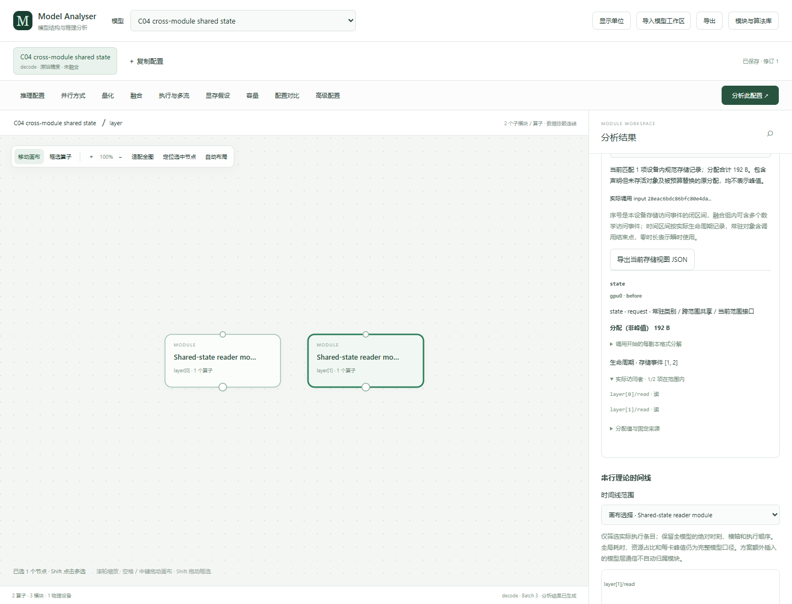
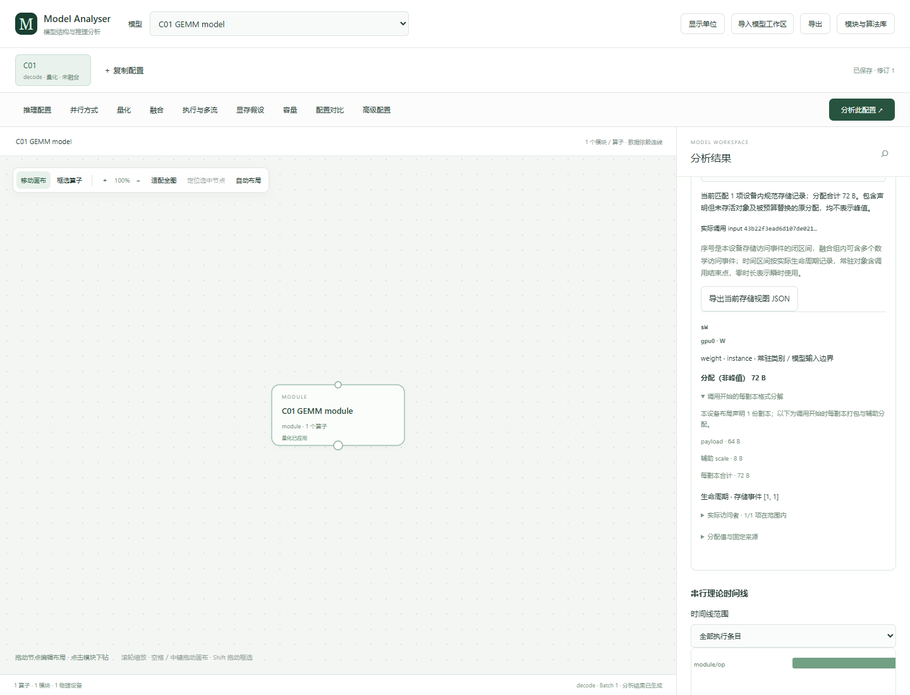
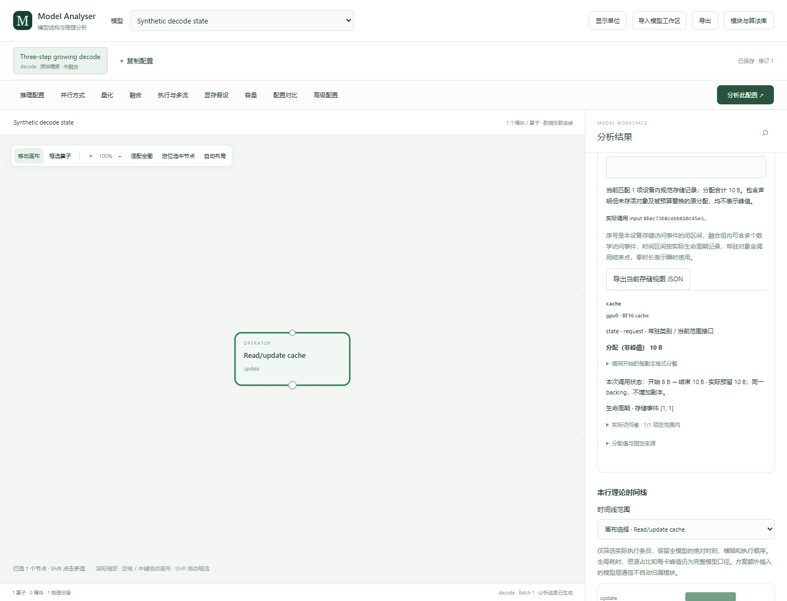

# 从模型画布查看所选范围的存储

检查点54在模型画布的分析侧栏增加“画布范围的规范存储”。点击模块、重复实例、算子或融合组，计算当前配置后，可用“查看所选范围存储”直接定位。画布继续支持拖动、缩放、平移和结构编辑；该视图只改变显示范围，不修改模型、配置或理论数值。

## 当前调用、物理设备和规范存储

目标选择跟随新的画布选择；手动改选后，普通重渲染不重置它。Decode序列按真实步骤选择，使用该步结果及输入hash。目标、步骤、设备或证据缺失会说明原因，不替换成另一个目标或把未知值显示成0。

每行对应当前物理设备上一份规范存储（canonical backing）。别名保留在同一行，多设备组指向同一物理设备时不新增卡数。当前目标访问者和范围外访问者分别列出，共享对象不会按模块数复制或平均分摊。

常驻、模型输入／输出、声明的模块接口和范围外共享分别标明。模块私有判断使用真实叶节点访问关系及完整声明接口，包括repeat实例的边界；没有访问者的保守预留不被猜成私有对象。已生效融合消除的中间存储保留身份，明确显示0 B及对应融合组，不恢复其原分配。

## 数值、格式和来源

数据直接取自原分配与生命周期计算路径记录的可选 `canonical-memory.1` 证据，不重新推导另一套显存。引擎仍为 `0.1.0-execution.18`，原数值算法和计算输入hash不变。旧结果缺少这些可选证据时仍可读取，界面提示重新计算。

展开“分配格式”查看真实副本数、每份payload、量化辅助布局及每份合计；分解采用已声明的存储格式。例如参考项目中的W4权重为64 B payload＋8 B scale＝72 B；两卡分片各32＋4＝36 B。按bytes公式直接声明的分配会明确说明不能证明量化格式，不反推payload或辅助布局。

展开来源后，沿当前结果记录查看数值、单位、固定公式ID／修订／表达式、实际匹配参数，以及独立列出的整次调用参数上下文、假设和覆盖。不会拿当前默认参数补填旧调用。原指标来源可以是整次求值共用的依赖清单；它不等于这份分配的独立公式依赖链，共享引用不被描述成每项独立贡献。来源池按内容复用，展示按需展开。

## 生命周期与峰值的口径

串行闭区间使用原存储事件序号；它不是模块内部重新编号后的执行序号。多流保留真实绝对秒数，时刻相接的对象按原闭区间规则参与峰值。常驻及跨调用保留的对象按原计算保留。

Decode状态显示实际步开始／结束／预留大小。增长状态第三步8→10 B与窗口状态恒定6 B使用各自真实转换，不重复加入开始和结束两份backing。分配格式表示调用开始时的原分配，跨步预留值及其来源单独显示。

“匹配规范存储的已知分配合计”是所列分配的合计；它不是这些对象同一时刻都存活的峰值，也不是模块独占显存。未分配／已消除、未知值、总量覆盖和私有预算分别说明。设备峰值仍是全模型口径，私有预算替代的原分配记录仍可查看；不把原行合计再加到覆盖值上。容量判断继续使用原实际设备结果，不能把所有卡的合计与单卡容量比较。

## 大图和导出

目标、设备和存储可分别搜索，当前选择始终保留在有界候选列表中。每页最多40份分配，访问者、公式、参数与辅助布局逐批展开。搜索改变匹配范围，不改计算输入；显示单位只转换呈现值。

“导出当前存储视图 JSON”使用 `selected-memory.1`，携带真实步骤hash、目标、设备与查询、规范存储／别名、访问关系、生命周期、预算／覆盖和来源池。池索引可在导出内解析，串行存储事件顺序随来源保留；缺失及部分证据不会导出成完整峰值结论。

## 可复算证据与验收

`npm run reference:selected-memory` 生成[八份项目与独立账本](../examples/selected-memory/hand-ledger.json)，包括量化、共享、增长／窗口Decode、融合、多流、预算和物理设备复用。独立核对一份192 B共享状态／两次读取384 B流量、融合2＋0＋2＝4 B、多流选中B为3 GiB而全模型5 GiB，以及原分配／私有预算／总量覆盖的区别。

新增13项领域／SSR和9项Chrome验证上述关系、严格证据、旧结果、实际来源及9,999节点下的有界列表。完整 `npm run acceptance:selected-memory` 已退出0：612单元／契约（69文件）、7HTTP（6文件）、168Chrome（27.4分钟）、45运行组、架构／严格编译／Schema结构正反／生产构建和全部既有参考通过，另五基础参考通过。428份冻结文件SHA一致；完整Chrome的9,999节点观察为40行、开始至编辑完成5820ms（不是输入延迟或帧率保证）。原Qwen工作区修订1、589资产／0问题、量化／融合／测量0保持。最终终端证据见[验收状态](ACCEPTANCE_STATUS.md)和 `checkpoint54-result.json`。

本页交付不代表全部原要求完成。比较表等其余F10入口、结构准备及兼容视图的同步长路径、已识别v1错误项目修复，以及原文逐条最终审计继续见[剩余项](REMAINING_PRD.md)。
