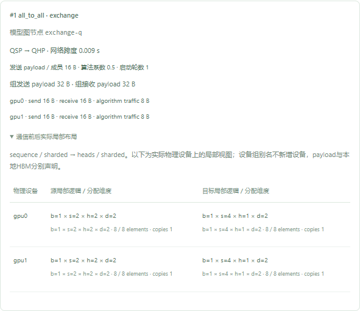
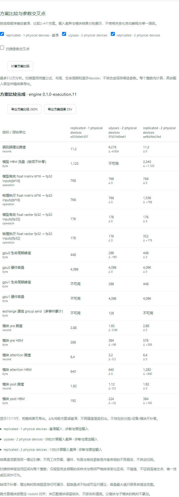

# Ulysses 风格模块布局交换研究

检查点28完成 P5 的第一个完整研究案例：SP投影 → Q/K/V各自AllToAll → head分片attention → 返回AllToAll → SP输出投影/残差。它沿原模块、局部方程、原生通信、执行和显存核心计算，可直接导入项目、修改工作负载并重算。检查点29已补齐[MoE混合研究](MOE_RESEARCH.md)；检查点30已补齐[CSA2复用](CSA2_REUSE_RESEARCH.md)与[三案复核](P5_RESEARCH_CASES.md)；P5其余特殊机制及P6仍待完成。

## 固定来源与作者声明

布局角色按[DeepSpeed官方Ulysses设计](https://github.com/deepspeedai/DeepSpeed/blob/79caae1c04fca210345bdeb03bcacf87b1ac2f23/blogs/deepspeed-ulysses/README.md)的Core Design核对：attention前从sequence分片换为完整sequence的head分片，之后换回sequence；仅SP不会分片模型权重。提交号、文件SHA256、核对日期和作者假设固定在`references/parallel/ulysses-source-lock.json`，原论文入口为[arXiv:2309.14509](https://arxiv.org/abs/2309.14509)。生成器在本地原始缓存存在时校验哈希，离线复算不要求下载。

本研究范围是当前prefill序列上的、无因果mask的材料化MHA前向子图。包括Q/K/V投影、QK、softmax代理及FP32暂存矩阵、AV、输出投影和残差。缓存、RoPE、norm、MLP、反向与优化器不在该子图范围；pastTokens必须为0，C参数上限0由正式参数绑定校验，decode/不整除输入保留诊断。

每张人工卡为4096 B容量、matrix/vector各1000 operations/s、HBM100 B/s，网络1000 B/s与每轮0.001 s延迟。这些数值、softmax每元素5 operations代理和完整FP32 scratch均是作者声明，不能当作厂商规格或实测性能。

## 三份可复算项目

运行 `npm run reference:ulysses`，生成[独立摘要](../examples/ulysses/reference.json)及以下项目/结果：

| 项目 | 实际设备 | 物理执行语义 | 默认理论跨度 | 每卡峰值 |
| --- | --- | --- | --- | --- |
| [single](../examples/ulysses/single-project.json) | 1 | 整个同一逻辑请求执行一次 | 11.2 s | 448 B |
| [sequence-heads](../examples/ulysses/sequence-heads-project.json) | 2 | SP→HP→SP，物理工作合计为一次请求 | 6.276 s | 288 B |
| [redundant](../examples/ulysses/redundant-project.json) | 2 | 两份完整冗余副本，模型有效工作仍为一次请求 | 11.2 s | 448 B |

将JSON通过“导入项目文件”打开，计算理论结果；再点击“解析设备布局”，展开每条通信的“通信前后实际局部布局”。默认各rank的Q从 `B1,S2,NH2,D2` 换为 `B1,S4,NH1,D2`，逆交换恢复SP。图中三个模块为pre、attention、post，权重在每张卡完整复制。

`sequence`、`heads`、`exchange`三种组名使用同一组实际deviceId。两卡案例始终只有两张卡；四卡测试仍为四张，不将组大小相乘。组名与实际mesh坐标随项目固定，改变成员/并行度时须同步明确布局、payload和算法系数，可用生成器的degree重新创建一致项目。

布局面板现在对任意通信展示实际源/目标逻辑形状、分配形状、元素数和copies，便于核对padding与边界。数据直接来自同一ParallelResolution，没有另行推断。改变Query tokens为6可复算10.692 s、464 B；改Batch为2得到11.268 s、448 B、每次发送payload32 B。奇数query在两卡even分片下明确失败。

导出项目后只用其assetSnapshots即可纯core复算相同hash；重新打开工作台得到同一结果。三份项目的公共模块/公式具有相同固定身份与内容，根模型的不同通信定义分别使用不同身份，可将三个方案/快照合并比较。

## 计算与搬运的独立算术

默认B=1、S=4、NH=2、D=2，E=NH×D=4。所有模型有效工作相同：

- 四个投影合计 `8BSE²=512` matrix operations；QK+AV合计 `4BNH S²D=256`，总768。
- softmax代理 `5BNH S²=160` 与残差 `BSE=16`，共176 vector operations。
- Ulysses各卡384 matrix、88 vector，组总768/176；冗余复制的组总为1536/352，模型有效分子仍768/176。精度始终分开。

四份BF16投影权重共 `8E²=128 B`。SP使用完整复制权重，因此两卡驻留权重合计256 B。每卡已知叶HBM为624 B，组内已知叶小计1248 B；单卡1120 B，冗余两卡2240 B。相对单卡，权重重复读取使已知叶小计增加128 B。通信本地读写/HBM未声明，完整模型HBM保持unavailable，不能把1248 B当作完整物理流量或有效MBU分子。

`scripts/ulysses-oracle.ts`使用独立标量公式，不调用core或项目公式求值器。其每节点Roofline分量、全部同时存活候选及网络时间与实际结果逐项核对，参考脚本直接断言，不以打印结果代替独立预期。

## 网络与缓冲

本例Q/K/V分开交换，前向三个启动，返回一个启动，共四次。每次每rank完整本地payload为16 B，包含本地self块；声明pairwise算法系数 `(P−1)/P=1/2`，实际远端8 B，启动轮数P−1=1。每次网络跨度 `8/1000+0.001=0.009 s`，合计0.036 s，组远端网络总量64 B。界面的组发送payload合计128 B包含self份额，与算法远端流量分开。没有再次乘卡数来计算通信跨度。

该显式四调用方案保留三次QKV启动，未采用论文实现可能使用的融合QKV通信。source/destination有不同逻辑tensorId与独立backing，源缓冲存活到交换结束，目标从交换开始分配；额外transport workspace取0是本研究的理想缓冲假设。通信本地HBM始终报缺项。八个叶节点每卡累计6.24 s，再加网络0.036 s，得6.276 s。

单卡峰值出现在softmax：权重128、X32、V32、scores64、probs64、FP32 scratch128，总448 B。两卡每卡为128+16+16+32+32+64=288 B。权重不变，非权重峰值从320降为160 B。单流streams等价执行的完整区间证据额外核对了交换期间源与目标同时存活；生产串行结果继续使用同一生命周期核心。

## 容量与验证边界

默认形状下，每卡峰值随Batch为：单卡/冗余 `128+320B`，Ulysses `128+160B`。4096 B人工卡下，指定边界扫描分别求得12和24；24为3968 B、25为4128 B并超容量。脚本输出每份项目的batch-capacity证据。

序列/heads必须与degree整除，不自动padding。长度扫描[20,22]包含S21缺项：S20为3488 B可容纳，S22为4176 B超出；容量状态保持unavailable，未根据两端跳过缺口声称最大值。缺失前向交换的SP→HP边界不能静默变成本地读取。

证据为`tests/ulysses.test.ts`的八类独立场景和`tests/e2e/ulysses.spec.ts`的三条Chrome流程，覆盖单卡/两卡/四卡、动态输入、容量、缺项、固定身份、纯快照复算、布局检查、重开和三方案比较。最终回归见[实施记录](PROGRESS.md)。检查点28未修改既有数值算法，当时引擎为0.1.0-execution.11；检查点29新增逐rank通信语义升为0.1.0-execution.12，当前参考沿新版本重算。

