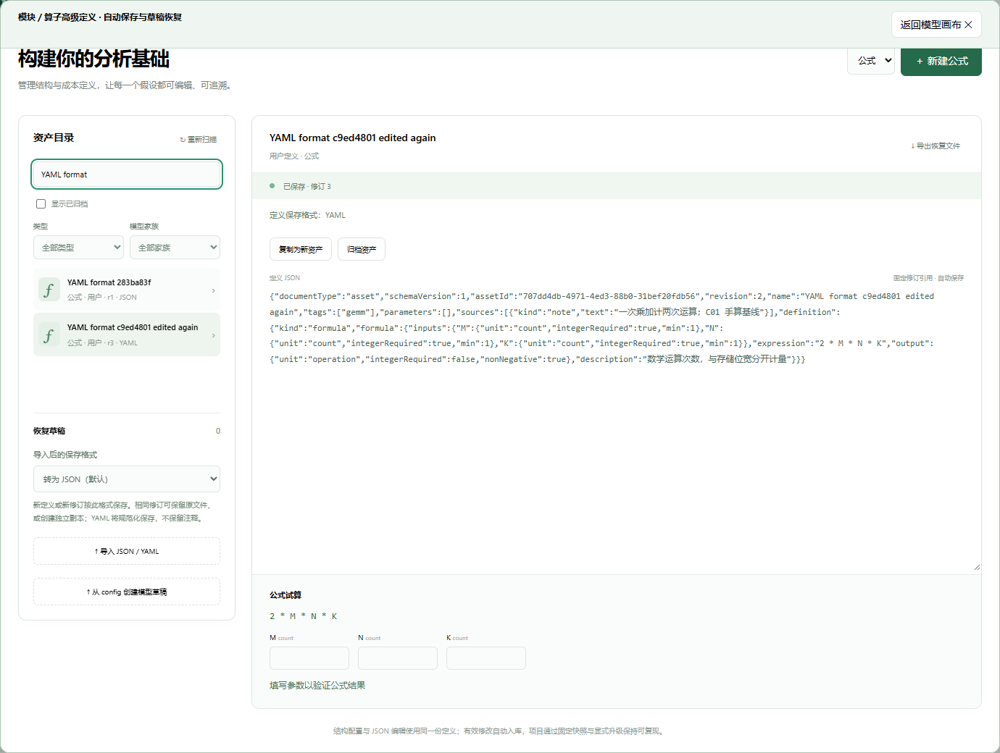

# YAML 导入与定义保存格式

检查点48补齐原PRD 6.2的导入设置。JSON与YAML沿同一契约、单位、图及引用校验；格式选择只影响文件序列化，不改变数学定义、固定引用或结果指纹。专项与完整组合的实际结果见[阶段状态](ACCEPTANCE_STATUS.md)；检查点49另行修复[独立文件的固定修订导入](FIXED_REVISION_IMPORT.md)。

## 从画布导入

1. 打开“模块与算法库”→“高级定义、导入与可恢复草稿”。
2. 在“导入后的保存格式”选择“转为 JSON（默认）”或“保留文件格式”，再导入资产或模型config。
3. 查看定义旁的保存格式及目录中的JSON／YAML标记。有效定义自动发布；config仍须逐项核对，不因选择格式而绕过确认。

“保留文件格式”将YAML输入保存为规范化YAML，JSON输入仍保存为JSON。YAML注释、原排版和`.yml`扩展名拼写不保留，新写入使用`.yaml`。编辑器使用统一JSON结构；恢复导出继续使用明确标注的JSON恢复文件。导入设置作用于本次新定义、新修订或冲突副本，不改变既有历史文件；关闭辅助界面后，下一次导入默认JSON，已有YAML定义继续沿原格式编辑保存。

同ID同修订内容不同，仍须显式选择新修订或独立副本。内容相同但所选格式不同，会显示已有格式与本次选择，可保留现有文件或按所选格式创建独立副本；不会为了格式生成一份重复权威文件或改写旧历史。内容与格式均相同时打开已有修订。

辅助界面成功发布、恢复或归档后，画布选择列表刷新；晚到的旧扫描不能覆盖新目录，旧解码结果不能替换后续导入。目录刷新不更改当前模型的固定快照、参数、配置或分析输入。

## 持久化与恢复保证

- `AssetDraft.storageFormat`为可选`json`／`yaml`字段，随未完成草稿恢复。旧草稿缺此字段时，新资产默认JSON，已有资产继承当前固定基线的保存格式；格式字段不写入AssetDocument或数学输入。
- 每个ID／revision只有一个权威定义文件，支持读取`.json`、`.yaml`、`.yml`。同一修订有多个候选文件时，即使内容相同也隔离并报告冲突；原文保留，不能按扫描顺序猜选。
- 正式写入使用临时文件与原子替换。按实际序列化文本核对4MiB界限；YAML展开后超限不发布head，能够读取的原恢复草稿保留。
- 新提交回执固定实际保存格式；旧JSON回执保持可重放。发布前中断可恢复同一修订，较新草稿保留；旧回执不回退当前head，也不能把外部改换格式的文件冒充原不可变修订。
- 显式孤立修订恢复识别唯一YAML文件。依赖升级的新父修订继承所修改固定基线的格式，新独立副本默认JSON；升级中断及完成重放均核对同一不可变定义。
- head、草稿、回执、项目和项目快照继续使用JSON。它们分别是指针、恢复／操作记录和可移植快照，不是同一资产的第二份权威定义。

## 可复算参考与验收

运行`npm run reference:storage-format`，在两个独立临时存储中验证同一YAML来源分别转JSON与保留YAML，并在退出时清理临时目录。[参考账本](../examples/storage-format/reference.json)列出每个库内的实际修订文件；[原项目](../examples/storage-format/project-before.json)、[升级项目](../examples/storage-format/project-after.json)及[单份YAML公式](../examples/storage-format/formula-preserved.yaml)可单独查看。项目内快照是固定历史，不是重复独立定义文件。

C01明确方程为`2×4×8×16=1024` operations、`(4×16+16×8+4×8)×2=448` B。在1000 op/s和100 B/s的人工硬件假设下，原耗时4.48 s；显式升级到`20×M×N×K`后为10240 operations、10.24 s，HBM仍448 B。JSON／YAML往返保持同一基线inputHash，旧项目仍复算原值。这是软件序列化与手算核验，不是硬件测量。

14项新增存储测试覆盖格式继承／转换、不可变历史、旧回执、失败／孤立恢复、相同副本冲突、损坏／未来文件、实际YAML超限及完整模型快照／升级；新增真实HTTP用例核对严格字段、发布失败、服务重启与幂等重放。画布浏览器验证默认／保留选择、格式冲突、草稿与迟到请求、config发布与离线结果。组合门禁为`npm run acceptance:storage-format`，包含原全部预设、型号、研究及文件门禁。首轮550单元／5HTTP与131／132Chrome通过；一条旧生命周期总时限失败，保留全部断言、调整该总预算后其文件3Chrome专项通过。后续独立参考全部通过；原完整命令退出1仍保留，版本导入修复后再跑新的完整组合。

契约仍206根／87联合／223分支，已有AssetDraft增加可选保存格式；数值引擎保持0.1.0-execution.18。软件运行规模基线和原PRD最终逐条审计继续保留，见[剩余项](REMAINING_PRD.md)。

检查点49已补齐固定版本导入，并重新执行新的完整`acceptance:fixed-import`退出0：563单元／6HTTP／137Chrome及全部原有参考通过；旧48的失败事实不改写。其后的内置ID恢复局部修复及专项验证单独列于[验收状态](ACCEPTANCE_STATUS.md)。

## 独立版本导入的后续修复

检查点48审计探针复现r7沿普通新定义提交变成本地r1，两种格式均如此；该历史失败记录保留。检查点49已区分固定导入与普通编辑，并以明确发布成员处理历史、回执和孤立文件，详见[修复与证据](FIXED_REVISION_IMPORT.md)。原探针没有携带新导入意图，不能再用它代表当前界面行为；普通新定义仍应从r1开始。新的完整组合结果单独记入阶段状态，全目标仍在进行。
